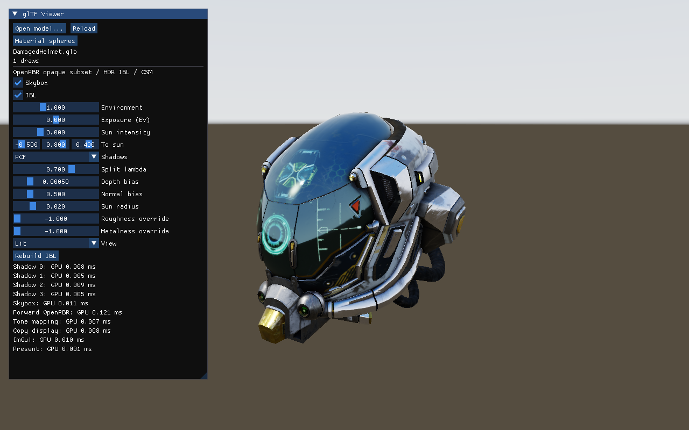
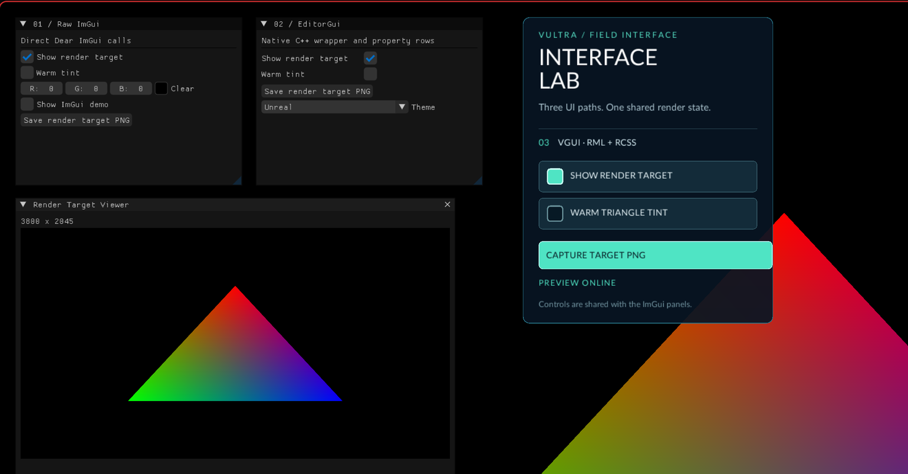

# libvultra

A small C++23 graphics framework built on VRI, with readable C++ and Slang code for research and prototyping.
The `dev-VRI` branch is under early development and targets Windows x64 and Linux x86_64 with Vulkan.
Experimental Android GameActivity and browser hosts run the existing clear/VRI/RenderGraph basics on Android,
WebGL2 and WebGPU. Host Slang cooking produces SPIR-V or WGSL with checked runtime loading. The hidden in-app
browser verifies WebGPU triangle canvas/readback parity; repeated Edge adapter/device initialization, device-loss
recovery and the remaining example ports are still open.
See [platform applications](BUILD.md#android-and-web-applications) for the tested paths and limits.

Select the capabilities you use around one public `vultra` static library. Direct GPU programs need no scene,
importer, ECS, renderer, UI or language host.

- VRI devices/resources, GLFW/SDL3 windows, input, profiling and finite-frame capture.
- Explicit RenderGraph and context-owned typed pass definitions, with C++ and JSON construction.
- Native Slang and game material shaders, reflection, cooking and transactional reload.
- CPU asset import/cache, GPU scene data and optional forward/deferred raster rendering.
- Optional EditorGui/ImGui, VGui/RmlUi and generated UI/property descriptions.
- Generic VPK byte sources, writing, embedding and builtin shader cooking.

[Get started](docs/get_started.md) provides complete desktop, offline and RenderGraph skeleton programs.
[BUILD.md](BUILD.md) contains setup, feature selection, export and verification commands.
[Architecture](docs/architecture.md) outlines the subsystems; [roadmap](docs/roadmap.md) records remaining gates.
Dependency revisions and recipes stay in [external/xmake.lua](external/xmake.lua).

## Quick start

```sh
xmake f -m release -y
xmake build -y --all
xmake run example-basics vri --frames 60
```

The library build does not require .NET, Lua or EnTT. Smaller selections are documented in BUILD.md.
For a parent xmake project, use `includes("external/libvultra")` and `add_deps("vultra")`.

## Examples

Run `xmake run <target> <mode> [options]`. Category `--help` lists compiled modes; single-mode targets omit
the mode argument. Each example declares its own requirements, so one sample need not build the editor/player.

| Target | Modes / purpose |
| --- | --- |
| `example-basics` | `window`, `vri`, `graph`, `mesh-shading`. |
| `example-offline` | Windowless triangle → compute → display, C++/JSON parity and PNG/PFM. |
| `example-ui` | Raw ImGui, EditorGui and VGui. |

Start from [offline GPU composition](examples/offline/main.cpp),
[desktop services](examples/basics/window.cpp). SceneData/GpuScene can be used directly; RenderingServer is optional.
Examples accept `--frames`, `--log-level` and `--log-file` where applicable.
Orbit controls use left-drag, middle/right-drag and scroll; FPS controls use WASD/QE, right-drag and Shift.
Use [offline runs](BUILD.md#offline-rendering) for automated rendering without desktop windows.

## Showcase

Builtin rendering with a glTF asset



The renderer accepts SceneData directly. Interactive model/research applications are maintained separately;
the examples in this repository focus on library mechanisms.

[UI Showcase](examples/ui/main.cpp)



The Damaged Helmet model retains its [upstream attribution and licenses](resources/models/DamagedHelmet/README.vultra.md).

## Scope and contributions

Current scope is static geometry and an opaque OpenPBR material subset.
Advanced RmlUi effects, D3D12 and clean-machine delivery still have [roadmap gates](docs/roadmap.md).
XR simulation/offscreen checks do not validate a physical headset.

Follow [AGENTS.md](AGENTS.md), the checked-in formatting/static-analysis rules and
[verification requirements](BUILD.md#development-checks). Keep contributions readable and independently maintainable.
Repository documentation is in English.

## Acknowledgements

- [Adobe OpenPBR BSDF](https://github.com/adobe/openpbr-bsdf): public Slang implementation
- [FileWatch](https://github.com/ThomasMonkman/filewatch): file-change notifications for shader hot reload
- [VRI](https://github.com/zzxzzk115/VRI): rendering abstraction and Vulkan backend
- [GLFW](https://github.com/glfw/glfw): desktop windows and input
- [SDL3](https://github.com/libsdl-org/SDL/tree/release-3.4.0): optional desktop window/input backend (zlib license)
- [Native File Dialog Extended](https://github.com/btzy/nativefiledialog-extended/tree/v1.3.0): Linux portal model picker (zlib license)
- [Dear ImGui](https://github.com/ocornut/imgui): immediate-mode UI, docking and multiple viewports
- [Slang](https://github.com/shader-slang/slang): shader compilation to SPIR-V and WGSL
- [ANTLR](https://github.com/antlr/antlr4/tree/4.13.2): private game shader parser and checked-in generated C++ (BSD-3-Clause)
- [argparse](https://github.com/p-ranav/argparse): command-line argument parsing
- [spdlog](https://github.com/gabime/spdlog): console and file logging
- [stb](https://github.com/nothings/stb): image loading, SIMD mip filtering and PNG writing
- [NVIDIA FLIP](https://github.com/NVlabs/flip): on-demand perceptual image assessment ([BSD-3-Clause provenance](external/flip/README.vultra.md))
- [VTask](https://github.com/zzxzzk115/vtask): parallel loading, geometry and texture import jobs
- [meshoptimizer](https://github.com/zeux/meshoptimizer): meshlet construction and bounds, inherited from `dev`
- [OpenFBX](https://github.com/nem0/OpenFBX): static FBX scene loading
- [VRI-Framework](https://github.com/zzxzzk115/VRI-Framework): ORCA FBX material and normal-map conventions ([MIT notice](external/vrf_fbx_license.txt))
- [DirectXTex](https://github.com/microsoft/DirectXTex): CPU DDS loading and block decompression
- [TinyObjLoader](https://github.com/tinyobjloader/tinyobjloader): original OBJ/MTL loading
- [bc7enc_rdo](https://github.com/richgel999/bc7enc_rdo): direct SIMD BC7 encoding
- [xxHash](https://github.com/Cyan4973/xxHash): source and derived-data content hashes
- [TinyGLTF](https://github.com/syoyo/tinygltf): glTF and GLB scene loading
- [GLM](https://github.com/g-truc/glm): vector and matrix math
- [OpenXR SDK](https://github.com/KhronosGroup/OpenXR-SDK): OpenXR headers and runtime loader
- [Vulkan-Headers](https://github.com/KhronosGroup/Vulkan-Headers): Vulkan API declarations
- [nlohmann/json](https://github.com/nlohmann/json): asset metadata, graph definitions and workspace persistence

## License

libvultra is licensed under the [MIT License](LICENSE). Third-party code and assets retain their own licenses; see [OpenPBR](external/openpbr/README.vultra.md), [FileWatch](external/FileWatch/LICENSE), [BC7 encoder](external/bc7enc/README.md) and [asset attribution](resources/README.md).
