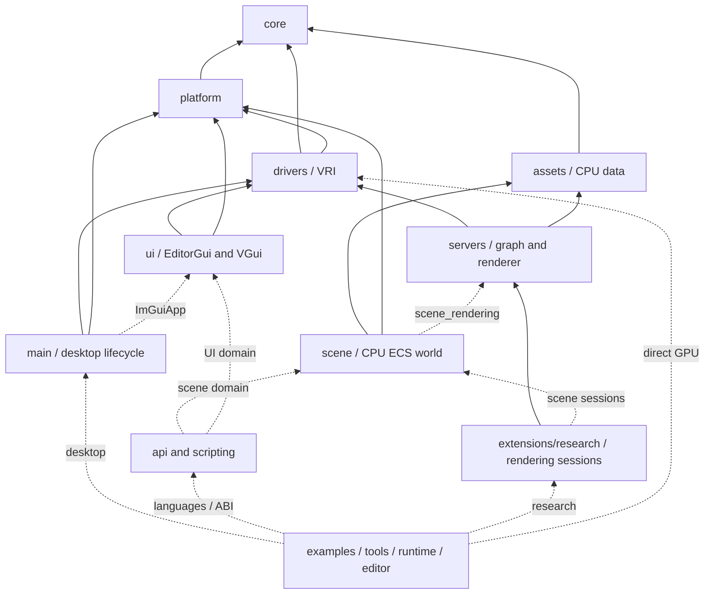
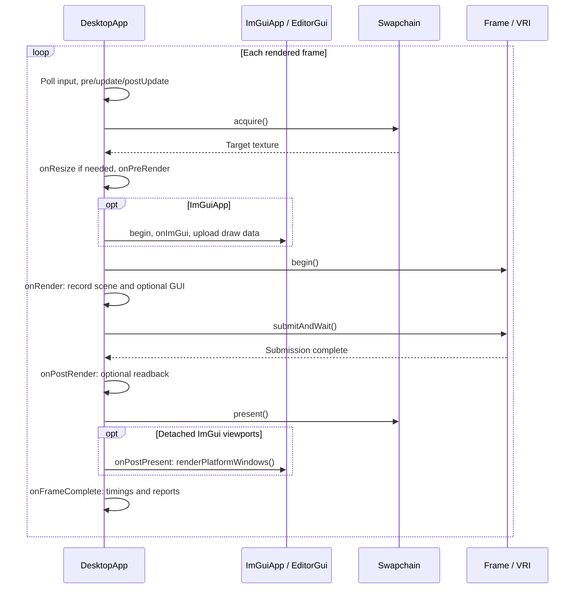
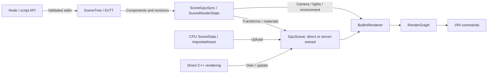
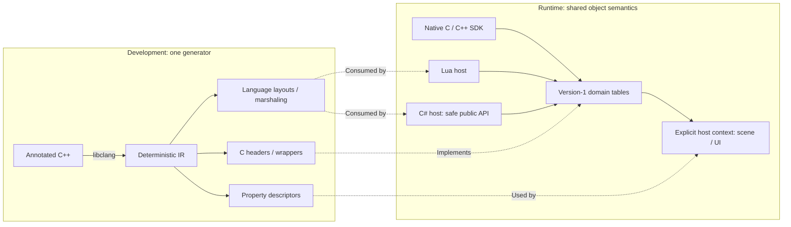

# Architecture

Vultra is a small C++23 framework built by selecting capabilities around the public `vultra` static library.
A GPU study can use VRI directly; graph, shader, asset, renderer, ECS world, UI and language hosts are additions.
Research and engine features are optional consumers of the same lower layers.

Feature composition follows [Bevy](https://bevy.org/learn/quick-start/getting-started/);
authoring/lifecycle organization follows [Godot](https://docs.godotengine.org/en/4.5/engine_details/architecture/godot_architecture_diagram.html).
EnTT is the runtime world store. Batching and GPU submission are Vultra implementation choices.
VRI is the only graphics abstraction; RenderGraph is the only graph executor.

## Feature selection

`libvultra_features` is a comma-separated dependency union controlling sources, packages and targets.
Embedded projects default to `gpu`; the repository defaults to `all` for development.
Example requirements extend the union, and each example compiles only its selected modes.

| Capability | Selected features |
| --- | --- |
| Basic values/diagnostics | `foundation`, with optional `math`, `json`, `properties`, `image` and image I/O/metrics. |
| GPU and desktop | `gpu`; add `window`/`input`, `swapchain`/`desktop`, `capture` or `xr` as needed. |
| Graph and shaders | `graph`/`graph_json`, native `shader`, `blit`, typed `material_values` and `game_shader`. |
| Assets and rendering | Byte `asset_source`, `project`/`resource_pack`, CPU asset values/import, `rendering` and camera controls. |
| Engine world | `world` for CPU ECS/authoring; `scene_rendering` adds render extraction, `asset_export` adds cooking/export. |
| UI and scripts | Independent `editor_gui`/`vgui`, scene/UI ABI domains and Native/Lua/C# hosts. |

`interactive`, `engine`, `research`, `runtime`, `editor` and `scripting` are convenience unions.
`engine` needs no window/VM/UI. `runtime` adds desktop, VGui, common script hosting and builtin resources;
language adapters and debug UI remain explicit. `editor` selects the current research workbench, not a completed
gameplay editor. Research tools and stereo have their own selectors.

[scripts/build_features.lua](../scripts/build_features.lua) owns the dependency closure;
[examples/selection.lua](../examples/selection.lua) owns example requirements.
VGui, scripting and research use opt-in companion libraries against the same selected core.
No consumer builds another hidden core with different public layouts. Commands live in [BUILD.md](../BUILD.md).

## Source ownership

Each `source/<module>` owns `include/vultra/<module>` and `src`. Public includes remain `<vultra/...>`.
Directory ownership and build selection are separate.

Principal dependencies are shown below; arrows point toward the dependency. Dashed edges apply only to selected
adapters/consumers. A CPU world has no GPU dependency until scene rendering is selected.

| Directory | Responsibility |
| --- | --- |
| `core` | Diagnostics, identifiers, math/images, typed properties and basic values. |
| `platform` | Desktop windows/input, files/processes and OS integration. |
| `drivers` | VRI Device/resources/Swapchain, GPU profiling and XR GPU integration. |
| `assets` | CPU model/material values, byte sources, import/cache, project manifests and package export. |
| `servers` | RenderGraph, GPU scene ownership/RIDs, raster rendering and texture blits. |
| `scene` | Optional ECS world, Node/Resource authoring, cameras and scene-render adapters. |
| `ui` | EditorGui/ImGui and VGui/RmlUi integration; no editor application dependency. |
| `main` | BaseApp/DesktopApp/ImGuiApp, desktop context and package bootstrap. |
| `api`, `scripting` | Generated ABI domains, borrowed callback sessions and selected language adapters. |
| `extensions/research` | Experiment sessions, reference transport, quality/reports, tracks, stereo and research SDK. |
| `editor`, `tools`, `runtime`, `examples` | Application policy/entry points. Lower libraries do not depend on them. |

## Ownership and frame lifecycle

RuntimeContext hides desktop construction behind `unique_ptr<Impl>` and owns
Window → Device → Swapchain → Frame → Profiler. Applications own optional renderers, servers and pass catalogs.
DesktopApp keeps update, UI construction, command recording, submission, completed-frame callbacks and
presentation distinct. UI is never constructed during update. Offline programs own their GPU services directly.

The successful acquisition path is:

Minimized/unavailable main targets skip recording; detached ImGui windows can still update through
`onRenderSkipped()`. Offline paths record/submit/wait without a swapchain or native UI.

One frame is in flight. Graphs/scene handles expire before their pass/server owners, and those expire before Device.
CPU destruction is not GPU completion: release resources, views and cached UI textures only after their final use.
Module unload also stops callbacks and removes borrowed descriptors/passes before releasing code.

| Identity | Meaning |
| --- | --- |
| Graph resource | Local to one graph; never persisted or retained by scripts. |
| Server RID | Live GPU resource in one server/context; never persisted. |
| ObjectId | Live CPU object in one world; foreign/retired references are rejected. |
| Asset/node ID | Stable authored identity stored in project/scene/package documents. |

## GPU, graph and rendering

Use VRI descriptors/commands directly; do not reinterpret its handles as Vulkan objects or add another RHI.
CPU/shader layouts, resource states, color spaces, projection/depth and UV conventions follow verified VRI and
shader contracts. Native interop remains inside declared platform/XR/plugin boundaries.

RenderGraph supports imports, transients, explicit history and exports. `addPass()` remains the direct C++ path.
PassDefinition adds stable type names, typed ports, numeric parameters, extent/format constraints and capability
requirements. PassCatalog starts empty; a caller explicitly installs builtin/project definitions.
Version-1 JSON `.vgraph` connections compile to that same executor and reject invalid graphs before GPU recording.

History is graph-owned and explicitly reset by its caller. Optional transient reuse shares whole VRI resources
only for identical descriptions and disjoint active lifetimes; imports/exports/history are excluded.
The reused plan is immutable. The current executor uses one graphics queue.

SceneData → GpuScene → BuiltinRenderer works without SceneTree. RenderingServer offers the same upload/render
implementation through owned, move-only handles and checked RIDs, with GPU-complete retirement.
The raster paths are NaiveDeferred and NaiveForward, with the current opaque OpenPBR subset, IBL and shadows.
Task/mesh shaders, ray queries and ray pipelines require explicit device capabilities, without silent emulation.

## Shaders and assets

Native `.slang` exposes compilation/reflection/cooking without game metadata. Game `.vshader` adds typed material
properties, named variants, Surface templates and explicit passes; ANTLR belongs only to this selected path.
A scoped compiler reuses module IR/program caches; Device owns VRI pipeline caches.
Cooked `.vshaderc` programs support source-free delivery. Failed reload retains the last valid shader/pipeline.

CPU SceneData/material/texture values own no GPU resources. Import preserves source files and caches derived data
under `.vultra/assets/`, validating actual source/dependency hashes. Static glTF/GLB, OBJ and FBX geometry and
material textures are supported; skinning, morphs, animation and blended transparency remain outside this importer.
AssetSource supplies filesystem or checked VPK entry bytes. Persistent references use asset/node IDs, never RIDs.

## World, objects and properties

SceneTree owns authoritative EnTT identity/hierarchy/lifecycle, transforms and render components.
Attached Node facades retain a world/entity locator; detached subtrees own staging values.
Native systems can query custom components and runtime-only entities without Node wrappers. No per-frame
Node-to-ECS copy exists. GPU/render data is derived from independent SceneChanges revisions; transform/light/material
edits reuse geometry, while topology/model changes require safe reimport.

The world owns CPU state; GPU scenes and render constants are derived data. The direct C++ route can upload
assets and record rendering without constructing a world.

Node is non-spatial; Node3D adds affine transforms. A plain direct parent breaks spatial inheritance.
Authoring `owner` is an ancestor reference distinct from parent/lifetime ownership.
Reparenting preserves world transforms by default. Resources and script instances have separate owners.

Enter is parent-first; Ready is children-first and runs once; Exit is children-first with reverse sibling order.
A 60 Hz fixed clock, variable process, pause/step/time scale, stable priorities and deferred FIFO structural changes
share one execution path. Failed process/deferred operations stop and report errors. GUI construction is separate.
World InputMap actions preserve ordered input and fixed-tick edges; general scene input/signal routing is pending.

Typed descriptors drive Inspector, JSON and bindings; semantic setters still validate writes and notify revisions.
Type/property catalogs belong to contexts, with borrowed registration records/code kept alive.
Snapshot persistence uses explicit Node/type codecs and rejects runtime-only entities rather than silently losing them.

## Bindings and scripting

One pipeline: annotated C++ → libclang IR → reflection/C ABI → language APIs.
Checked-in generated output keeps normal builds independent of Python/libclang.

Version-1 function tables require exact `struct_size`; fixed-width PODs, UTF-8 pointer/length strings and
callback-scoped opaque borrows cross the boundary. C++ classes, exceptions and ImGui types do not.

Native extensions consume the header-only SDK without linking another core. Native C++ scripts use the script
adapter and its entry macro; ordinary C++ applications may call the library directly.
Lua and safe C# author APIs share world identity and enter/ready/fixed/process/exit semantics.
Unsafe managed interop stays internal; .NET 10 hosting is optional. Absent UI domains are null.

Replacement stages new code/state before stopping old callbacks; failure preserves active code.
Native/Lua local fields currently reset on reload. Managed field restoration does not yet provide a common
export schema or restore script-instance references. Arbitrary native extension unload with live C++ objects is invalid.

## UI and applications

EditorGui wraps upstream Dear ImGui with frame/window/layout and left-label/right-control Inspector rows.
The GUI context owns property drawers; callback data/code must survive registration and active frames.
VGui wraps RmlUi for authored game documents and embedded PNG control skins.
The current backend lacks advanced transforms, clip masks, layers and effects. Layouts are isolated by AppName.

The workbench owns authored scene/graph/workspace documents. Valid candidates replace active GPU state only at
frame completion; failed edits keep the preceding valid graph. Numeric drag changes affect the next frame.
Undo, scene instancing and an independent Play world remain roadmap work; the current app is a research frontend.

## Research and delivery

Optional ExperimentSession borrows Device and owns scene/server, renderer, pass/graph, Frame and Profiler.
Batch and Python consume this same session; fixed-step scripts run before rendering, with no GUI callbacks/reload.
Owned NumPy readbacks survive host/session closure. The host is thread-affine; concurrent scans use processes.

Reference transport uses VRI ray queries and ordinary graph history/AOVs. It samples the declared opaque material
subset, analytic/emissive/environment lights with MIS; current texture filtering is bilinear mip zero.
Radiance/albedo/normal/depth/motion/sample/ray counts are marked outputs. Depth is positive view depth (miss zero);
motion is previous minus current unjittered pixel position, top-left origin. Relevant camera/scene/seed/shader changes
reset accumulation. PNG is display output; PFM/NumPy retain linear/signed values. Same-device determinism is tested.
Environment sampling follows [PBRT's infinite-area light model](https://pbr-book.org/4ed/Light_Sources/Infinite_Area_Lights).

Reports associate build/device/input/shader identifiers, graph parameters, images/resources/producers and nested
CPU/GPU timings. Workbench previews/probes map separate textures and never overwrite raw experiment data.
Ordinary batch/workbench UI capture is offline; tracked stereo projects still require desktop/XR.
[Research sources](../extensions/research/README.md) contain the reusable extension entry points.

ProjectManifest owns extension JSON metadata; extensions interpret their keys. Project, scene, graph, workspace,
experiment, cache, shader-package, VPK and ABI version fields stay `1` before release. Breaking changes update
writers/readers/bindings/examples/tests together; no compatibility readers or migration paths.
Checked examples define the current document shapes: [project](../resources/research.vproject),
[scene](../resources/scenes/research.vscene) and [graph](../examples/research/color_gain.vgraph).

The base player embeds engine resources and reads external or appended VPKs. Export uses built APIs/tools without
xmake. Scene/model/HDR/UI/game-shader entries can be read directly; engine shader bootstrap still uses temporary
files, and native/managed modules are materialized selectively. Static engine/Lua does not imply a fully static
Linux executable: system graphics/display/libc remain dependencies. Native plugins/C# have explicit sidecars/runtime
requirements. Python/research/editor code does not enter the base player.

Remaining gates and optional servers/vendor plugins are in [roadmap.md](roadmap.md).
[Mainframe](https://github.com/Mainframe-Games/mainframe-engine/tree/2fcdb6c4f4d1760f0aab60bd1f687574b252f293)
informs engine organization; [Falcor](https://github.com/NVIDIAGameWorks/Falcor/blob/master/docs/getting-started.md)
informs research workflow. Neither reference is an imported implementation.
