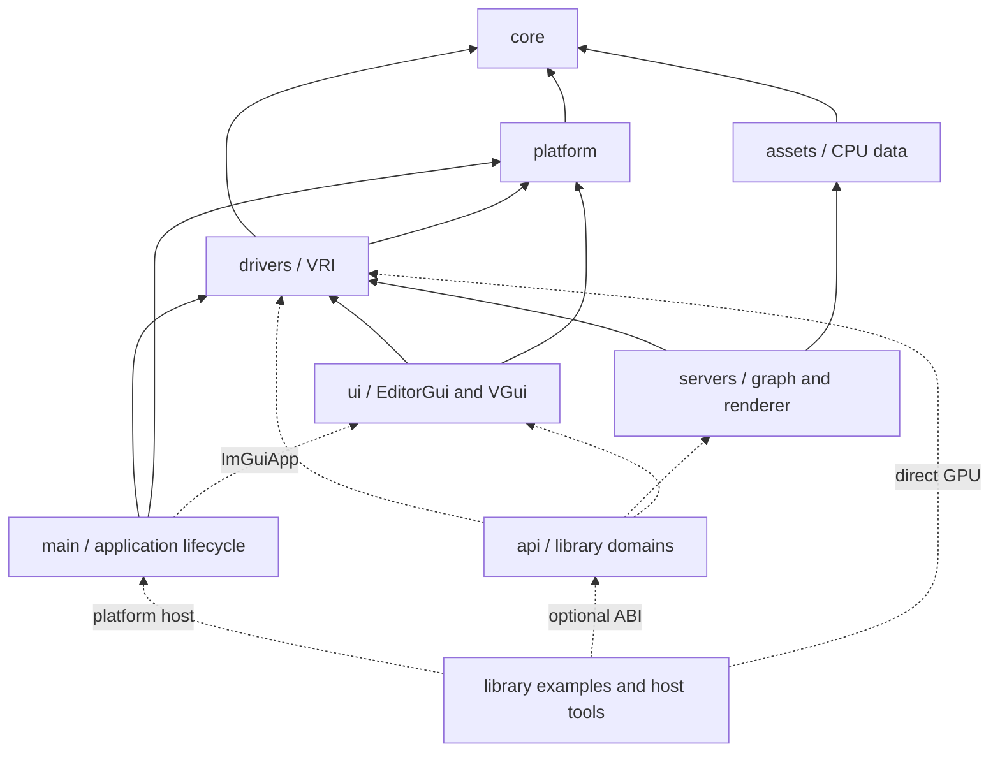
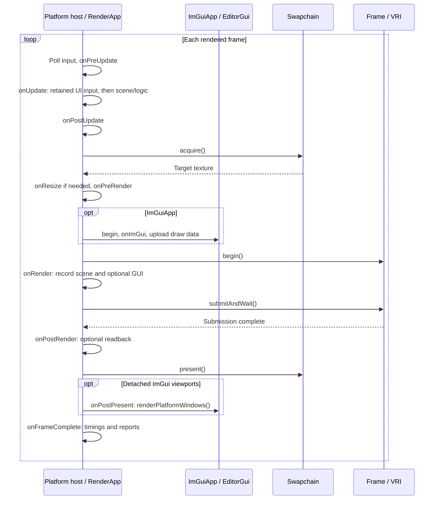
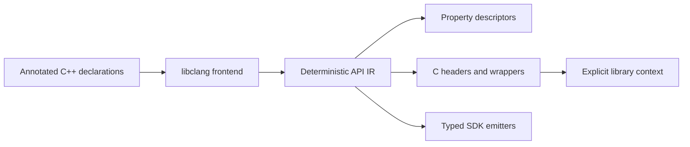

# Architecture

libvultra is a composable C++23 graphics library. Applications select capabilities around one public `vultra`
static library: values/logging, platform hosts, VRI resource ownership, RenderGraph, shaders, asset data, basic
rendering and optional UI. Direct GPU programs need no scene tree, ECS, scripting host or editor.

VRI is the rendering abstraction; RenderGraph is the only graph executor. Context-owned services and explicit
RAII ownership keep construction, GPU completion and destruction visible. Feature selection controls sources,
packages and targets together, following Bevy's additive approach.

VRI exposes an NRI-style C API with immutable device-owned conventions and explicit conversion helpers.
`Device(VriDeviceCreationDesc)` preserves caller configuration. Convenience constructors select the existing
Y-up shader/camera convention; a different convention also needs matching application matrices and shaders.
Submission and explicit waits check returned status; destructor cleanup reports errors without throwing.

The optional `compute` feature provides a synchronous buffer/kernel context and generated C table. It supports
float32/int32/uint32 buffers and owned transfers; bindings, group dimensions and scalar push-constant offsets come
from Slang target reflection. This feature includes host shader compilation. The separate cooked shader runtime
does not require that compiler. No Python runtime is required by either native path.

## Feature selection

`libvultra_features` is a comma-separated dependency union controlling sources, packages and targets.
Embedded projects default to `gpu`; the repository defaults to `all` for development.
Example requirements extend the union, and each example compiles only its selected modes.

| Capability | Selected features |
| --- | --- |
| Basic values/diagnostics | `foundation`, with optional `random`, `math`, `json`, `properties`, `image` and image I/O/metrics. |
| GPU and desktop | `gpu`; add `window`/`input`, `swapchain`/`desktop`, `capture` or `xr` as needed. |
| Graph and shaders | `graph`/`graph_json`, cooked `shader_runtime`/`game_shader_runtime`, CPU `material_block`, GPU `shader_material`, host `shader`/`game_shader` and `blit`. |
| Compute interop | `compute` adds a synchronous buffer/kernel context and generated C ABI over `shader`/`gpu`; no Python or UI dependency. |
| Assets and rendering | Byte `asset_source`/`resource_pack`, CPU asset values/import, `rendering` and camera controls. |
| UI | Independent `editor_gui`/`vgui`, generic properties and generated UI ABI. |

`shader_runtime` reads compiled programs and their VRI-normalized bindings. `game_shader_runtime` adds cooked
material schemas, variants and typed instances; `shader_material` prepares their GPU parameters/pipelines without
Slang, ANTLR, file watching, importers, a scene or a window. Host `game_shader` adds `.vshader` parsing/cooking.
`rendering` consumes prepared geometry/textures and cooked shaders; it selects no compiler, importer or watcher.
Select `scene_prepare` for CPU texture/meshlet preparation, `asset_import` for model files and `shader` for source
compilation. `vgui` also uses the cooked shader runtime. Both remain part of the selected `vultra` static library.
`ImportedAsset` is an owned CPU data snapshot in `asset_values`; storing it requires no importer or GPU.
`importAssetExpected` reads static FBX, OBJ and glTF/GLB from a directory or an AssetSource. It reports
source, parser, texture and worker failures as error values. It joins started import jobs before returning
a failure, and an import failure leaves the previous derived cache intact. A stale or corrupt cache is
rebuilt on successful import. Cache publication is best effort and the native importer CLI checks that its
requested archive was published. The older throwing interfaces remain for existing callers.
`render_values` exposes light value types independently of rendering resources.
Cooked layouts store VRI descriptor/view types, not Slang enum values.

`ShaderRuntime` belongs to `shader_material`: it owns one asset snapshot and independent instances, validates
replacement GPU candidates before publishing, and retains the previous snapshot after failure. It can load relative
VPK entries or explicitly reload cooked files without worker threads or host dependencies. Adding `game_shader`
enables source compilation/polling; private `ShaderSourceReload` owns and joins those watchers/jobs before runtime
GPU ownership ends. Source watching never retains a GPU preparation callback.

`interactive` groups desktop drawing requirements; `tools` selects host import/shader tools.

[scripts/build_features.lua](../scripts/build_features.lua) owns the dependency closure;
[examples/selection.lua](../examples/selection.lua) owns example requirements.
VGui compiles into the same selected `vultra` archive; RmlUi remains a private dependency.
No consumer builds another hidden core with different public layouts. Commands live in [BUILD.md](../BUILD.md).

## Source ownership

Each `source/<module>` owns `include/vultra/<module>` and `src`. Public includes remain `<vultra/...>`.
Directory ownership and build selection are separate.

Library dependencies are shown below; arrows point toward the dependency. Dashed edges are optional.
Application state and document policy remain outside these modules.



| Directory | Responsibility |
| --- | --- |
| `core` | Diagnostics, identifiers, math/images, typed properties and basic values. |
| `platform` | Desktop windows, GameActivity/Web input, files/processes and OS integration. |
| `drivers` | VRI Device/resources/Swapchain, GPU profiling and XR GPU integration. |
| `assets` | CPU model/material values, byte sources, import/cache and generic VPK reading/writing/embedding. |
| `servers` | RenderGraph, GPU scene ownership/RIDs, raster rendering and texture blits. |
| `ui` | EditorGui/ImGui and VGui/RmlUi integration; no editor application dependency. |
| `main` | BaseApp/RenderApp, DesktopApp/AndroidApp/WebApp, desktop ImGuiApp and package bootstrap. |
| `api` | Generated library ABI domains and their context/borrow checks. |
| `tools`, `examples` | Library cooking tools and direct C++ drawing/UI examples. Lower modules do not depend on them. |

## Ownership and frame lifecycle

DesktopApp owns RuntimeContext directly. RuntimeContext hides desktop construction behind `unique_ptr<Impl>` and owns
Window → Device → Swapchain → Frame → Profiler. Applications own optional renderers, servers and pass catalogs.
RenderApp keeps update, UI construction, command recording, submission, completed-frame callbacks and
presentation distinct. ImGui construction stays in pre-render; retained game UI processes input and hit-test
layout before scene logic. Offline programs own their GPU services directly.

On native Metal, VRI preserves previously bound compute state when a timestamp or transfer closes the compute
encoder. A new encoder restores pipeline, native resource tables, argument-buffer residency and copied inline
constants. Cached descriptor/set references remain borrowed until the recorded GPU use completes; starting a new
command buffer clears them. Graph dependencies, resource transitions and submission/fence completion determine
when callers may update or destroy those resources. See the pinned
[VRI patch contract](../external/vri/README.md) and `test-compute-encoder-state` for the regression and current
query-timing limitations.

An offline profiler can opt into completed-command timestamp ordering. It uses the native encoder barrier
around each marker. Callers can resolve results in a later submission after the recorded work completes.
This avoids a same-submission timestamp copy limitation in the pinned MoltenVK. The checked benchmark writer
tracks frame and pass availability independently, with empty CSV fields for unavailable measurements.
It publishes the manifest after all CSV files have closed successfully.

`Frame::create(device, queueType)` selects a VRI graphics, compute or transfer queue. Each Frame owns one command
buffer and permits one submission in flight. `submitExpected(waits, signals)` submits without a host wait;
`waitExpected(timeoutNs)` establishes its completion before allocator reuse. `submitAndWaitExpected()` retains the
ordinary synchronous path. Queue types can alias the same native queue: type selection does not establish physical
parallel execution. The pinned Vulkan backend uses one graphics-capable family and selects additional queues only
when available. Metal creates distinct native queues. Resource transitions and VRI wait/signal descriptors remain
explicit; RenderGraph does not automatically distribute passes across these queues.

Wait and signal spans borrow caller-owned VRI fences. Those fences and every referenced resource, descriptor and
uploaded parameter allocation must survive their final queued GPU use, including waits in other Frames. A Frame's
private completion fence is only its host/lifetime boundary; it is not an exported dependency ticket. Callers submit
the necessary GPU dependency chain before blocking on completion, and preserve external resources through every
consumer. Destruction waits for the Frame's own submitted work rather than unrelated queues. An actual wait failure
is logged and triggers a conservative device-idle attempt before cleanup; unused or partially initialized Frames
require no device-wide wait. Queue dependencies and native heap alias eligibility remain explicit.

`submitWithCompletionExpected(waits, signals)` opts into a move-only `SubmissionCompletion`. It owns a separate
native fence signaled only by that accepted submission, so it survives Frame reuse/destruction. Ordinary submits
allocate no extra fence. `readyExpected()` returns false on timeout and an error on observation failure; an empty
or moved-from completion rejects observation. A completion is a CPU lifetime credential, not a new GPU dependency
ticket: its native fence is not exposed. Device must outlive every credential. Destroying an unobserved accepted
credential waits for that submission; normal collection polls without waiting.

`Device::deferReleaseExpected(owner, lastUses)` consumes a unique owner and a vector of accepted same-device
completions only on success. Supply the final outstanding use on every relevant queue; bundle graph-owned heaps,
imports, pass instances and borrowed descriptors together, or retain their owners separately through those uses.
No resource-use inference or shared ownership is added. `collectDeferredExpected()` releases a batch only after
every supplied completion is observed. Timeout retains it; observation failure reports an error and retains pending
owners. A later ready batch can be collected past an older unavailable batch. Frame begin collects before resetting
its command allocator; a collection error prevents begin. Device teardown drains deferred owners before destroying
the native device. Collection itself adds no device-idle wait; captured owners retain their own destructor behavior.

`RenderGraph::PassRecording` supplies an explicit command buffer for every live pass, in `activePasses()`
order. The Expected executor validates the complete list before recording and restores all tracked graph resource
states if any callback fails. All destination command buffers must then be discarded; none may be submitted until
the entire graph recording succeeds. History clears use the initial command buffer, so every dependent destination
must wait for it. `executeOrderedExpected` accepts caller-declared completion edges between recording destinations.
It checks that the order is acyclic and that every required dependency is reachable through it. The check includes
pending history clears that overlap a consumer's buffer range or texture mip, layer and aspect. Invalid orders fail
before graph commands or pass callbacks. `validateOrderedRecordingExpected()` runs the same destination, dependency
and native family checks using the stable VRI handles from `Frame::recordingDestination()`. Preflight can run before
beginning the command buffers. It neither invokes pass callbacks nor publishes family claims. Texture layouts and
temporary callback accesses are checked during recording. Callers encode the corresponding GPU waits and signals, select compatible
queues and retain resources and descriptors through final use. Multiple destinations reject identical whole-resource
reuse and the single-buffer Profiler. Use `supportsRoutedRecording()` to preflight an allocation
plan. Native heaps permit multiple destinations. Their overlap proof uses the live pass dependencies or a
proposed completion order supplied at compile time. Callers preserve that proof by submitting the corresponding
GPU waits, including waits at branch joins. An exported resource survives the graph's transient lifetimes. Export data needed by an external
readback or capture it into a separate graph output. Native queues can pipeline independent encoder stages, so
queue selection alone is not a strict serial-performance control.

A native begin or end failure requires `discardExpected()` before recording again. An ordinary submit rejection
retains the executable command buffer and completion value for a retry. A wait timeout retains the pending
submission for a later wait. Reset, discard and resubmit are rejected while pending. Vulkan and Metal use a
checked allocator reset. A failed reset before begin allows a later begin attempt, while a failed discard makes
the recording unusable until discard succeeds. Device loss is terminal for the Frame.

For checked rollback, pass every participating Frame to `checkpointExpected(frames)` after begin and before
recording the graph. Retain the Frames through restoration and submit or discard their recordings through Frame.
The graph checks that the checkpoint covers every command buffer it used after capture, including clear-only
Frames and both ends of any queue-family transfer recorded by the graph. Each captured recording requires a
successful checked discard of that exact generation. A successful restore removes the rolled-back recording
evidence and invalidates later guarded snapshots that depend on it. Use `validateCheckpointRestoreExpected()`
before undoing external or tail state. Restore later graphs first when they import outputs of earlier graphs.
The no-argument checkpoint leaves proof of unsubmitted commands to the caller.

The immediate OpenGL/GLES backend rejects discarding recorded GPU work because those commands may already be
executing. Metal and Vulkan regressions cover recording and submission failures, retries, external fences,
allocator ownership, command discard and exact cross-queue buffer readback.

`test-queue-textures` additionally draws into one selected R32_UINT mip/layer, performs independent compute work,
consumes both results on the compute queue, then reads every subresource on the transfer queue. Its six-cycle
control covers three mips and two layers, including unchanged regions. The fixture uses Texture's mip/layer
transition tracker and cached views rather than a parallel state table. This does not add graph queue scheduling. A common
GPU start gate on distinct Metal queues separates queued work from host synchronization. The optional
`--serialize-independent` control adds only a graphics-to-independent-compute GPU dependency.

An external Metal System Trace comparison of the same executable and shader records target-process Fragment and
Compute GPU Active intervals overlapping in the independent case and no such overlap in the serialized case.
Both cases complete 24 exact readback cycles. This is native stage-scheduling evidence for that synthetic workload,
not a guarantee of hardware instruction concurrency, renderer speedup or equivalent behavior on other devices.
Use GPU-stage records rather than CPU encoding/submission spans or query intervals that can include encoder gaps.

PlatformApp is a compile-time alias for DesktopApp, AndroidApp or WebApp. Grouped examples share one platform entry
and build setup while keeping separate executables and mode dependencies. AppConfig describes rendering requirements;
AppLaunch supplies borrowed GameActivity entry state or a browser canvas selector. AndroidApp owns the Vulkan
surface/swapchain and processes the GameActivity native glue on its native thread. It waits for GPU completion
before acknowledging surface destruction, blocks while paused and resets the update clock on resume. WebApp yields
to requestAnimationFrame with ASYNCIFY; CSS size/DPR determine its drawing extent. AppConfig.size/title configure
desktop windows; Android's Activity and the Web page own their presentation size/title.
The Web shell's optional `Module.onGraphicsReady` callback runs after the first completed/presented frame.
Emscripten's `onRuntimeInitialized` only means WASM startup; the page keeps its startup status until GPU work succeeds.

The normal desktop/Android acquisition path is:



Minimized/unavailable main targets skip recording; detached ImGui windows can still update through
`onRenderSkipped()`. Offline paths record/submit/wait without a swapchain or native UI.

`Window::create` and `Window::borrow` return `expected`, as do framebuffer and logical size queries. A borrowed
native window must outlive its wrapper and its swapchains. The SDL3 backend still has throwing legacy window-mutation
methods; those are not yet part of an exception-free application path.

`Swapchain::create`, `acquireExpected`, `presentExpected`, `resizeExpected` and `setVsyncExpected` return
`expected`. A successful acquisition must be presented before a second acquire, resize or vsync change. An empty
surface or an out-of-date acquire returns a null texture for retry; failed resize or image enumeration leaves the
swapchain marked for reconstruction on the next attempt. A failed vsync change attempts to restore the previous
mode. Use `size()` for the actual surface extent, which may differ from the requested size. Surface-format selection
preserves sRGB versus linear encoding and reports the selected channel order through `format()`. If created with an
empty extent, format selection is provisional until the first successful acquire. The legacy constructors and methods
still throw; callers must migrate to the expected path for exception-free operation.

Browser WebGPU canvas images expire on an event-loop yield. WebApp renders/readbacks an owned image first, then
acquires the canvas and copies/submits before yielding for GPU completion. Canvas texture views are recreated per
acquisition. WebGL2's VRI backbuffers already own their storage and use the normal frame path. The pinned VRI patches
preserve sRGB presentation and implement browser queue-completion waits; animation-frame pacing is not a GPU fence.
WebGL context loss currently fails explicitly and requires restart. Android/Web input covers keys, pointer/scroll
and primary touch; IME, additional touch contacts and gamepads are not yet integrated. ImGuiApp remains desktop-only
until its platform input and GUI lifecycle are ported.

One frame is in flight. Graphs/scene handles expire before their pass/server owners, and those expire before Device.
CPU destruction is not GPU completion: release resources, views and cached UI textures only after their final use.
Module unload also stops callbacks and removes borrowed descriptors/passes before releasing code.

| Identity | Meaning |
| --- | --- |
| Graph resource | Local to one graph; never persisted or retained by scripts. |
| Server RID | Live GPU resource in one server/context; never persisted. |
| ObjectId | Live CPU object in one world; foreign/retired references are rejected. |
| Asset/node ID | Stable authored identity stored in project/scene/package documents. |

## GPU, graph and rendering

Use VRI descriptors/commands directly; do not reinterpret its handles as Vulkan objects or add another RHI.
CPU/shader layouts, resource states, color spaces, projection/depth and UV conventions follow verified VRI and
shader contracts. Native interop remains inside declared platform/XR/plugin boundaries.

`resourceInfoExpected()` checks graph ownership/index and returns declared resource metadata before or after
compilation. `nameResourceExpected()` changes inspection names without invalidating a compiled non-aliased plan;
invalid ownership/empty names and edits to immutable aliased plans reject before mutation. `snapshotExpected()`
requires a compiled graph and returns resources, pass dependencies, normalized exports, history cells and heap requests without GPU readback.
Native allocation-enumeration failures return an error without changing the graph. Unsupported telemetry retains
topology and explicitly unknown allocation bytes; it does not fabricate estimates.

`exportRangeExpected({resource, textureRange, bufferRange})` retains the selected mip/layer/aspect cells or
buffer bytes. The range for the other resource kind stays at its default. Compilation validates initialization
and keeps producers for the exported selection. Other cells and bytes may remain unwritten. The whole allocation
stays outside native heaps and whole-object reuse. `exportResourceExpected()` selects the full resource.

`captureRangeAfterPassExpected(passName, selection, name)` inserts a copy before a later pass can overwrite
the selected data. Texture snapshots keep their format and rebase the selected mip and layer to zero. Each
selected 3D mip copies its full depth. Cube-aligned selections retain cube views. Other face ranges become a
2D texture or a 2D array. A single aspect of a combined depth/stencil texture requires independent layouts.
The snapshot retains the combined format and exports only the copied aspect. Consumers must select that aspect.

Buffer snapshots compact the selected bytes to offset zero in a device buffer with stride zero and transfer
usage, retaining the source's ConcurrentQueues flag. Zero mip, layer or byte counts select the remainder.
An empty writer name selects the last pass with a write overlapping the selection. A named pass must write
part of the selection. Compilation checks that every copied cell or byte is initialized at the insertion point.
`captureAfterPassExpected()` keeps the whole-resource default and the buffer-range overload.

Construction validates ownership, usage, bounds and writer identity before insertion. Rejection keeps the
compiled plan. Insertion requires recompilation and remaps existing explicit edges. The texture copy's
CopySource layout adds ordering between the capture and earlier and later live overlapping accesses. These
edges preserve culling and content dependencies. Disjoint subresources can use independent destinations.
Ordered recording checks the required completion edges, and callers encode the corresponding GPU waits.
On recording failure, discard every destination as usual. Keep the graph, input owners and snapshot alive
through their last submitted uses. The source transient can be reused after its final use.

The design follows Falcor's generic
[graph output lookup](https://github.com/NVIDIAGameWorks/Falcor/blob/759aad033ff610fb0d82c74f7e0a508d0096d5f2/Source/Falcor/RenderGraph/RenderGraph.cpp#L565-L579)
and [buffer copies](https://github.com/NVIDIAGameWorks/Falcor/blob/759aad033ff610fb0d82c74f7e0a508d0096d5f2/Source/Falcor/Core/API/CopyContext.cpp#L578-L586).
Vultra's explicit inserted snapshot and selected-range graph uses remain local API choices.

VultraLab's StereoResearchRenderer consumes these checked graph operations directly. Its public fallible lifecycle
uses Expected, retains a candidate graph until successful publication and keeps a recorded graph/Pass checkpoint
until the host reports completion or discards known-unsubmitted commands. See the
[Lab lifecycle contract](../../VultraLab/docs/architecture.md#experiment-session). The core graph does not infer
queue scheduling, accepted submissions or external UI ownership from that higher-level protocol.

Native explicit memory uses the existing VRI resource API. Create an unbound buffer/texture with
`memoryLocation = Undefined`, query its requirements for the intended heap location, allocate `VriMemory`, then
bind the resource once at an aligned offset. Requirements now report `requiresDedicatedAllocation`; required
dedicated resources must use ordinary resource allocation rather than this shared-heap path. Respect every
resource's native size/alignment and memory-type compatibility, plus `VriDeviceDesc::bufferTextureGranularity`
between linear buffers and optimal textures. A zero granularity is unreported, not permission to ignore separation.
The memory-type mask remains backend-specific; an empty compatibility intersection cannot be passed as the legacy
zero/unrestricted allocation mask. Allocation rejects invalid size/location/alignment and clears its output on
failure. Vulkan and Metal binding validate native requirements, device ownership, bounds and single-use ownership
before publishing the backing; a rejected bind leaves an unbound resource available for a valid retry.

Metal uses placement heaps and honors the requested buffer/texture offsets. Vulkan retains a borrowed explicit
allocation and its buffer offset, validates the actual bound object's memory type and dedicated requirements, and
creates explicit images with alias eligibility. Mapping checks the resource-local range and host visibility;
explicit Vulkan buffers map their borrowed allocation plus heap offset, without taking allocation ownership.
The heap outlives every bound resource and its final GPU use. Buffer owners never free a borrowed heap.

`test-explicit-memory` verifies overlapping buffer bindings, distinct offsets and neighboring buffer/texture
contents. Queue-alias transfers use explicit graphics-to-compute-to-transfer fence dependencies, including when
queue types share a native queue. This proves neither physical overlap nor automatic queue scheduling. General
RenderGraph's separate `compileHeapsExpected()` path plans native alias heaps and records activation dependencies;
`compileExpected(true)` retains identical whole-resource reuse. Explicit deferred retirement can hold a graph and
its borrowed dependencies behind all final-use submission completions; heap planning does not select those uses.

Choose `compileHeapsExpected()` before the graph's first allocation. Imports, exports and histories retain ordinary
allocation. Eligible transients must discard prior contents on the first use of every selected mip/layer/aspect
cell or buffer byte interval. Unused intervals do not contribute a use. Required dedicated resources also retain
ordinary allocation. Eligible distinct objects pack into aligned byte regions within compatible native memory
locations and intersected memory-type masks. The planner uses deterministic first-fit placement. By default,
every use of a previous occupant must be a dependency ancestor of every use of the next before their bytes can
overlap. Declaration-order intervals alone do not establish this. Only resources requested in `Device` memory
may overlap.
Otherwise regions remain disjoint, including the reported `bufferTextureGranularity` separation between linear
buffers and optimal images. Missing/invalid native granularity and arithmetic overflow reject before allocation.
This is a placement policy, not a claim of optimal packing or lower resident memory on every graph.

`DeviceUpload`, `HostUpload` and `HostReadback` resources retain distinct byte regions even when all GPU uses are
ordered. Pass callbacks can map these resources while recording commands, before any of those GPU dependencies
execute; a later CPU write must not overwrite an earlier unsubmitted copy source. Compatible host-visible resources
still pack into the same allocation at disjoint offsets. Mapping still requires any conflicting submitted GPU uses
to have completed. Unexported handles remain restricted to declared uses; discarded recordings restore CPU tracking,
not mapped bytes. Explicit VRI bindings outside the graph retain their caller-managed host/GPU lifetime contract.

Allocation and binding publish atomically, with resource objects destroyed before borrowed memory on rejection.
Fix the cause and retry without rebuilding the graph definition. Members whose native regions may overlap receive
`CmdAliasMemoryBarrier` before first use each frame, and their tracked contents/layout reset to undefined before
the normal transition. Packed regions without overlapping occupants retain ordinary resource tracking. Vulkan
records a global memory dependency; Metal uses a GPU event between encoders and tracked placement heaps. Retain
all resources, borrowed dependencies and heaps through final use on every submitted queue. Unexported transient
handles may only be consumed within declared uses. This does not establish attachment-local tile retention.

`addOrderingExpected(before, after)` adds an explicit control dependency between uniquely named passes in declaration
order. It retains an otherwise culled predecessor without adding a content/history-invalidation dependency. Native
heap plans freeze graph edits.

`compileHeapsExpected(initial, recordings, order)` accepts a proposed submission plan before the first allocation.
Use `planActivePassesExpected()` to discover the complete live pass list in declaration order before allocation.
The query resolves dependencies and culling without recording or allocating native resources. Compilation
revalidates the current definition against the supplied names and edges. An empty list models all live passes
on `initial`.
Stable destinations from `Frame::recordingDestination()` can be used before begin. The compiler checks that the
completion edges are acyclic and preserve every live pass dependency before allocating. It can reuse a device heap
range when all uses of the previous occupant precede all uses of the next in declaration order and the proposed
plan orders each pair, either in one command buffer or through transitive completion edges. Submission edges
leave pass liveness and history invalidation unchanged. The planner retains the affected pass lifetimes without
retaining the proposed command buffer handles.

When overlapping heap occupants span multiple recording destinations, call `executeOrderedExpected()` and
supply the completion edges that the actual submission waits and signals implement. Preflight checks the graph
dependencies and any overlap that relied on a proposed plan. A different grouping or set of edges can execute
when it orders the same lifetimes. An invalid order fails before commands or pass callbacks. Aliases confined to
one destination can use `executeExpected()`, even when other destinations use disjoint heap regions. Wait for the
preceding frame's last GPU uses before reusing its graph.
[Vulkan semaphore synchronization](https://docs.vulkan.org/spec/latest/chapters/synchronization.html#synchronization-semaphores).

Routed execution rejects cycles formed by grouping pass dependencies and pending history clears into command buffers,
before invoking callbacks. Routed recording checks each texture mip, layer
and aspect against the batch order. A layout change requires completion of all earlier overlapping accesses.
A user requires completion of the batch that established its layout. `executeOrderedExpected` uses the checked submission edges as proof, including
transitive edges. Independent readers can share a layout established by a common producer. A depth attachment
with a native store counts as a write for these checks even when its graph use preserves depth values.

`executeOrderedExpected()` accepts explicit `HistoryResetRecording` placements for pending history.
Each placement selects a history texture range or buffer byte interval and a destination Frame.
Selections must be disjoint. Pending ranges outside the selections still clear on the initial command
buffer. A placement may designate a clear-only Frame. The declared submission order must reach every
overlapping consumer from the Frame that performs its clear, including a consumer on a different
native queue of the same family. For exclusive history on another family, specify a release Frame before
clearing.
`validateOrderedRecordingExpected()` checks the same plan before recording. Begin every Frame before
recording, include the clear-only Frames in a guarded checkpoint, and use the declared completion edges
when submitting. Discard and restore every participating recording after a failure known to be unsubmitted.

Buffer placements accept graphics, compute or transfer Frames. Color placements accept graphics
or compute Frames, and depth/stencil placements require a graphics Frame. Keep each range on a
queue that supports its native operation.
[Vulkan color clear](https://docs.vulkan.org/refpages/latest/refpages/source/vkCmdClearColorImage.html)
and [Vulkan depth/stencil clear](https://docs.vulkan.org/refpages/latest/refpages/source/vkCmdClearDepthStencilImage.html).

Vulkan devices can opt in to a separate compute family through `VriDeviceCreationDesc::allowSeparateComputeFamily`
or the final argument to `Device::create()`. VRI prefers a second queue in the graphics family and can choose
another compute-capable family when the graphics family exposes one queue. The default device keeps its
queues in the graphics family. The opt-in preserves explicit queue selection by the caller.

RenderGraph queries the native family of each routed Vulkan recording destination before callbacks. Enabling
separate compute-family selection also checks single-destination recordings. A buffer byte range or a texture mip,
layer and aspect accessed from more than one family within one routed recording requires either a queue-family
handoff or its matching `ConcurrentQueues` usage. Disjoint ranges of exclusive resources can be assigned to
separate families. The destination of each
pending history clear also claims its range, including exported histories with no pass consumer.

With separate compute-family selection enabled, the first graph recording assigns each used exclusive range
of a graph-owned resource to a family. The assignment lives on the texture or buffer wrapper, including across
single-destination recordings and recompilation that retains that object. Import with
`RenderGraph::ImportOwnership::eTrackFamilies` to share that tracking across graphs and to acquire new ranges.
Rebinding selects the replacement wrapper's claims. Use the same live wrapper in every tracking graph and
serialize CPU recording against it. A previously unclaimed range must be unused or already belong to its
first graph-use family. Overlapping use on a different family requires an explicit handoff.

Between graph recordings, use `transferBufferOwnershipExpected()` or `transferTextureOwnershipExpected()`
to preserve the contents of a tracked import or retained graph export while moving a selected range to another
Vulkan family. Every selected byte or texture cell must already be tracked on the releasing family. The call
records matching release and acquire barriers after the producer's uses and before the consumer's uses.
For graph-owned resources, the selected range must be fully covered by the union of its declared exports.
Adjacent buffer exports and separate depth/stencil exports can satisfy one transfer together. A gap rejects the
entire transfer before either barrier is recorded.
Both command buffers must be recording outside rendering. The destination access and layout must be valid
on the acquiring queue. The caller submits the release before the acquire with an all-commands semaphore
dependency and retains all resources through GPU completion. The destination graph then sees the new owner
and access state on the shared wrapper. Imported resources also need a lifetime that excludes overlapping
occupants of the same native allocation.
[Vulkan queue-family transfers](https://docs.vulkan.org/spec/latest/chapters/synchronization.html#synchronization-queue-transfers).

Caller-managed imports retain the within-recording family checks. Use this contract when external code changes
queue-family ownership. Callers supply submission edges and order external uses for either import policy.
[Vulkan resource sharing](https://docs.vulkan.org/spec/latest/chapters/resources.html#resources-sharing).

`executeOrderedExpected()` accepts explicit `QueueFamilyHandoff` selections for ownership changes within
a graph recording. A selection names the byte or texture range and the first destination pass. Specify
`releaseAfter` for the last source pass, or `releaseAfterReset` for the Frame that records the history clear.
Named passes must be uniquely named and active. The release and acquire command buffers must use distinct
native Vulkan families. The acquire uses the access and layout of the destination declaration covering the
selection. A source pass must also declare a use covering the selection. An overlapping use between the two
endpoints rejects the handoff.

When an exclusive history is already owned by another Vulkan family, set `HistoryResetRecording::release`
to a Frame on that previous family. The graph records matching barriers before the clear. Only pending
bytes or texture cells within the placement transfer. An unclaimed pending range, a mismatched owner,
or the same source and destination family rejects the transfer before recording. The source may be a
release-only Frame. Order the prior GPU uses before that Frame, then order its completion before the
clear Frame. Include both in a guarded checkpoint and discard both before restoring unsubmitted state.

For a release after a reset, the planned clears on that one Frame must cover the whole selection. Adjacent
byte clears and separate texture cells can cover a selection together. The Frame can record only clears.
Supply this handoff on recordings with the pending clear. The first overlapping pass acquires the range.
For example, a graphics Frame can clear packed depth/stencil history, then transfer only depth to compute
while stencil remains on graphics when independent depth/stencil layouts are enabled.

Every overlapping earlier access must reach the release destination, and the acquire destination
must reach every overlapping later access. This includes read-only accesses without a content edge.
Submit the release before the acquire with an all-commands semaphore dependency. Split command buffers
when an ownership round trip would otherwise require a cyclic submission order. Graph-owned transients
and tracked imports can participate. Declare any ordering needed by heap placement before compilation.
The transfer preserves selected contents and publishes the final family claims after successful graph
recording. Discard all participating recordings before restoring an unsubmitted checkpoint.
[Vulkan queue-family ownership transfers](https://docs.vulkan.org/spec/latest/chapters/synchronization.html#synchronization-queue-transfers).

The graph publishes the new assignments after successful recording. They are part of its CPU checkpoint.
Discard every affected command buffer before restoring a checkpoint for a recording known to be unsubmitted.
Restore checkpoints in reverse recording order when several graphs recorded against the same tracked wrapper.
If a multi-queue submission is only partly accepted, keep the graph and its dependencies through final GPU use
and rebuild it before retrying the whole frame. Once a release submission is accepted, either submit its
matching acquire or retire the affected native resources and their wrappers. The pre-transfer checkpoint no
longer describes the queued ownership state.

During a routed callback, Texture and Buffer wrappers check graph-owned and imported resources against the
callback's declared ranges and its assigned command buffer. Texture coverage selects mips, layers and aspects.
Buffer transitions and snapshot restorations may span adjacent declarations with compatible access. A content
write requires writable declarations over the entire selection. The preserving depth attachment use permits
attachment read/store synchronization, while clearing the aspect requires a writable declaration. State
publication through `setState` requires coverage of the whole resource. Publishing an undefined texture layout
also requires write permission because subsequent transitions may discard the contents.

The Texture wrapper records layout changes even if the callback returns to the original layout. Each routed
pass uses a native memory dependency and a queue-neutral transition source scope. The caller supplies compatible
queue usage and cross-queue signals and waits.

A rejected wrapper access fails graph recording even if the callback uses a legacy void entry point or drops
the Expected error. A native clear failure during a routed callback also invalidates the recording. Direct VRI
commands must follow the same declarations. The caller discards every affected unsubmitted command buffer
after a failure. The graph restores its CPU checkpoint.

For native depth/stencil attachment resolve, use `eDepthWriteResolve` when replacing multisample
contents and `eDepthReadWriteResolve` when loading previous samples. Declare the separate single-sample
target as `eDepthResolveDestination`. These uses keep attachment layouts and include fixed-function
resolve access at the color-output stage, in addition to the source's fragment-test accesses.
Declare every aspect of a combined format. Use `discardPrevious` only when the pass replaces the
whole selected subresource.
[Vulkan fixed-function resolve synchronization](https://docs.vulkan.org/spec/latest/chapters/renderpass.html#renderpass-resolve-operations).

`Texture::depthStencilResolveAttachmentExpected()` prepares matching attachment views for one rendering
layer of D16, D32, S8, D24S8 or D32S8 when the device supports the format and resolve capabilities.
The source selects mip zero and one multisampled layer. The single-sampled target selects its own mip
and layer at the same extent. Bind the returned attachment to the format's depth and/or stencil slots,
using the same descriptor in both slots of a combined format. Both planes select sample zero.
`depthResolveAttachmentExpected()` remains the depth-only entry point.

The caller supplies the load action, whether the scope records draws, and the source store action.
The source store action controls retention of the multisample data. The graph uses or their equivalent
barriers must precede native rendering. A combined resolve uses both planes in one scope. A partial
combined resolve returns an Expected error at graph compilation. Qualcomm Vulkan on Android requires a
draw when the resolve scope loads its source. The checked attachment helper rejects a load-only request
on that backend. Direct VRI callers check the same capabilities.
[Metal depth and stencil resolve filters](https://developer.apple.com/documentation/metal/mtlrenderpassdescriptor?language=objc).

Falcor's [resolveSubresource](https://github.com/NVIDIAGameWorks/Falcor/blob/759aad033ff610fb0d82c74f7e0a508d0096d5f2/Source/Falcor/Core/API/RenderContext.cpp#L545-L573)
selects one mip and layer in each image and calls its resource command encoder. Vulkan and Metal
expose depth/stencil resolve through the attachment scope. Vultra keeps the explicit subresource
selection and declares the relevant attachment accesses in RenderGraph.

Snapshots distinguish native resource-object `allocation` identities from shared `heap` identities. Each member
reports `heapOffset` and `heapBytes`: its byte placement and native requested footprint, including native padding.
These fit within the heap request and do not measure resident bytes. Lab reports preserve that distinction. The current heap
data probes cover buffers, RGBA8 mixed objects, R32_UINT/RGBA8/RGBA16F/RGBA32F image aliases, and D32 depth views,
including arrays/cubes/3D, selected mips/layers/full depth, repeated/routed recording, pending-history grouping,
delayed readers, rejection and retry on Metal, MoltenVK and Adreno. CPU-visible graph buffers additionally cover
mapping at a resource-local offset, ordered GPU copies, single/routed recording, discard/retry and completed
readback without temporal overlap. Additional finite probes alias distinct ASTC 4x4/6x6 mipmapped arrays,
combined D32F/S8 and standalone S8 images, and 4x MSAA RGBA8/RGBA16F arrays with explicit attachment resolves.
They check original compressed blocks, independently rewritten depth/stencil planes, resolved layer values and
completed outputs after discard/retry. Depth/stencil resolve has its own nonaliasing fixture. The heap coverage
is limited to the listed formats and sample counts. History initialization uses the separate contract below. On Android Qualcomm, the pinned VRI backend records a GPU memory dependency
after an MSAA array color resolve to preserve updated selected-layer data. Callers still provide cross-queue
waits/signals and establish host completion. See the [native patch contract](../external/vri/README.md).

`<vultra/core/math/projection.hpp>` provides explicit `flipProjectionY()` and depth conversions between
`[-1, 1]` and `[0, 1]`. Y conversion negates the full clip-Y row, including off-center and jitter terms;
it leaves Z/W unchanged. These value helpers do not change the current device/camera convention implicitly.

`Texture::viewExpected(VriTextureViewDesc)` selects a native view without introducing another resource type.
Null texture and Unknown format inherit this resource; a foreign handle is rejected.
MaxEnum view type inherits the texture dimension, and zero counts select the remaining mips/layers. Equivalent
normalized requests share one texture-owned descriptor, including the default and mip convenience entry points.
Invalid ranges/aspects/dimensions return Expected errors before native calls. Native failure leaves the cache
unchanged and destroys any partial descriptor; a subsequent request may retry. Resource descriptions/handles stay
immutable after creation, and callers retain the texture and its borrowed views through the final use on every queue.

Views support 1D/array, 2D/array, 3D and cube/array dimensions. One-dimensional views retain their original dimension;
2D and cube-array resources can expose selected 2D layers, and cube sources can expose aligned groups of six faces.
Three-dimensional views retain all depth slices at the selected mip; they are not 2D slice aliases. MSAA views
retain their original 2D/array dimension. Two-dimensional views of 3D textures remain unsupported.

Different native view formats require `VriTextureUsage_MutableFormat` at texture creation and a successful
`GetTextureViewFormatSupport(device, source, view, usage)` query for every declared usage. VRI owns compatibility:
supported uncompressed color formats use native texel-bit classes; compressed views keep the same codec and block
shape while selecting linear or sRGB encoding. Depth/stencil color casts and compressed/uncompressed casts reject.
Backend/device restrictions still apply, including Vulkan portability component-layout restrictions; the query
does not certify every dimension/extent/sample-count combination. Creation and view failures return Expected
errors, without format substitution. Missing native support rejects mutable creation before allocation.

The cache key includes the normalized format, so different interpretations of the same mip/layer have distinct
descriptors. They share the texture's base-format storage and mip/layer/aspect state; selecting a view performs no
conversion, copy or transition. Shader numeric types and any explicit SPIR-V image format must match the selected
view. Texture owners and cached views survive their final submitted use on every queue. This native API does not
add automatic graph format conversion or expand graph ports into a second resource hierarchy.

Vulkan creation and explicit-memory queries use the same mutable flag and compatible format list. Metal requests
PixelFormatView only for explicit mutable textures or stencil-plane views; ordinary same-format color views do not
need that permission. This avoids an unnecessary native creation flag, without an unmeasured performance promise.
The VRI ABI extension requires rebuilding consumers. D3D12, WebGPU and OpenGL currently reject mutable creation.

None in the texture constructor selects the format's native aspects; None in a view inherits that default.
Combined depth/stencil attachment views may select both aspects, while sampled views select one. Metal maps a
stencil view of D32S8/D24S8 to its X32/X24 stencil view format. Sampling uses VRI's ShaderResource layout contract;
storage/attachment callers select a single mip appropriate for that binding. Whole-resource transitions cover both
aspects of a combined format, even when a view selects one. Selecting a descriptor does not itself transition a
resource. Use `transitionExpected()` for independent mip/layer/aspect transitions. Partial combined-depth/stencil
transitions require `VriDeviceDesc::hasSeparateDepthStencilLayouts`, which reports an enabled Vulkan feature.

`Texture::transitionExpected(commands, next, view)` validates the selected range using the native view contract,
but creates no descriptor. It tracks one state per mip/layer/format aspect, expanding a uniform state only when needed. Mixed
whole-resource transitions use the actual previous state of each cell, then collapse to a uniform state. Repeated
identical sampled and read-only depth states skip redundant barriers; repeated writes still synchronize. A 3D mip includes all its depth slices,
and cube faces use native layers. Unsupported independent depth/stencil transitions reject before barriers or state
changes. This does not assign queue ownership. Callers still provide every cross-queue fence dependency and retain resources through the last consumer.

`stateExpected(mip, layer, aspect)` queries selected format aspects. None selects all format aspects, so the existing
`stateExpected(mip, layer)` rejects independently mixed depth/stencil states. The no-argument form likewise returns
an Expected error for mixed states; neither query substitutes Undefined or picks one cell. `setState()` records a known external whole-resource state,
such as acquisition of an XR image. Partial native work must use matching tracked transitions instead.
`captureState()` captures a value snapshot bound to this texture's owner, handle and shape.
`restoreUnsubmittedExpected()` rejects foreign/stale identities before changing any state. Snapshots borrow the
texture's lifetime and restore CPU tracking only after recorded work is known to be unsubmitted or discarded;
they do not wait for queues, retire resources or restore GPU contents. Graph checkpoints and Expected recording
rollback preserve the complete mixed state, and validate all checkpoint identities before mutation.

`TextureReadback::create()` allocates staging for one selected mip, array layer/cube face and format aspect,
including the complete depth of a 3D mip. Combined depth/stencil requires an explicit single plane. The raw result
contains the format, selected native region and tightly packed native texel/block bytes, without color conversion.
Scalar/vector, packed, BC/ASTC and depth/stencil encodings use their native block footprints and the device's row
alignment. Every depth slice is copied while stripping row padding; footprint overflow rejects before allocation.
Native texture/transfer capability requirements still apply. Recording transitions only the selected mip/layer/aspect
and restores its preceding state; other cells retain their complete tracked states.

`TextureReadback::start()` owns a graphics-queue Frame and staging, submits without a CPU wait, and accepts borrowed
VRI fence waits/signals for explicit cross-queue dependencies. `dataExpected()` waits before mapping and returns
owned bytes; repeated reads are supported. Timeout or mapping failure retains the owners/data for retry. The Frame
is destroyed before staging, establishing completion for accepted work even when the caller abandons a pending
task. Device, source texture and external fence owners must survive their final use. The manual `create()` mode
instead records through `recordExpected()` into the caller's frame: the caller must discard/complete earlier work
before re-recording and establish completion before reading. A recording error requires command discard.

`BufferReadback::create(device, source, offset, size)` selects buffer-local bytes. Zero size selects the remainder
at creation; subsequent recordings use that fixed interval, even with another compatible source. The initialized
source must belong to the device and declare TransferSrc. Empty/out-of-bounds intervals and CPU footprint overflow
reject before allocation. `BufferReadbackData` owns the original offset and exact native bytes, without conversion.
Recording copies through HostReadback staging and restores only the selected source interval's preceding access
states. `Buffer::restoreExpected(commands, snapshot, offset, size)` clips mixed snapshot ranges to that interval;
it emits no barriers for neighboring intervals. Failed recording restores CPU bookkeeping and requires command discard.

`BufferReadback::start()` owns a graphics Frame and staging, accepts explicit borrowed fence waits/signals and
submits without a CPU fence wait. `waitExpected()` and `dataExpected()` retain accepted work after timeout/error;
mapping failure can be retried and completed reads can repeat. The Frame is destroyed first, completing accepted
copies before staging is released. Source buffer, device, backing memory and external fences remain caller-owned
through their final use. Cross-queue callers supply compatible sharing, access scopes and every dependency.
Manual `create()`/`recordExpected()` mode instead relies on caller-established completion before reading or
re-recording. `readbackBufferExpected()` is the blocking helper. Neither path schedules a graph or proves physical
queue overlap.

The offset/size and staging-copy design was checked against
[Falcor CopyContext::readBuffer](https://github.com/NVIDIAGameWorks/Falcor/blob/759aad033ff610fb0d82c74f7e0a508d0096d5f2/Source/Falcor/Core/API/CopyContext.cpp)
and [Buffer::getBlob](https://github.com/NVIDIAGameWorks/Falcor/blob/759aad033ff610fb0d82c74f7e0a508d0096d5f2/Source/Falcor/Core/API/Buffer.cpp).
That readBuffer allocates a readback-heap region, copies, submits with a CPU wait, then copies/reclaims the region.
Its getBlob maps ReadBack directly, delegates DeviceLocal to that path and rejects Upload. Vultra's asynchronous
buffer owner extends the existing TextureReadback lifetime design; it is not an asynchronous Falcor buffer API.

`ImageReadback::create()` and blocking `readbackExpected()` are float-image adapters. They retain the existing
RGBA/BGRA8, RGBA16/32F and D32 conversion and single-layer contract; sRGB bytes are not decoded. A 3D image capture
copies only depth slice zero, including only that slice's staging allocation. Manual image recording supports
Expected consume and explicit unsubmitted discard/retry. Blocking capture destroys its Frame before staging on
every return path. Legacy constructors, record/consume and `readback()` delegate and still throw at their boundary.
The asynchronous full-mip ownership/row/depth design was checked against the pinned Falcor CopyContext source below;
it uses the existing VRI/RAII/Expected types rather than adding a context or resource hierarchy.

`savePfmExpected()` validates float images and returns file-system or write failures through Expected.
It stores lossless RGB in PFM's bottom-up row order.

The uniform/per-cell state approach was checked against
[Falcor CopyContext.cpp](https://github.com/NVIDIAGameWorks/Falcor/blob/759aad033ff610fb0d82c74f7e0a508d0096d5f2/Source/Falcor/Core/API/CopyContext.cpp)
and [Resource.cpp](https://github.com/NVIDIAGameWorks/Falcor/blob/759aad033ff610fb0d82c74f7e0a508d0096d5f2/Source/Falcor/Core/API/Resource.cpp).
Unlike its mixed global-state query, this interface reports an Expected error requiring an explicit cell query.

The normalized cache follows the view-selection idea inspected in
[Falcor Texture.cpp](https://github.com/NVIDIAGameWorks/Falcor/blob/759aad033ff610fb0d82c74f7e0a508d0096d5f2/Source/Falcor/Core/API/Texture.cpp).
This API rejects invalid ranges instead of clamping them. Sampled stencil shaders declare an Unknown SPIR-V image
format for the combined-format image view; this is a sampled-image contract, not formatless storage-image access.
Vulkan and Metal honor explicit stencil load/store/clear operations independently from depth. Bind the same combined
view when both slots are present. Omitting stencil retains the combined-depth convenience; binding only stencil
requires disabled depth tests/writes. On macOS Vulkan, VRI preserves the otherwise unused depth plane with an
explicit Load/Store attachment and an internal dependency to avoid MoltenVK's automatic attachment substitution.
Callbacks must declare all physically touched aspects, including that preserving depth load. Separate aspect state
tracking does not change attachment defaults or prove every mixed shader/attachment combination. The existing
readOnly depth contract still requires no explicit stencil slot.
The pinned Android Qualcomm array-clear workaround is documented with the [VRI patches](../external/vri/README.md).

RenderGraph supports imports, transients, explicit history and exports. `addPass()` remains the direct C++ path.
PassDefinition adds stable type names, typed ports, numeric parameters, extent/format constraints and capability
requirements. PassCatalog starts empty; a caller explicitly installs builtin/project definitions.
Version-1 JSON `.vgraph` connections compile to that same executor and reject invalid graphs before GPU recording.
`GraphDefinition::serializeExpected/parseExpected/loadExpected/saveExpected` provide one checked persistence path;
the duplicate throwing parse/load/save/serialize interfaces are removed. Nonfinite parameters, invalid UTF-8,
malformed input, empty/null-containing paths and documents over 64 MiB reject without publishing altered data.
File reads report open/read/parse failures. Save validates first and uses the existing Expected atomic file writer,
so a rejected candidate preserves the preceding file. Valid UTF-8 names and numeric values round-trip with version 1.
Persistence permits editable partial descriptions; connection/capability validation belongs to `buildExpected()`.
Legacy graph build/execution and other host APIs still have throwing boundaries.

The definition compiler validates schema, connections and cycles before constructing its reachable pass instances. Marked
outputs and `PassDefinition::sideEffect` determine reachability; unused branches create no GPU implementation.
`PassCatalog::addDefinitionsExpected()` validates an entire definition group, including conflicts with existing
types and within the group, before publishing any member. It checks ports, resource kinds, parameter/control
schemas and Expected factories without invoking a factory or allocating GPU resources. Rejection releases candidate
factories and preserves existing definitions and their addresses. An empty group is a no-op; successful registration
preserves input order and may invalidate existing catalog references. `addExpected()` uses the same path for one
definition. `installBuiltinRenderPassesExpected()` installs tone mapping and the four raster definitions as one group.
Check its result before building graphs; a later conflict does not leave an installed prefix.
GraphPass has one pure virtual `addPassesExpected()` operation; the legacy factory slot, virtual append operation
and exception adapters are removed. Factories own native initialization failures through Expected and unique
ownership. `bindFactoryExpected()` replaces the checked factory without changing ports or parameters.
`definitionExpected()` returns a checked borrowed definition pointer. Do not mutate the catalog while building
from its definitions.

`PassCatalog::buildExpected()` validates inputs, parameters, capabilities, factory results, outputs and side-effect
declarations. `GraphDefinition::buildExpected()` uses that same path after its schema/reachability/topology checks.
Both append transactionally: rejection removes new command callbacks, exports and resources before their Pass
instances are destroyed. The preceding compiled non-aliased graph and its allocations remain usable. Call between
completed GPU uses, and keep successful BuiltPass/GraphBuild owners until their callbacks and GPU uses finish.
Each factory and graph pass can add resources, passes and exports during construction. A builder can rename its
new resources, add incoming ordering to its new passes and insert captures after its new writers. Nested builders
can read the enclosing graph's resources and passes and can edit only their own additions. Compilation, recording,
checkpoint capture and restore, import rebinding and history resets return errors until construction finishes.
Imported objects receive their debug labels only after the outermost commit. Arbitrary external factory effects
remain the caller's responsibility. Aliased plans require a rebuilt graph.
Every command callback appended by a catalog factory or graph pass must use `addPassExpected()`. A legacy
recording callback rejects construction within the append transaction, before publishing the instance. Existing direct RenderGraph clients
retain their separate legacy interfaces; PassCatalog add/build/lookup wrappers and other renderer/host adapters
still throw during the ongoing migration. This is not global exception-free acceptance.

`bindBuiltinRasterPassesExpected()` first checks all four stage definitions before replacing any factory. Bound
raster stages use the existing BuiltinRenderer Expected append methods. Their output bindings publish only after
that stage succeeds; a late device/append failure preserves the preceding bindings. The binding bundle belongs to
the caller's candidate graph and outlives the catalog and callbacks. Discard that bundle with a rejected larger
multi-pass candidate; the append transaction does not roll back arbitrary external factory state.

Declare side effects in the definition, including for instances without outputs. The catalog retains the command
passes emitted by such an instance. Direct C++ `addPass(..., true)` remains available.
`findResourceExpected()` resolves a unique resource name before or after compilation and reports missing or ambiguous
names without throwing; the legacy `findResource()` retains its throwing interface.

`Use::discardPrevious` explicitly declares replacement of the selected texture cells or buffer bytes and permits
culling their previous producers.
It is legal only with write-only usages. The default preserves content dependencies, including for partial copies;
attachment LOAD and blending still require read/write usage to declare the GPU access correctly.
Compilation tracks execution hazards separately from content producers: overwritten writes and unused readers
do not stay live solely because another pass follows them. Snapshot `dependencies` reports ordering constraints;
`contentDependencies` reports producers needed for liveness. History roots retain their final writer.
Constant/uniform buffers use `eConstantRead`: only buffers with constant-buffer usage are accepted, and their
access state participates in expected-execution rollback. Callers may capture a move-only state checkpoint before
recording and restore it only when the recorded commands are known not to have been submitted; graph resources and
history epoch and import binding epoch must remain unchanged. This also restores whether pending history initialization must run. It does
not restore GPU content or states of resources outside the graph.

`eDepthRead` preserves depth for dataflow and culling. The graph includes native attachment STORE in its
synchronization scope even when pipeline depth writes are disabled. Passes using the preserving VRI
attachment contract can declare `eDepthReadOnly`. It selects the read-only depth/stencil layout directly.
Bind the depth attachment with `readOnly`, Load and Store, without a resolve or separate stencil
attachment. Disable depth and stencil writes in the pipeline. Attachment-based transparency uses
this declaration.

VRI maps preserving read-only attachments to `STORE_OP_NONE` on Vulkan. Independent recording
destinations can use the same initialized subresource after a common predecessor has established
the read-only layout. The caller submits the corresponding waits. A layout change must still wait
for earlier overlapping accesses. Metal preserves the contents with a native Store, so the graph
requires an order between its overlapping attachment accesses. Other backends retain conservative
store tracking. See the [VRI patch contract](../external/vri/README.md) and
[Vulkan attachment store operations](https://docs.vulkan.org/refpages/latest/refpages/source/VkAttachmentStoreOp.html).

History is graph-owned and explicitly reset by its caller. Legacy transient reuse shares whole VRI resources
only for identical GPU-only descriptions and disjoint active lifetimes; imports/exports/history and CPU-visible
resources are excluded. Native heap compilation uses the distinct-object dependency proof described above.
`resetHistoryExpected(selection)` invalidates only the selected history resources, after validating the entire
selection. Foreign, out-of-range and ordinary resources reject the operation without changing any epoch or pending
clear. Empty selections do nothing; repeated resources reset once. The no-argument overload still resets all
histories. Call either form between completed frames, after every queue using those histories has finished.
`historyEpoch()` advances for any nonempty selection or whole-graph reset. A temporal pass must instead compare
its own history's `ResourceInfo::historyEpoch` to avoid resetting on unrelated edits. The caller determines which
camera, scene, shader or parameter changes invalidate each temporal chain; the graph does not infer that policy.

The `HistorySelection` overload selects texture cells through `TextureRange`, or buffer bytes through `bufferRange`.
The other resource kind's coordinates must remain default. For textures, it selects complete mip/layer/aspect cells.
Zero counts select the remaining mips/layers. Overlapping selections reset a cell once, and an invalid resource,
range or aspect rejects the entire selection before any epoch/pending change. Histories support native color-storage
textures with multiple mips, arrays/cube faces and full 3D mip depth. A cell includes every depth slice in that mip;
individual 3D slices are not separate histories. Depth/stencil history uses the attachment clear contract below;
compressed storage histories remain unsupported. Native dimension/format limitations still apply, including Metal's
rejected 1D mip chains.

`historyInfoExpected(resource, range)` returns the latest reset epoch among the selected cells and whether any
requires initialization recording. A temporal algorithm consuming one range compares this epoch rather than the
whole-resource aggregate. `ResourceInfo` retains aggregate epoch/pending metadata; inspection snapshots additionally
list every history cell's resource, mip, layer, format aspect, epoch and pending flag. Resetting one cell preserves
the epochs, data, allocation and descriptor identities of unrelated cells. Epoch queries alone do not establish
GPU completion.

`createHistoryBufferExpected(name, desc, initial)` owns persistent buffer storage and an immutable HostUpload
snapshot of its initial bytes. TransferDst and allocated memory are required. Empty initial data means zero-filled contents;
otherwise its size must equal the complete buffer size. Caller data is copied during creation and may then be
modified or released. Initial snapshot allocation/map failures return Expected without changing the graph prefix.
The buffer retains its allocation across frames and resets and is excluded from both resource and heap aliasing.

Initialization records native buffer copies on the initial command buffer, before consumers. It copies only pending
intervals at their original offsets; ordinary graph uses then transition the initialized bytes to their next use.
There is no per-frame upload or resource recreation. This is one explicit copy path for arbitrary initial data,
including odd byte counts. Explicit initial bytes retain a full-size HostUpload snapshot. Empty initial data
uses one zero-filled snapshot of up to 256 KiB per history, reused from source offset zero for each chunk.
Both snapshots stay alive until graph destruction. Keep the graph and device through every final GPU use.
Immutable source writes finish before submission. The private initial buffer has no GPU writer and allows
concurrent queue sharing.

`bufferHistoryInfoExpected(resource, range)` returns the latest reset epoch/pending state in the selected byte
interval; zero size selects the remainder. History metadata uses coalesced intervals rather than one entry per byte,
independently of the compiled dependency partition. Overlapping reset selections share one new epoch; neighbors
retain their epochs and content. Cross-frame edit propagation uses the compiled exact buffer intervals, including
feedback from a later writer to an earlier next-frame reader. Buffer ranges participate in initial-command queue
dependencies. The caller still supplies fence waits/signals and compatible resource sharing; no scheduler is added.
Recording failure and known-unsubmitted checkpoint restoration retain the pending masks. A pending flag describes
recording, not accepted submission or GPU completion.

Inspection `bufferHistories` includes resource identity, initial logical bytes, separately measured initial allocation
bytes (unknown when unsupported) and all interval epochs/pending flags. The approach retains Falcor's explicit
[counter reset boundary](https://github.com/NVIDIAGameWorks/Falcor/blob/759aad033ff610fb0d82c74f7e0a508d0096d5f2/Source/Falcor/Utils/Debug/PixelDebug.cpp)
and [buffer copy operations](https://github.com/NVIDIAGameWorks/Falcor/blob/759aad033ff610fb0d82c74f7e0a508d0096d5f2/Source/Falcor/Core/API/CopyContext.cpp).
The initial-byte snapshot and interval history API are Vultra choices, not a Falcor graph history API.

`resetDependentHistoryExpected(changedPasses, changedImports)` accepts command-pass names and incoming content
edits after compilation. Pass names represent camera, shader or parameter changes that are not carried by a graph
resource. An optional `ResourceRange` describes a changed range of an imported texture or buffer, with the other
kind's coordinates left default. Texture edits use mip, layer and aspect cells. Buffer edits may start and end within
a compiled interval. They seed only live passes consuming those incoming bytes or cells before a graph writer.
A preserving write consumes incoming content, and a full overwrite replaces it.

The graph follows compiled content dependencies to same-frame consumers, including consumers of intermediate
writes. For each history cell, only the final writer determines whether its contents survive as changed input
for the next frame. An independent full overwrite cuts that link for its covered cells. A preserving final write
still depends on the earlier write. Affected passes can invalidate all history cells for which they are the final
writer. Synchronization edges alone do not carry an edit. A reset reaches earlier readers of that cell's
previous-frame contents, so feedback propagates to a fixed point. Unrelated chains retain their allocation,
epoch, pending flags and GPU data.

Every pass name must resolve uniquely, and every supplied import and range must be valid. The mixed edit advances
the epoch once if it reaches any history. Empty, culled or fully overwritten seeds leave the epoch unchanged.
Like an explicit history reset, an accepted nonempty history selection invalidates older checkpoints. This call
changes metadata for the next recording. Upload or rebind imports separately and finish their preceding GPU work
before declaring the edit.
`PassCatalog::setParametersExpected()` records each built instance's command-pass names and automatically applies
this invalidation before committing changed parameter values. Validation, missing/ambiguous pass names and an
uncompiled changed graph reject without changing parameter storage or history state. Equal values are a no-op;
parameter spans remain valid. `ExperimentSession::setPassParametersExpected()` uses the same path. These Expected
interfaces replace the previous void parameter setters; rebuild consumers for the expanded BuiltPass layout.
Scene/camera editors still report affected command passes or explicitly select history resources themselves.
The Lab reference tracer now reports its own command pass when accepted camera, numeric material, transform,
light, environment, seed or shader-generation changes require a reset. Its radiance/ray-count histories and
reachable temporal consumers reset; an independent Accumulate chain retains its epoch and sum. Rejected
preparation or shader replacement preserves the preceding accumulation. This does not infer arbitrary external
GPU writes or dynamic-geometry edits; their owners still report invalidation and retain valid resource bindings.


This explicit edit boundary follows the inspected
[Falcor AccumulatePass refresh/scene decisions](https://github.com/NVIDIAGameWorks/Falcor/blob/759aad033ff610fb0d82c74f7e0a508d0096d5f2/Source/RenderPasses/AccumulatePass/AccumulatePass.cpp#L129-L155).
The implementation uses the existing graph dataflow, without a refresh dictionary or an implicit scene observer.
`test-history-invalidation` checks dependency and feedback boundaries with exact GPU readbacks, including abandoned
recording and successful retry. Its dependency callbacks deliberately issue no shader writes, isolating graph-owned
initialization on GPU sentinels. The committed history checks cover overwritten texture layers, byte ranges,
preserving writes and same-frame consumers under both standard and native-heap compilation.

Each history independently retains its pending initialization until it has an allocation and records its clear.
Activating a previously culled history initializes that resource without clearing retained histories. Expected
recording failure restores all pending flags, and an unsubmitted checkpoint restores the same selection after
discard. A reset after checkpoint creation invalidates that checkpoint. Snapshot/resource metadata exposes both
the local epoch and `historyResetPending`. Resetting preserves allocation and descriptor identities.

A stateful pass can supply `CapturePassState` as the final argument of `addPassExpected()` or legacy `addPass()`.
It returns an Expected `RestorePassState` action; that action also returns Expected. Capture reads CPU state,
including tracking snapshots of retained borrowed resources. Restore assigns that state without issuing GPU work
or editing the graph. Only active passes are captured. A failed capture or empty restore action rejects before
recording. Retain every captured state/resource owner until the checkpoint is restored or discarded.

The graph holds a state transaction during checkpoint capture, command recording and checkpoint restoration.
Editing the same graph's topology, resource bindings or history during this transaction returns an Expected
error before the edit has any effect. A nested execute, capture or restore also returns an error before invoking
callbacks or recording commands. Pass callbacks can still query graph metadata and record commands through their
declared resources. Serialize graph access on the host and make graph edits between completed frames.

`checkpointExpected()` includes these actions alongside complete resource states and pending history flags.
`executeExpected()` uses that same checkpoint path: any recording failure restores resources and registered CPU
state before returning an error. CPU restore actions run in reverse pass order. A reported restoration failure
names the pass, attempts every remaining restore action, and makes the graph unavailable for execution, checkpoint
capture and recompilation. Recreate the graph and its pass owners after such incomplete recovery. Successful
resource prevalidation does not prove arbitrary pass restoration will succeed. All recorded command buffers must
then be discarded.
For a successful recording that is intentionally abandoned, or an End/submit rejection known not to have accepted
GPU work, capture a caller checkpoint before recording, discard all unsubmitted buffers, then call
`restoreUnsubmittedExpected()`. A changed compiled plan, including an ordering-only or export edit, invalidates
prior checkpoints. Recompiling an unchanged plan preserves them. The graph also checks history epochs and bound
resource identities before restoring any state. Dropping a checkpoint releases its actions without running them.

CPU values remain speculative between recording and completion, like tracked resource states. Once any submission
is accepted, do not restore an earlier checkpoint: retain pending CPU/GPU state through a timeout and continue
waiting or recover the device explicitly. This API cannot infer whether a native submission was accepted. It is not
a GPU-content snapshot, a device-loss recovery system or a multi-queue heap retirement mechanism. CPU state not
registered by a pass, descriptor contents and state outside the graph still require their owner's recovery policy.
Legacy `execute()` accepts both callback kinds through its existing throwing error boundary; automatic Expected
recording rollback requires `executeExpected()` and a graph containing only Expected callbacks.

Lab's accumulate, Gaussian blur, composite and image-difference recording callbacks now use Expected resource/view
binding and the existing VRI commands. Accumulate snapshots its sample count, history epoch and enable state, with
no shader, precision, image layout or GPU counter change. Their factories and graph append now use Expected
native initialization and transactional catalog/definition construction. The older Session render/prepare path,
other pass families and public legacy wrappers retain exceptions; these changes do not establish whole-project
exception removal or legacy Session GPU-failure recovery. The reviewed
[Falcor executor](https://github.com/NVIDIAGameWorks/Falcor/blob/759aad033ff610fb0d82c74f7e0a508d0096d5f2/Source/Falcor/RenderGraph/RenderGraphExe.cpp#L33-L45)
iterates passes directly; its accumulation counter advances during execution. The explicit unsubmitted rollback
contract here addresses our Expected failure model rather than claiming an upstream transaction implementation.

Finite checks cover CPU snapshot failure/move/reverse restore and explicit multi-buffer failure; actual two-chain
averages at 17x13 and 9x5 verify recording failure, discard, injected End/submit rejection, an accepted submission's
injected wait timeout and abandoned selective-history reset. The average retry intentionally supplies no caller
checkpoint for a recording failure, so it tests the executor's automatic CPU rollback. GPU validation passes on
Metal, MoltenVK and a loaded-Khronos Android diagnostic package; the tests do not measure renderer performance.
History initial values use `VriClearValue`: select `.color` for color formats and `.depthStencil` for depth/stencil
formats. Histories own ordinary allocated resources; an Undefined memory location is rejected. Color initialization
requires single-sample storage/transfer-destination usage and native storage range-clear support. Depth/stencil
initialization requires attachment/transfer-destination usage and `hasClearDepthStencilTextureRange`, accepts native
MSAA and preserves unselected planes. Depth values must be finite in [0, 1]; stencil values fit eight bits. Values
are converted by the native format, including UNORM quantization. Texture/native creation still determines supported
format/dimension/sample combinations; unavailable formats are not substituted.

History metadata, invalidation, pending-clear dependencies, queries, snapshots and checkpoints use independent
layer/mip/aspect cells. None selects all format aspects. A partial combined-depth/stencil reset requires enabled
independent layouts and rejects before changing epochs when unavailable. Resetting depth never invalidates stencil
in the same mip/layer. Whole-history initialization on one destination records one complete range.
Partial or split initialization groups adjacent pending mips with identical aspect masks on each
destination within each layer.
The pending mask clears after successful recording. Expected recording failure restores it automatically;
explicit discard or rejected submission requires restoring the caller checkpoint. Accepted work must survive a
wait timeout and cannot be rolled back. Checkpoints store a partial pending mask only when needed, avoiding a new
per-cell allocation for steady completed frames.

`Texture::clearDepthStencilExpected()` transitions the selected cells to CopyDestination and uses
`CmdClearDepthStencilTextureRange`. Vulkan records native selected depth/stencil image clears; Metal records private
render-pass clears for each selected mip/layer, leaving the other attachment plane unbound. The operation is outside
rendering and requires a graphics-capable native command pool. The pinned VRI Vulkan implementation creates all
three queue types from its graphics family; an external or future queue implementation must still satisfy this
native requirement. Explicit routed waits/signals remain caller-owned. Recording failure requires discarding the
commands and restoring an unsubmitted checkpoint; accepted work cannot be rolled back.

The design review inspected Falcor's
[clearDsv implementation](https://github.com/NVIDIAGameWorks/Falcor/blob/759aad033ff610fb0d82c74f7e0a508d0096d5f2/Source/Falcor/Core/API/RenderContext.cpp#L422-L435),
which selects depth/stencil independently through native view-clear flags. The reviewed graph executor and cache
do not supply this aspect-cell history invalidation scheme. Vultra extends its explicit graph through VRI rather
than introducing another executor. Vulkan's graphics-pool requirement follows its
[native clear contract](https://docs.vulkan.org/refpages/latest/refpages/source/vkCmdClearDepthStencilImage.html).
The `VriClearValue` parameter and expanded VRI tables require rebuilding callers; serialized versions remain 1.

`Texture::clearStorageExpected()` validates a native `VriTextureSubresourceRange`, transitions selected color cells
to CopyDestination and records the native range clear. Failure restores CPU tracking and requires command discard;
successful recording leaves those cells in CopyDestination for their next transition. Other cells keep their
tracked states. The patched Metal backend uses its existing device-owned typed kernels and a private compute
encoder, preserving user compute bindings. The legacy VRI command still clears mip zero; the new range command
supports selected mips/layers/full 3D depth. Native format queries reject unsupported compressed writes and unavailable D24S8
instead of substituting a different depth format. Backend clear support is separate from the view and graph
contracts described here. See the [VRI patch contract](../external/vri/README.md).
The selected-clear review inspected
[Falcor ComputeContext](https://github.com/NVIDIAGameWorks/Falcor/blob/759aad033ff610fb0d82c74f7e0a508d0096d5f2/Source/Falcor/Core/API/ComputeContext.cpp),
which clears a UAV view with format-appropriate float/integer interpretation. Vultra expresses the selection as a
VRI range and retains VRI's transfer-domain clear contract; shader programs and cooked bytes remain unchanged.
The reused plan is immutable. Default recording uses one command buffer; `PassRecording` explicitly routes passes
to caller-owned command buffers and submissions.
`Use::range` selects cells with `TextureRange {baseMip, mipNum, baseLayer, layerNum, aspect}`. Zero counts select
remaining mips/layers; None selects every aspect of the format, independently of a wrapper's default view aspect.
The default selects the whole texture. Buffers reject texture coordinates/aspects and instead select
`Use::bufferRange` with `BufferRange {offset, size}`. Offsets are buffer-local bytes; zero size selects the remaining
bytes, and the default selects the entire buffer. Textures reject nondefault buffer ranges. Buffer ranges must be
nonempty and fit the resource without overflow. Partial ranges require `hasBufferRangeBarriers` and
`CmdBufferBarrierRange` before allocation; unsupported backends retain ordinary whole-buffer behavior.
The compiler partitions buffers at declared endpoints, including unused holes for initialization/export checks.
It tracks content producers, RAW/WAR/WAW ordering and culling per interval. Disjoint declarations in one pass are
valid; overlaps require one appropriate read/write usage. Callbacks must honor the declared byte ranges, including
their native descriptors and copy regions. A whole-buffer export requires every byte to have a producer or an
explicit initialized import. Graph ports still bind whole resources; pass factories declare their accessed ranges.
Partial combined-depth/stencil uses require enabled independent layouts before allocation. The compiler tracks producers, readers and initialization per cell, so writing one mip does not
initialize another. Multiple uses of one texture in a pass must be disjoint; overlapping declarations are rejected.
Use an appropriate read/write usage for a cell accessed both ways. Callbacks bind their corresponding native views
and must honor the declared range and replacement promise.

```cpp
const std::array uses {
    RenderGraph::Use {image, Usage::eCopySource, false, {0, 1, 0, 1}},
    RenderGraph::Use {image, Usage::eCopyDestination, true, {1, 1, 0, 1}}};
```

Execution transitions only those cells using Texture's authoritative tracker. Content dependencies and culling
follow the selected cells; a final writer in another mip does not replace their producer. Whole-resource exports
require all cells to have a producer or an explicit initialized import. Whole-resource reuse uses the union of
all live cell uses as one conservative lifetime. Native heap compilation checks all uses against dependency ancestry;
neither path aliases independently live mip/layer cells within one resource. Snapshots and Lab graph reports include
declared ranges, replacement promises and content dependencies.
`preserveContentsExpected()` excludes a resource from both reuse planners when a later frame can read earlier
contents, as with cached shadow maps. The resource still follows ordinary pass culling and reset rules.
Buffer execution transitions only selected intervals. `Buffer::stateExpected(offset, size)` reports a uniform
selection or an error for mixed states. `captureState()` and `restoreUnsubmittedExpected()` preserve all intervals
and borrow the buffer's identity/size; restore only after discarding known-unsubmitted work. `setState()` assigns an
externally established whole-buffer state. A failed multi-interval transition leaves CPU tracking unchanged, but
already-recorded native commands must be discarded. Graph failure/checkpoint restoration includes full buffer
intervals. Routed transitions preserve neighboring CPU states while using queue-neutral source scopes; callers
still supply every queue dependency and retain the resources through completion. Neither byte-range tracking nor
Metal's conservatively tracked native hazards establish physical queue overlap.

The buffer review inspected Falcor's
[Buffer views](https://github.com/NVIDIAGameWorks/Falcor/blob/759aad033ff610fb0d82c74f7e0a508d0096d5f2/Source/Falcor/Core/API/Buffer.cpp#L258-L280)
and [CopyContext barriers](https://github.com/NVIDIAGameWorks/Falcor/blob/759aad033ff610fb0d82c74f7e0a508d0096d5f2/Source/Falcor/Core/API/CopyContext.cpp#L427-L438).
Its SRV/UAV cache distinguishes offset/size views, while that buffer barrier uses a global resource state. Its
ResourceCache field aliases refer to the same resource index. Vultra extends the explicit access contract with
byte intervals in the existing VRI/code-driven graph; this is not a port of a Falcor byte-range scheduler.

Rebuild callers for the expanded `Use`/`PassUseInfo` and VRI layouts. Uncompiled/failed graphs are not executable.

`bindExpected(resource, texture)` and `bindExpected(resource, buffer)` replace borrowed imports without recompiling
the graph. Texture device, type, dimensions, mip/layer/sample counts, format, usage and memory location must match
the declared contract. Buffers require the same device, byte size, structure stride, usage and memory location.
Graph-owned resources and resource-kind changes reject. The replacement must satisfy the original initialized-content
contract; rebinding does not initialize GPU data or change producer dependencies.

`bindExpected(span<ImportBinding>)` validates a complete batch before publication. Construct each request from a
graph Resource and a Texture/Buffer reference. Duplicate targets, foreign/out-of-range resources and incompatible candidates
reject the whole batch. Alias checks use the final binding set: two imports may swap their underlying resources,
including in a mixed texture/buffer batch, while assigning one native handle to two graph resources rejects.
Unselected imports and graph-owned allocations participate in that final alias check. A rejected batch changes no
binding, tracked resource state, debug name, history or checkpoint validity. Empty/identity batches are no-ops.

Every changed accepted batch advances an import binding epoch. Checkpoints from before that change reject before
restoring resource or callback CPU state, even if a later A->B->A cycle returns every pointer to its original value.
The batch creates no GPU resource and waits for no queue. Native heap and whole-resource-reuse plans retain their
compiled allocation policy. Finish submitted uses and discard earlier unsubmitted recordings before rebinding;
refresh cached native views/descriptors and retain borrowed owners through their final submissions. Old external owners may use Device's explicit deferred
retirement queue. Applications decide whether a content change invalidates temporal history, using the separate
history reset APIs. Rebinding changes neither arbitrary callback-owned descriptors nor queued-resource ownership.
The legacy texture `bind()` retains its throwing adapter; new buffer/batch entry points report Expected errors.

`bindAndResetDependentHistoryExpected(bindings)` combines compatible import replacement with dependent-history
invalidation. It returns `true` when at least one borrowed wrapper changes, and `false` for an empty or identity
batch. A changed batch requires a compiled graph. The changed imports seed the existing range-aware content
dependency traversal over their full incoming ranges, including cross-frame feedback and overwrite boundaries.
The operation validates the complete reset before publishing pointers, native labels or the binding epoch.
A reset error preserves the previous imports, history masks/epochs and checkpoint validity. An accepted change
invalidates prior checkpoints even when its dependency closure contains no histories. Borrowed owners, refreshed
views/descriptors and explicit submission dependencies follow the same lifetime contract as plain rebinding.


This external-resource path was reviewed against pinned Falcor
[RenderGraph::setInput](https://github.com/NVIDIAGameWorks/Falcor/blob/759aad033ff610fb0d82c74f7e0a508d0096d5f2/Source/Falcor/RenderGraph/RenderGraph.cpp#L527-L547),
[RenderGraphExe::setInput](https://github.com/NVIDIAGameWorks/Falcor/blob/759aad033ff610fb0d82c74f7e0a508d0096d5f2/Source/Falcor/RenderGraph/RenderGraphExe.cpp#L116-L119)
and ResourceCache registration. Falcor forwards Resource references to the existing executor; atomic multi-input
permutations and the checkpoint epoch are Vultra's explicit ownership/state contract.

Graph-owned/imported textures support the native 1D/array, 2D/array, 3D and cube/array descriptions, subject to
dimension/count/device limits and actual native creation support. A 3D cell includes the mip's full depth, and cube
faces are native layers. Depth/stencil formats are selected through native capabilities instead of a D32-only graph
restriction. Depth and stencil have independent producer, reader, initialization and native-state cells when the
enabled capability permits it. Disjoint aspects can have different uses in the same pass; a depth writer cannot
initialize stencil or satisfy a whole-resource export alone. A native view still selects its own aspect. Color
and depth/stencil histories use their respective native initialization paths and the same per-cell invalidation
contract above. Color storage history remains single-sample; depth/stencil histories may use native MSAA.
Native Metal rejects 1D/1D-array mip chains with Unsupported through a pinned VRI patch; it does not emulate them.
The legacy capture-after-pass operation copies every mip, layer and 3D depth slice, splitting depth/stencil copy
planes. It retains its legacy callback/error API; the Expected executor still requires Expected callbacks.

The dependency review inspected Falcor's
[RenderGraphCompiler](https://github.com/NVIDIAGameWorks/Falcor/blob/759aad033ff610fb0d82c74f7e0a508d0096d5f2/Source/Falcor/RenderGraph/RenderGraphCompiler.cpp),
[RenderPassReflection](https://github.com/NVIDIAGameWorks/Falcor/blob/759aad033ff610fb0d82c74f7e0a508d0096d5f2/Source/Falcor/RenderGraph/RenderPassReflection.h)
and [ResourceCache](https://github.com/NVIDIAGameWorks/Falcor/blob/759aad033ff610fb0d82c74f7e0a508d0096d5f2/Source/Falcor/RenderGraph/ResourceCache.cpp).
Its graph uses logical field edges and whole-resource lifetimes; aliases there connect fields to the same resource,
not general heap aliasing. Its native state tracking remains a separate layer. Vultra's explicit cell-level graph
access is an adaptation of those ideas, not a claim that Falcor supplies this queue/range scheduler. Complete resource/port constraints, subresource tracking, typed
parameters and pass recompilation are open prerequisite gates in the roadmap.

SceneData → GpuScene → BuiltinRenderer works without SceneTree. RenderingServer offers the same upload/render
implementation through owned, move-only handles and checked RIDs, with GPU-complete retirement.
`RenderingServer::uploadSceneExpected(scene, prepared, meshlets)` owns a complete candidate GpuScene before
publishing its RID. `GpuSceneHandle::getExpected()` and `RenderingServer::sceneExpected()` reject empty, stale,
foreign-server and wrong-type identities. Moving a handle preserves its RID and empties the old owner. Releasing
an RID removes lookup access immediately and retains the scene in the server's retirement list.
`collectCompletedFrame()` requires the caller to establish completion of every retired scene's final GPU use.
Alternatively, `deferReleasedExpected(lastUses)` transfers that batch to Device's explicit deferred queue; checked
failure preserves scenes and completion owners, and an empty retired batch leaves completions untouched. Supply
every final use of the batch and retain external views/descriptors independently. Future handle release remains
allocation-free after the batch transfers. The server
outlives all its handles. Native upload failure releases partial candidate buffers/textures and preserves existing
scene owners. These Expected entry points consume prepared texture payloads; host import/preparation convenience
wrappers still have legacy failure boundaries.

`GpuScene::create` accepts optional prebuilt meshlets, sharing the indexed initialization path and checking their
primitive table and requested capability before upload. `GpuMeshlets::create` reports geometry, buffer ownership,
native allocation/view and command/submission failures through Expected. Partial owners release their descriptors
before buffers. The borrowed vertex buffer and device outlive the meshlet owner, and creation runs between
completed uses of those vertices. The final borrowed-vertex transition follows all candidate resource/view
creation. A rejected submission restores its prior tracked state; an accepted submission keeps the new state even
when observing completion reports an error. This preserves the existing explicit mesh-shader requirement and does
not add emulation on devices without it.

`BuiltinRenderer::create` initializes the indexed/optional mesh renderer through Expected LUT, buffer, view,
sampler, descriptor and shader-pipeline creation. Scene buffers/material textures and the complete environment
must belong to its device; the fixed environment sampler requires native linear filtering support. A failed
candidate releases its own partial native owners without publishing a renderer. The borrowed scene, environment
and optional cooked AssetSource outlive a successful renderer. Its destructor waits for final GPU use before
releasing pipelines, descriptors and resources; an uninitialized candidate has no external GPU use to wait for.
The legacy constructor delegates to this initialization and still throws. Expected composition methods cover
shadows, sky, forward, G-buffer, deferred lighting, tone mapping and complete scene/display graphs. Image inputs
are checked for graph/device ownership, format, single-sample 2D shape and required extents. Multi-step append
failures remove new callbacks/resources and preserve the preceding compiled non-aliased graph. The four lazy
opaque forward variants publish together; failed native creation releases every staged variant. A successful
immutable pipeline cache may remain warm after graph assembly. Aliased plans still require rebuilding.

`prepareExpected` requires the compiled graph and matching render path. It validates scene tables/buffer identities,
settings, camera/cascades and lighting, resolves native views and prepares borrowed materials before updating the
frame constant buffer and descriptor set. Accepted/candidate CPU frame values swap only after success. Both sets
retain their visible-list/material/pipeline-vector capacity; the tone-parameter member address remains stable for
recorded spans. Failure disables scene recording until another preparation succeeds. Borrowed ShaderMaterial
preparations are independent per Pass: earlier material caches may already have changed when a later Pass fails.
This is not whole-renderer material atomicity. Descriptor caches may also warm. Accepted GPU images remain until
new commands are submitted. Do not edit the scene/settings/material owners between preparation and recording.

Scene callbacks use Expected texture views and material binding, closing an active rendering scope before returning
a draw error. Every shadow callback registers its cache/recorded-key/draw-flag snapshot with RenderGraph. Recording
failure restores these CPU values automatically; after abandoned or rejected submission, discard commands and
restore a caller checkpoint taken after preparation and before recording. Never restore accepted GPU work after
a wait timeout: wait again, then call `completeFrame` only after final GPU completion to publish the new shadow
contents. Graph/renderer/resource owners outlive checkpoints, callbacks and GPU uses. Graph replacement or in-place
GPU geometry/alpha writes still require explicit `invalidateShadowCache` as documented on the API.

`prepareShaderMaterialExpected`, `setShaderMaterialExpected` and `shaderSubshaderCompatibilityExpected` use checked
material/reflection paths. A borrowed material must belong to the renderer's device. An isolated reload candidate
can be prepared without replacing the live material; preparing an already installed material disables recording
until full frame preparation succeeds. `pollShadersExpected` polls the independent owned pipelines and reports
accumulated errors; successful earlier replacements are not a bundle transaction. Polling also requires preparation
before another scene recording. The legacy poll preserves diagnostic logging; other legacy methods delegate and
throw at their explicit boundary. These wrappers remain until their callers migrate.

`ToneMappingPass::create` and `addPassesExpected` provide Expected initialization, append and recording. The catalog
definition installs an Expected factory. Input is one single-sample, single-mip/layer 2D RGBA16F or RGBA32F image on
its device. Append failure retains the preceding graph. The borrowed three-value parameter span stays valid until
callbacks are discarded and is validated when appending and recording: finite float exposure, bypass in [0,1],
and integral operator 0/1/2. Values remain live between completed frames. Recording resolves both native views
before rendering commands; errors require discarding the command buffer as for any Expected graph callback.
RGBA/BGRA8 UNORM receives the display transfer; RGBA16F stays linear. This preserves the same exposure, ACES,
Reinhard and display-palette bypass arithmetic. The owner survives callbacks and final GPU use; direct Pass users
establish completion before destruction. Construction and graph append are Expected-only: use `create()` and
`addPassesExpected()`. BuiltinRenderer exposes this composition step through `addToneMappingPassExpected()`.
The former throwing ToneMappingPass constructor/append and renderer tone wrapper have been removed; rebuild C++
consumers after migrating those calls. Member destruction releases the pipeline before its shared binding layout.

Tone mapping uses `ShaderBindings` for its reflected layout, pool, positional sets and named `hdrColor` texture
updates. The Pass requires one non-array Texture2D and a 16-byte push block whose `toneParameters.values` is float4.
Push bytes are packed by `ShaderUniformBlock`; unchanged parameter tuples reuse accepted CPU bytes. The input-view
batch is allocated once and its borrowed pointer is cleared after each synchronous update. No GPU uniform buffer
is needed for these push constants. Pipeline destruction precedes the binding layout's destruction.

The pipeline's reflected callback validates the retained binding layout before native replacement. Compatible code
reload keeps the binding owner; a changed named layout rejects while the old pipeline and parameters remain usable.
A separately constructed Pass can consume relocated descriptor sets/bindings when the required named interface
still matches. Initial binding/parameter assignment stays inside the unpublished factory candidate. Reload callbacks
never publish a new binding owner during a pipeline transaction. Cooked AssetSource construction/reload uses these
same checks without a runtime Slang compiler; source-watcher polling retains ShaderPipeline's existing contract.

`Environment::create` with a preprocessing program checks the uploaded radiance format's native linear-filter
support before creating preprocessing pipelines. Unsupported filtering returns Expected and releases the candidate
upload. It does not silently change format or sampling. Callers can explicitly prepare a supported FP16 input;
radiance-only construction without preprocessing remains available. A complete environment passed to
BuiltinRenderer must also meet its fixed sampler's filtering contract.

The raster paths are NaiveDeferred and NaiveForward, with the current opaque OpenPBR subset, IBL and shadows.
Task/mesh shaders, ray queries and ray pipelines require explicit device capabilities, without silent emulation.
`GpuScene::raySceneExpected()` lazily owns one default inline-query `RayScene`. Renderers borrow it, so recreating
a renderer does not rebuild a static scene's acceleration structures. A failed initial build leaves the cache empty
and may be retried. Repeated requests update transforms/material instance flags and notified vertex positions while retaining the RayScene and
its descriptor identity. Call only between completed GPU uses; borrowed descriptors remain valid until GpuScene
destruction, which releases the AS before its geometry buffers. Changed topology/material indices or native geometry
buffer identities reject before another build; replace the GpuScene for unsupported geometry changes. In-place
position writes require the explicit notification below; other unannounced geometry writes are unsupported. Rebuild all
consumers for the expanded GpuScene layout. Independent RayScene owners remain available for different visibility policies.

BLAS geometry is shared by all `RayScene` owners for that GpuScene. Each policy owns its own TLAS, instance
upload buffer and descriptor, and borrows the same scene-owned bottom-level structures. Destroy every external
RayScene before its GpuScene. The scene retains its completed BLAS through renderer/tracer recreation, even if no
policy currently borrows it. The initial geometry candidate is published only after the first TLAS and descriptor
are ready; failed initial construction discards it. Failed later policy creation retains the shared geometry and
existing policy owners. A known-rejected build submission discards its recording and restores unsubmitted input
buffer states. BLAS submissions remain bounded to 32 primitives and release supported scratch only after completion.

The ownership/lazy-build review inspected Falcor's
[scene-owned BLAS/TLAS data](https://github.com/NVIDIAGameWorks/Falcor/blob/759aad033ff610fb0d82c74f7e0a508d0096d5f2/Source/Falcor/Scene/Scene.h#L1368-L1438)
and [raytracing binding/build path](https://github.com/NVIDIAGameWorks/Falcor/blob/759aad033ff610fb0d82c74f7e0a508d0096d5f2/Source/Falcor/Scene/Scene.cpp#L3746-L3897).
Vultra's inline-query default needs no shader-table/ray-type cache. This does not add skinning, generic
AS refit/compaction, native heap aliasing or automatic queue retirement.

`RayScene::create` excludes alpha-blended primitives by default. `RaySceneOptions::includeAlphaBlended` includes them
as non-opaque instances so ray-query shaders can evaluate their material coverage; it does not itself implement
alpha testing or compositing. `forceOpaque` and `disableFaceCulling` override those instance flags when requested.
`forceNonOpaque` instead sends every triangle through candidate filtering and is mutually exclusive with
`forceOpaque`. It permits reference transport to retain its explicit sidedness/alpha tests without rebuilding BLAS
geometry or changing another policy's opaque-instance optimization. Shared geometry adds no automatic queue
ownership transfer or topology mutation path.
The options are fixed for a RayScene lifetime. Material flag and transform edits become
visible after `update()` and completed GPU work; geometry topology changes require rebuilding the scene.

`GpuScene::notifyVertexPositionsChangedExpected(localBounds)` publishes a completed external, in-place vertex-position
write. Supply conservative object-space bounds for every existing primitive; topology, indices, native allocations and
all other vertex attributes stay fixed. It validates the complete finite/nonnegative bounds set before changing local
and transformed bounds, scene center/radius or `geometryRevision()`. Rejected notification does not undo the external
GPU write: correct the input and retry before rendering. Meshlet scenes reject because their baked bounds/cones would
also require regeneration. Opaque-alpha certificates remain valid only because alpha attributes are unchanged.

Record the external write through the existing Buffer/RenderGraph state tracking and establish any required queue
release/acquire and completion; notification does not infer native writes or transfer ownership.
Complete all previous GPU uses, notify, then successfully update every borrowing RayScene before tracing. The common
BLAS set rebuilds once for the new revision in its original allocations; each policy rebuilds its TLAS even when its
instance bytes are unchanged. RayScene and descriptor identities remain stable. Failed recording or known-rejected
submission preserves the pending revision and restores unsubmitted input tracking; retry completes the outstanding
builds. A wait failure after accepted submission is not an unsubmitted rollback. Do not consume a stale policy after
an unsuccessful update. Unchanged revisions perform no AS work. BuiltinRenderer includes geometry revisions in its
shadow cache key and uses the updated bounds for culling. Other clients that retain geometry-dependent anchors,
visibility histories or captures must invalidate them explicitly when this revision changes.

The pinned Vulkan/Metal scratch patches reacquire released scratch when recording an ordinary AS rebuild and report
allocation failure from EndCommandBuffer, which propagates through Frame's Expected path. Completed batches release
it again. Metal also implements the existing release entry point and tracks its AS backing, scratch and translated
instance buffers in native object telemetry; Vulkan restores scratch accounting when reacquiring it. Compacted destinations and larger/different topology remain outside
this rebuild contract. The implementation fully rebuilds fixed-topology BLAS; it does not perform native refit or
selectively track deformed primitives. The design review also reads Falcor's
[geometry update invalidation](https://github.com/NVIDIAGameWorks/Falcor/blob/759aad033ff610fb0d82c74f7e0a508d0096d5f2/Source/Falcor/Scene/Scene.cpp#L1803-L1916)
and [in-place rebuild/refit branch](https://github.com/NVIDIAGameWorks/Falcor/blob/759aad033ff610fb0d82c74f7e0a508d0096d5f2/Source/Falcor/Scene/Scene.cpp#L3443-L3507).

`calculateCascadesExpected` computes four directional-light cascade bounds for a reference camera and optional
additional views. Every view must use the same near and far distances, and every view ray must advance through the
reference camera's depth planes. The bounds include the reference frustum and each additional frustum, including
asymmetric or canted views, with the reference view defining cascade depth selection. Light-space depth bounds
are quantized outwards to avoid changing the projection on every sub-texel movement. Invalid settings, transforms
and degenerate depth rays return errors. CPU tests cover slice containment and malformed inputs. This function
only computes transforms; point or spot-light shadow maps are separate work. The
shared built-in frame layout now carries the reference-view depth plane used by surface shaders for cascade
selection; the single-view renderer sets it from its camera. Both views of the visibility fixture select the same
cascade despite different eye views on Metal, MoltenVK and Android Vulkan. This validates selection, not shared
shadow-map rendering. The frame block grew by 16 bytes; applications and cooked shaders that consume it must be
rebuilt together. BuiltinRenderer now uses the Expected cascade implementation for its reference camera, including
validated frustum rays and outward light-depth quantization. Additional-view cascade construction remains an
explicit caller choice; the renderer does not infer a stereo shadow policy.

`ShadowRasterPipeline` records one indexed directional depth cascade using expected-based resource validation.
It preserves alpha-mask, double-sided and mirrored-culling behavior. Opaque draws use a depth-only pipeline;
masked draws use the material alpha fragment shader. The caller owns graph declarations, frame and material
bindings, draw filtering and resource lifetimes. A 64x64 depth-readback fixture checks all four
cascade matrices, masking and culling on Metal, MoltenVK and Android Vulkan. On the tested Adreno 740, the Slang
matrix-array representation produced only cleared depth even though ordinary projection and depth readback worked.
Representing the four matrices as separate shader fields, with the same CPU offsets and a selector function,
passed the fixture. This is an observed portability workaround; the underlying compiler or driver cause is not
established. Existing shader sources that accessed `frame.lightViewProjection` directly must use
`shadowLightMatrix` and be recooked. `addShadowRasterGraphPasses` declares four shared depth writers with their
geometry, frame and alpha-texture dependencies. Visibility resolves can declare those same four imported maps as
sampled resources; the graph validates their descriptors and keeps the writers ahead of both eyes. The application
must supply matching frame and material descriptors, dynamic caster lists and lifetimes. Tests verify producer-to-
consumer graph dependencies on Metal, MoltenVK and Android Vulkan. Optional per-cascade redraw flags preserve
previous depth contents when false; the caller must draw before first use and commit cache state only after successful
GPU completion. Applications must connect scene lights, caster bounds and every shading consumer; this graph API
does not enable shadows on its own.

## Shaders and assets

Native `.slang` exposes compilation/reflection/cooking without game metadata. Game `.vshader` adds typed material
properties, named variants, Surface templates and explicit passes; ANTLR belongs only to this selected path.
A scoped compiler reuses module IR/program caches; Device owns VRI pipeline caches.
Cooked `.vshaderc` programs support source-free delivery. Failed reload retains the last valid shader/pipeline.
`shader_runtime` loads checked artifacts from files or borrowed entry bytes into owned program data and builds
ordinary VRI pipelines. It has no Slang compiler or FileWatch dependency. `shader` adds source compilation, binding
reflection, cooking and file watching; `blit` requires only the cooked runtime. Source-based applications select
`shader` explicitly. A pipeline built from an in-memory program consumes it synchronously and has no file reload.
ShaderPipeline, Environment, BuiltinRenderer and VGui accept a borrowed shader AssetSource for filesystem or VPK
`.vshaderc` entries. This source outlives the consumer and its reload/rebuild operations. An explicit shader source
never compiles `.slang`; entry names select cooked siblings. A memory-backed VPK needs no extraction or source tree.

Native Metal buffer-length queries use the VRI view's logical byte range. A view with size zero means the remaining
bytes from its offset, not the native allocation size. Structured counts divide those bytes by the shader stride;
raw queries return bytes. The pinned backend supplies SPIRV-Cross metadata through per-stage inline bytes for direct
bindings and a size table inside each existing storage-bearing argument buffer. Descriptor updates maintain that
table; no new public resource owner or per-dispatch heap allocation is introduced. Texture/sampler-only argument
sets keep their existing layout. Slot selection excludes declared descriptor/push bindings, vertex streams and the
multiview mask. Exhaustion rejects pipeline creation, including required fragment stages; queried byte lengths above
`UINT32_MAX` reject recording rather than wrap. Caller-established completion still governs descriptor updates,
resource lifetime and command reuse. Compute encoder replay and compatible pipeline changes retain these bindings.
The Vulkan backend normalizes the same logical buffer view ranges, maps each vertex attribute's stream index
through `bindingSlot`, and enables supported queried fragment storage/atomic operations. These native fixes do not change shader reflection bindings or serialized format 1.
Mesh/task commands share the Metal metadata hook, but their runtime qualification is separate from the compute and
vertex/fragment regression described in [BUILD.md](../BUILD.md#buffer-length-query-verification).

Descriptor arrays preserve separate contracts. `Array` retains array addressing, including capacity one; it grants
neither sparse population nor non-uniform indexing. On Vulkan, `PartiallyBound` and `VariableSized` require enabled
bindless features. Their binding flags are forwarded even when update-after-bind is unavailable for that type.
The backend enables queried sampler/image, uniform-buffer, storage-image and storage-buffer update-after-bind bits
and chooses the native binding/layout/pool flags from those enabled bits. Types without that update-after-bind feature keep ordinary descriptor
bindings; texture/sampler capacity reporting then uses ordinary limits. No public update-while-pending guarantee is
added: callers retain the existing completion and descriptor/resource lifetime obligations. This distinction follows
[Vulkan's binding flag contract](https://docs.vulkan.org/refpages/latest/refpages/source/VkDescriptorBindingFlagBits.html)
and [per-type requirements](https://docs.vulkan.org/refpages/latest/refpages/source/VkDescriptorSetLayoutBindingFlagsCreateInfo.html).
The current MoltenVK variable-range path retains the declared fixed capacity; it does not qualify native variable-count
allocation on that runtime. Buffer view offsets must respect the reported offset alignment independently of view size.

`TextureBlit::create()` and `setSourceExpected()` accept single-layer, single-sample 2D textures that support
floating-point shader reads. Integer formats are rejected. The factory checks the cooked shader's complete 32-byte
push-constant contract, including the manual-filter flag; recook older blit programs after changing this layout.
The source binding uses native linear filtering only when VRI advertises it. Otherwise, the shader performs four
clamped level-zero loads and FP32 bilinear interpolation, with a nearest sampler bound to keep native validation
legal. HDR values and alpha are not quantized. A failed view or sampler creation preserves the previous slot's
source, descriptors and filter choice. The portable GPU fixture checks both paths, distinct rectangles, untouched
borders and failed-binding recovery. The legacy constructor/setter/draw APIs still require separate expected-based
caller migration; their existence is not an exception-free API guarantee.

`ShaderCompileOptions.profile` selects a SPIR-V profile (default `spirv_1_5`) or `wgsl`. Slang emits code and
reflection for that target into the same version-1 archive; no SPIR-V-to-WGSL translator is involved. A program
owns one target, so its layout cannot accidentally come from a different target. WGSL entry strings remain owned
and NUL-terminated for VRI. Pipeline creation rejects target/backend mismatches before invoking its builder.
Pipeline/report identities use `bytecodeHash`, independent of shader format. The basic WebGPU paths use VRI's
existing push-constant integration; libvultra does not inject native backend bindings or shader coordinate fixes.

`ShaderCompiler::create`, `compileExpected` and `compileSourceExpected` return construction, input, Slang compile,
link, code-generation and reflection errors through `std::expected`. A context retains its isolated frontend-IR
cache and optional disk program cache across requests. Entries, includes, macros, linked files/sources, optimization,
debug settings, SPIR-V/WGSL targets and diagnostic text retain their existing meaning. Request metadata must be valid
UTF-8, and embedded NULs in authored source/options are rejected before C-string Slang calls. Reflection failure or
an input change during compilation prevents publication of the candidate. A rejected request preserves prior IR
and program files. Unreadable development caches rebuild with a diagnostic; failure to publish the optional cache
warns without discarding a successfully compiled program. Cache identity includes the compiler/source fingerprint.

`ShaderCompileOptions::typeConformances` explicitly links Slang implementation/interface pairs with uint32 dispatch
IDs. Types are looked up in the composite containing the entry module, requested entries and linked files/sources;
the selected `ITypeConformance` components join that program before final linking. A selection restricts dynamic
dispatch for its interface to the listed implementations. IDs are unique within each interface, and each
implementation has one ID there. Different interfaces can reuse an ID. Empty/NUL names, duplicate names/IDs,
resolved alias collisions, missing types, non-interface targets and nonconforming types return Expected errors.
The caller supplies only valid selected IDs to `createDynamicObject`; arbitrary uint uniform values are not
automatically checked against this semantic contract.

The full program request includes selected types, interfaces and IDs. Frontend IR deliberately excludes that
link-only selection, so changing IDs or selecting a subset can reuse an unchanged entry module while producing a
different program key. Source/dependency validation, native pipeline failure and accepted-pipeline retention follow
the existing transaction. The offline tool accepts repeated `--type-conformance TYPE INTERFACE ID` triples.
Cooked bytecode and reflection use the existing version-1 archive and execute in `shader_runtime` without Slang.
The host and shader input protocol retain the selected ID meanings; runtime loading does not create a material
registry. Compiler implementation changes still change its fingerprint and program keys, including empty-selection
requests.

This follows the mechanism used by Falcor's
[material factory](https://github.com/NVIDIAGameWorks/Falcor/blob/759aad033ff610fb0d82c74f7e0a508d0096d5f2/Source/Falcor/Scene/Material/MaterialFactory.slang#L43-L53)
and [per-type module/conformance collection](https://github.com/NVIDIAGameWorks/Falcor/blob/759aad033ff610fb0d82c74f7e0a508d0096d5f2/Source/Falcor/Scene/Material/MaterialSystem.cpp#L608-L632),
using the current [Slang compilation API](https://shader-slang.org/docs/compilation-api/#dynamic-dispatch).
It provides explicit linking for custom shader models; a complete scene material-model system and material graph
remain separate work. Generated `Surface` authoring supports OpenPBR and Unlit.

`Model Unlit` uses `void entry(SurfaceInput input, inout UnlitSurfaceOutput output)`. Its independent author output
contains `color` (linear HDR radiance), `opacity` and `alphaCutoff`, defaulting to white, one and 0.5. Negative color
components become zero. It generates the same Forward, MeshForward, DepthOnly, ShadowCaster, GBufferBase and
GBufferMaterial entries as OpenPBR, using the shared inherited render state and AlphaTest coverage. Cull state
controls visibility; both visible sides emit. Opaque surfaces ignore opacity. Numeric properties and sampled alpha
can change coverage without rebuilding pipelines.

The deferred representation writes emission plus zero diffuse, specular, coat and ambient response into the existing
attachments. The lighting pass recognizes that zero-scattering representation and evaluates emission directly.
Normals and shadow-debug outputs retain the shared geometry conventions. Direct light, constant ambient and IBL
do not modify Unlit radiance. The Unlit Forward program does not include the OpenPBR implementation; compiling the
material asset needs only the builtin shader include root. The builtin renderer still creates its ordinary engine
pipelines and requires their cooked programs for source-free delivery.

See [the Unlit fixture](../tests/shaders/unlit_surface.vshader). This is a generated raster Surface model, not a
general model registry or material graph. The imported-material visibility and reference paths still use their
existing OpenPBR contract. The design separates author parameters, evaluated scattering and emission, as in Falcor's
[IMaterial](https://github.com/NVIDIAGameWorks/Falcor/blob/759aad033ff610fb0d82c74f7e0a508d0096d5f2/Source/Falcor/Rendering/Materials/IMaterial.slang)
and [StandardMaterial](https://github.com/NVIDIAGameWorks/Falcor/blob/759aad033ff610fb0d82c74f7e0a508d0096d5f2/Source/Falcor/Rendering/Materials/StandardMaterial.slang).
Falcor StandardMaterial emits only on its front-facing side; this Unlit model deliberately follows its Cull state.

Game shader variants can declare their own implementation set:

```text
Variant "Custom"
{
    Modules { "material_models.slang" }
    Conformances
    {
        "MyMaterial" "IMaterial" = 3
        "OtherMaterial" "IMaterial" = 11
    }
}
```

Type/interface names are quoted Slang names, including qualified or specialized names. IDs are unsigned decimal
uint32 literals; signed, fractional, exponential and out-of-range forms reject with source context. A variant has
at most one `Conformances` section. `ShaderVariant::typeConformances` contains declared selections after parsing.
Compilation combines global `ShaderCompileOptions::typeConformances` with each retained variant's declarations,
rejects conflicts, and stores the effective selection in that variant. These combined records drive each Pass's
link request. They are not silently overridden by a variant. The source-free asset retains the effective records,
so callers can inspect the ID meanings of an active cooked variant. The CLI's game-shader `--reflection` report
includes the same `type_conformances` beside each Pass/variant layout.

`ShaderTypeConformance::validateExpected()` shares name/ID metadata checks between the compiler and cooked-only
asset validation. Slang still performs actual type lookup, canonical alias and implementation checks at link time.
Each variant allows at most 4096 conformance records and each name at most 4096 bytes. Game archives now require a
`type_conformances` array on every variant, including an empty array for ordinary assets. This is a deliberate
pre-release version-1 format change: recook older game assets. Raw Slang archives do not change.

`ShaderMaterial` continues to own independent reflected bindings and pipelines per Pass/variant. A failed switch to
a variant requiring another resource retains the previously prepared pipeline, descriptors and uniform values.
`ShaderRuntime` prepares all live material candidates before publishing their new asset, effective dispatch IDs and
GPU owners together. Failed loading or preparation retains the accepted group. This supports explicit custom Pass
models through the existing binding path; it does not infer an interface from an integer property, migrate numeric
dispatch IDs between protocols, or expand the builtin scene/reference renderer's material models.

Direct Slang SPIR-V emission is followed by an explicit sequence based on the pinned SPIRV-Tools performance
pipeline for the existing default/high/maximal optimization modes. It omits that sequence's second redundancy
elimination: adding this step reproduces a GPU fence stall in textured visibility shading on the tested Adreno 740;
the complete sequence without it passes the same finite scene and image checks. This isolates a triggering
transformation, without establishing whether the underlying defect belongs to the optimizer or native driver.
The existing none mode skips these transforms, and WGSL keeps its own
Slang code path. Slang remains the source of reflection, entry/thread-group metadata and parameter layout. The
optimizer preserves resource bindings and non-I/O entry interfaces. Validation/optimization errors return Expected
before publishing any program or cache candidate; successful diagnostic messages remain with the program.
The linked SPIRV-Tools build identity joins the existing Slang/source fingerprint in cache requests. Recook delivery
archives after this compiler change. Cooked-only targets link neither compiler and launch no optimizer process.

This integration was compared with the pinned
[Falcor ProgramManager](https://github.com/NVIDIAGameWorks/Falcor/blob/759aad033ff610fb0d82c74f7e0a508d0096d5f2/Source/Falcor/Core/Program/ProgramManager.cpp),
which separates frontend reflection from linked kernels and normally emits Vulkan code through GLSL. Vultra keeps
its current direct Slang backend and uses the
[SPIRV-Tools library](https://github.com/KhronosGroup/SPIRV-Tools/blob/vulkan-sdk-1.4.335.0/include/spirv-tools/optimizer.hpp)
for final optimization. The Lab reference integrator additionally groups its sampled globals into a separate
descriptor set. Its prepared eight-frame/eight-AOV fixture passes on Metal and the tested Adreno with the ordinary
cooked program and original analytic bounds. The full furnace/convergence fixture is qualified on Metal; the exact
15-frame history/recovery fixture is also qualified on Metal and Adreno after explicit FP16 publication rounding.
Broader Android reference coverage and real-scene frame times remain separate checks.

`builtin/shaders/lib/float16.slangh` provides `roundToHalfEven()`: nearest-even binary16 quantization represented as
binary32. It uses integer significand rounding and exact power-of-two subnormal scaling, preserving signed zero and
NaN classification and producing infinity on overflow. It requires no float16 arithmetic capability. Accumulate uses
it before its RGBA16F store while retaining FP32 sums. The numeric regression covers both signs of every adjacent
finite binary16 midpoint, neighboring binary32 values, subnormals and exceptional classes, checking the FP32 result
and actual half-image storage on Metal, MoltenVK and Adreno. NaN payload identity is not part of this contract.

`ShaderProgram::loadExpected` accepts a file or byte span, while `saveExpected` validates and atomically
publishes the existing version-1 raw-Slang archive. Shared typed decoding is used by development caches and the
legacy raw-program loaders. `writeFileAtomicallyExpected` reports stream, publication and temporary-file cleanup
failures; a failed replacement preserves the destination. These APIs add no durability/fsync guarantee. Cooked-only
Android uses the same archive/runtime implementation without linking the host Slang compiler.

`ShaderPipeline::create` accepts owned programs, source/cooked files and an optional borrowed AssetSource, using an
Expected builder. Source construction retains compile options, caches and dependency watching. A missing `.slang`
file selects its cooked sibling, as before; an explicit AssetSource always selects cooked bytes. Cooked input never
creates a compiler or watcher. Invalid cooked archives return errors without compiling source instead.

`reloadExpected` reports read, compile, watch, descriptor, builder and retirement errors. `pollExpected` returns
false when no debounced change is ready, true after publication, or an error. A rejected replacement retains the
old GPU handle, complete identity and generation. A builder transfers a new nonnull VRI pipeline on success and
owns any partial construction on failure; returning the accepted handle is rejected. The no-argument reload waits
for device idle before retiring the old pipeline. `reloadExpected(lastUses)` instead transfers the old native
pipeline behind every supplied final-use completion, without a device-idle wait. Checked rejection preserves the
old handle/identity/generation and caller completions; success consumes the completions before publishing the new
handle. The retired pipeline owns its deleter independently of the ShaderPipeline wrapper. Layouts, descriptors
and other builder inputs remain caller-owned through their final GPU uses. Wrapper destruction still waits for
device idle for its current pipeline. An unused candidate is destroyed on retirement failure. Initial creation needs
no device-idle wait. Immutable-program construction releases its builder after creation. File-backed pipelines
retain builders for reload, so their captured references must remain valid for that lifetime.
Call from the owning thread; the synchronous paths require completed frames, and deferred reload requires the
complete old-use set. Callback bytecode is borrowed for the synchronous call, and the device and borrowed
source/package bytes outlive the pipeline.

The compile-options file factory also accepts a `ReflectedBuilder`. It receives the candidate `ShaderProgram`
alongside the selected VRI shader descriptors, before retirement or publication. A direct Slang Pass can call
`ShaderBindings::validateLayoutExpected(candidate, entries)` before creating its native pipeline, so an incompatible
reload preserves the accepted layout, descriptors and pipeline. Ordinary Expected builders keep their bytecode-only
signature. A reflected builder must not publish external state: native creation and old-pipeline retirement can
still fail after its checks. To accept a changed layout, prepare a complete replacement owner containing its
bindings, uniform storage and pipelines, then publish it at the caller's GPU completion boundary.

Watching keeps accepted and rejected-candidate dependencies observable until a replacement succeeds. Missing former
include directories resolve to existing parents, allowing source edits to remove those dependencies. A successful
replacement trims retry watches. The native watcher returns startup/thread/callback failures through Expected and
retains asynchronous errors for polling. Watch callbacks only invalidate CPU revision state; they do not build or
submit GPU work. The macOS patch also handles coalesced rename events, owns one descriptor per captured file and
skips disappearing atomic-save temporaries. See [FileWatch integration](../external/FileWatch/README.vultra.md).

Legacy constructors and compile/load/save wrappers still throw; legacy pipeline builders use an explicit adapter.
Other Pass families, legacy material/catalog/BuiltinRenderer wrappers, host scene preparation and Session retain
legacy boundaries. Lab's four basic image factories use the Expected pipeline path directly; their private
ImageKernel has no legacy throwing constructor.
These additions do not finish whole-project exception removal, general scene material integration or device-loss
retirement. Do not route a new Expected factory through a legacy throwing constructor.

ShaderAsset now offers `parseExpected`, `compileExpected`, `compileSourceExpected` and `cookExpected` for host
source authoring. The parser returns syntax, quoted-string, finite-number and semantic errors with source locations;
strict UTF-8 source/path validation precedes ANTLR input construction. Compilation retains explicit variants,
link-time constants, modules, defines, inherited render state and generated Surface Passes. It uses the existing
Expected Slang compiler, compile identities and dependency checks. A candidate asset is returned only after every
selected program and final validation succeeds. File compilation also checks that the source bytes stayed current.

`cookExpected` returns true for a rebuilt artifact and false for a current cache hit. An unreadable cache is reported
and rebuilt; failed source compilation or saving preserves an existing accepted output. `loadExpected` accepts a
physical file, an AssetSource entry or owned/borrowed memory consumed synchronously. The reader checks archive
integrity, typed metadata, bounded sections, locations, variant coverage and nested raw-program reflection/code.
`saveExpected` validates the complete selected programs before the existing atomic archive writer. Each game
SubShader requires `surface`: null for explicit Pass-only assets, or model, entry, state and source-location metadata
for a Surface. Source text remains stripped. Generated Passes require Surface metadata. The format remains version 1;
this is a deliberate breaking schema change requiring old game assets to be recooked. Raw Slang archives are unchanged.
Generated material/Pass source and source projections
also have Expected entry points; rejected block mapping preserves its existing mappings and cursor. Legacy
wrappers delegate and still throw. These APIs do not establish whole-project exception removal.

`MaterialGraph` is a CPU authoring frontend for ordinary Slang value functions, selected through the optional
`material_graph` feature over `foundation,json`. It owns no GPU resources, bindings or command executor. A graph
declares its entry/result type, ordered typed parameters, authored Slang helpers and stable-ID function-call nodes.
Arguments refer to parameters, other nodes or finite float32/int32/uint32/bool literals. Relative member/vector
selections and constant array indices can select fields from a shared node result. Slang helpers, constructors and
overloads supply the operations; there is no second host-side shader type registry or evaluator.

`sourceExpected(identity)` validates every reference and rejects duplicate IDs/parameters, invalid selections and
cycles, including disconnected cycles. It emits the result's dependency closure in deterministic topological order,
using IDs to order independent nodes. Disconnected nodes remain in authoring data but do not execute. Parameter
order stays part of the function signature. Intermediate types are inferred by Slang, which checks emitted calls,
selections, overload/conversion rules and the result at normal shader compilation. Diagnostics identify an emitted
node as `identity:nodeId`. Generation alone does not establish type correctness or device feature support.

The version-1 `.vmatgraph` JSON stores entry, result_type, parameters, helper code, nodes and result under kind
`material_graph`. `serializeExpected()` canonicalizes node storage order; `parseExpected()` rejects invalid schema,
unknown fields, duplicate object keys, malformed UTF-8, nonfinite scalar literals and incompatible literal ranges.
The functional limits are 4096 nodes, 64 parameters, 256 arguments per node, 65536 total arguments, 1 MiB of helper
code and 4 MiB per document/generated source. IDs are bounded to 128 ASCII identifier characters. Namespaced function
names, type spellings and selections are bounded to 1024 bytes; source identity is bounded to 4096 bytes.

`vultra-shader input.vmatgraph --output pattern.slangh` validates and atomically exports a Slang header. Include that
header in an ordinary `.vshader` Surface or raw `.slang` Pass and use the existing compiler/cooker and reflected
MaterialInstance/MaterialBlock/ShaderBindings owners. The graph parameters are function arguments, not additional
global GPU bindings. A shared texture-producing node may return a struct with several fields. The checked-in
[pattern](../tests/shaders/material_graph.vmatgraph) is used by both a compute shader and an
[Unlit Surface](../tests/shaders/material_graph_unlit.vshader). Cooked consumers require neither the graph JSON nor
this authoring feature. Existing shader source watching observes an emitted header under its configured watch root;
JSON edits require explicit
regeneration. Structural export failure preserves the old header, and shader compile failure preserves the previous
cooked artifact or accepted runtime pipeline through the existing publication gates.

Publish graph-derived GPU binding/pipeline changes between completed GPU uses. A layout change still requires
the existing complete candidate binding/pipeline transaction and appropriate history invalidation. This frontend
does not provide a visual editor, automatic JSON watching, a general scene material-model registry or broader BSDF/
reference-renderer integration. These remain part of the material-system work. Its separation of pattern generation
from shading follows the inspected Falcor
[IMaterial](https://github.com/NVIDIAGameWorks/Falcor/blob/759aad033ff610fb0d82c74f7e0a508d0096d5f2/Source/Falcor/Rendering/Materials/IMaterial.slang)
and [MaterialFactory](https://github.com/NVIDIAGameWorks/Falcor/blob/759aad033ff610fb0d82c74f7e0a508d0096d5f2/Source/Falcor/Scene/Material/MaterialFactory.slang)
responsibilities. The locally authored frontend reuses the current Slang compiler and existing GPU owners.

Material parameters are shader-defined; OpenPBR is one builtin material schema. MaterialInstance stores typed
shader-property overrides, and ShaderMaterial owns their reflected GPU bindings. The implemented `MaterialBlock`
CPU data layer separates owned reflected layouts, instance-owned values/revisions and renderer-owned GPU storage.
The optional `material_block` feature depends only on `shader_runtime`. Direct cooked Slang callers need no
`.vshader` metadata, compiler, scene or builtin renderer. An unlit or research material can define its own fields
and textures without carrying unused PBR parameters. Render passes validate the material inputs they consume.
For example, an unlit block may contain only `tint` and `colorTexture`, while an experiment block contains
`density`, `phase` and `volumeTexture`. Neither inherits an OpenPBR parameter superset. A MaterialBlock describes
data and bindings, not a shading algorithm: a custom block needs a compatible pass, rather than being implicitly
accepted by every builtin raster or reference path. CPU values do not own GPU allocations; their renderer prepares
and retires reflected storage at the existing GPU completion boundary.
Generalizing the remaining fixed OpenPBR scene/ABI interfaces and adding material graphs remain separate work.

`MaterialBlock::create(program, scope)` selects a named ConstantBuffer or ParameterBlock, including nested containers.
Each reflected constant-buffer element owns a `ShaderUniformBlock`; descriptor-only fields are separate symbolic
resource slots. Canonical binding names omit `$element` nodes. Constant-buffer arrays expose independent entries
such as `material.controls[0]` and `material.controls[1]`, indexed by the flattened native descriptor-array index,
including `[0]` for a reflected array of length one. Numeric field edits retain paths such as
`layers[1].tint`. Texture, storage texture, sampler, structured/storage buffer and acceleration-structure references
use `AssetId`, with bounded resource arrays. Zero IDs explicitly mean unassigned; they are not native null views.
Push-only blocks and unsupported numeric widths reject with Expected. Array elements count toward the same
4096-slot and aggregate uniform-byte limits as scalar bindings. Selecting an array's canonical scope also supports
self-contained serialization of its indexed elements.

`ShaderBindings::create` can own an entire constant-buffer array by its canonical binding name, or accept the
complete set of indexed element names exposed by `MaterialBlock::uniforms()`. Partial ownership, repeated elements,
out-of-range indices and noncanonical numeric indices reject before native layout/storage creation. Owned arrays
cannot mix borrowed views with owned elements. Ownership is bounded to 65536 elements in total; device descriptor
limits still apply. Descriptor-view tables are allocated only after every selected array is complete, so sparse
invalid selections cannot allocate full tables for many incomplete arrays. Uploads and uniform-buffer/accepted-block
queries use indexed names;
the descriptor update still publishes one complete native array. Each element retains its own buffer, typed layout
and accepted bytes. `createInstanceExpected()` creates independent element storage and starts unprepared while
borrowing the existing native layout. Numeric edits reuse the element buffers and pipeline. The existing atomic
multi-buffer map/update rule applies across the complete array and other owned bindings.
Graph users must import/declare every element buffer read by their pass and retain the binding owner through GPU
completion; the indexed uniform query exposes those same buffers without adding another synchronization owner.
Index uniformity and native descriptor-indexing features remain the shader/device contract. In particular,
per-invocation divergent indices require the appropriate native features and Slang's
[`NonUniformResourceIndex`](https://docs.shader-slang.org/en/stable/external/core-module-reference/global-decls/nonuniformresourceindex-03ai.html)
annotation; array ownership itself does not enable them. The material-array fixture selects a dynamically uniform
index from its constant data and verifies both values in separate completed dispatches.
The inspected Falcor [ShaderVar array lookup](https://github.com/NVIDIAGameWorks/Falcor/blob/759aad033ff610fb0d82c74f7e0a508d0096d5f2/Source/Falcor/Core/Program/ShaderVar.cpp#L51-L86)
and [ParameterBlock subobject binding](https://github.com/NVIDIAGameWorks/Falcor/blob/759aad033ff610fb0d82c74f7e0a508d0096d5f2/Source/Falcor/Core/API/ParameterBlock.cpp#L758-L793)
separate resource-range and flattened array indices. Vultra retains that distinction with explicit VRI ownership;
it does not introduce Falcor's GFX shader-object lifetime or copy its exception policy.

`setExpected(uniforms, resources)` stages all typed field edits and resource-reference replacements before publishing
any change. Invalid names, duplicates, array sizes, numeric shapes/types or revision exhaustion preserve the entire
block. Empty or identical edits return false; a changed batch advances the aggregate revision once. Numeric packing
uses the same matrix/array/bool rules as ShaderUniformBlock. Resource edits change references, not GPU allocations.

`reconcileExpected(program, diagnostics)` returns an independent candidate for the same scope. Compatible numeric
fields are repacked by the shared uniform reconciler. Constant-buffer arrays retain common indexed elements;
new elements start with zeroed uniform bytes and removed elements are diagnosed and omitted. Resource slots retain
their common array prefix only when
descriptor kind and texture dimension match. New/incompatible slots remain unassigned, and additions, removals and
resizes produce diagnostics. Failure preserves the source block and diagnostics. A layout/value/schema change
advances the candidate revision once; no live GPU owner is replaced implicitly.

`resolveResourcesExpected(resolver)` first rejects every unassigned reference, before invoking any callback. It then
returns a complete borrowed-view batch for `ShaderBindings::updateExpected`, or an Expected error. Resolution checks
the returned nonnull descriptor, declared kind and texture-view dimension. Opaque VRI descriptors do not expose
their device, usage or lifetime through this interface: the resolver retains actual owners and validates those
contracts. Prepare numeric uploads and the resolved resource batch together. For a changed shader layout, prepare
the complete candidate bindings and pipeline before publishing at the caller's completed-GPU-use boundary.

`serializeExpected()` / `parseExpected()` preserve scope, uniform layouts, exact packed bytes (including padding)
and symbolic references in a self-contained version-1 JSON document. The document records native byte order;
another byte order rejects rather than reinterpreting bytes. No shader code, resource contents or native handle is
embedded. Parsing validates the saved schema and payload; a subsequent typed upload still validates compatibility
with the selected program. Restore starts at revision zero. Invalid UTF-8/JSON, duplicate or out-of-scope names,
invalid IDs/enums/layouts/hex bytes and mismatched payload sizes reject. Aggregate limits are 4096 bindings,
16 MiB of uniform bytes, 65536 resource references and a 64 MiB document, in addition to per-layout limits.

The implemented CPU uniform layer is `ShaderUniformBlock` in `shader_runtime`. It owns one reflected uniform
type and zero-initialized bytes, independent of a compiler, `.vshader` asset, scene or GPU allocator. `create()`
accepts a uniform type or unwraps a reflected ConstantBuffer/ParameterBlock element. It validates the uniform
tree's bounds, field identity/overlap, array counts/strides and matrix storage before allocating the bytes.
The numeric contract is exact IEEE binary16, 32-bit float, signed integer, unsigned integer and boolean, with scalar,
one-to-four-component vector and up-to-four-by-four matrix shapes. Other scalar widths return Expected errors.
Descriptor-only fields are outside the uniform payload, and nested GPU containers remain separate bindings.
Uniform payloads are bounded to 16 MiB, uniform layouts to depth 64 and 100,000 visited nodes, paths to 4096 bytes,
and edit batches to 100,000 fields.

`create(layout, bytes)` additionally accepts an exact prepacked initial payload. It copies all bytes, including
padding, after the same layout validation and an exact size check. Initial revision is zero; no numeric or boolean
normalization is implicit. The caller supplies bytes that already follow the declared layout.

`setExpected(writes)` resolves paths such as `items[1].tint` and `weights[1][2]`. Each write borrows typed
component spans only for the call and specifies its scalar/vector/matrix kind and shape. Matrix components arrive
in dense row-major order and are placed using the target's reflected major order and matrix stride. Host booleans
become 32-bit zero/one words. Other values retain their bit patterns; this layer performs no color-space, range or
signedness conversions. All fields in a batch validate and stage before publication. Invalid paths/types/shapes,
overlapping writes and revision exhaustion preserve bytes and revision. A byte-identical or empty edit returns
`false`; a changed batch returns `true` and increments revision once. Padding and unselected values remain intact.

`ShaderFloat16 {bits}` carries an exact 16-bit IEEE binary16 payload, distinct from a 32-bit float or an integer.
For example, `ShaderFloat16 {0x3c00}` is positive one. Writes borrow `std::span<const ShaderFloat16>`; callers perform
any numeric conversion and rounding explicitly before this boundary. Packing copies two bytes per component at
the reflected offsets, array strides and matrix-major locations. Adjacent half fields and mixed-width aggregates
retain their independent values. Negative zero, subnormal and NaN payloads survive CPU packing and reconciliation
without canonicalization. Material snapshots preserve the packed bytes. GPU arithmetic may have different
denormal/NaN behavior. Changing a field between binary16 and float32 resets it during reconciliation rather than
implicitly converting it.

Current Slang `Float16` reflection uses the distinct `ShaderScalarType::eFloat16` value in the existing version-1
cooked metadata. Rebuild consumers for the expanded uniform-write variant. Old half artifacts reflected as `eOther`
need recooking; ordinary 32-bit scalar identities are unchanged. Typed CPU layout acceptance does not establish
device shader support. Vulkan binary16 arithmetic and uniform/buffer/push/interface storage require their separately
enabled features. The pinned VRI patch enables only the queried supported bits. This contract does not change
builtin OpenPBR arithmetic or establish a mobile performance improvement.

`reconcileExpected(layout, diagnostics)` creates an independent CPU candidate for a changed uniform layout.
Struct fields match by their case-sensitive names. Numeric values survive only when scalar category and logical
scalar/vector/matrix shape match; nominal type names, field order, offsets, strides and matrix major order may change.
Arrays preserve the common index prefix recursively, including nested arrays. The candidate repacks logical numeric
components into the new offsets, array strides and matrix order. New fields, incompatible types/shapes, new array
cells and padding start at zero. Removed fields, incompatible fields, additions and array resizes append diagnostics
once per schema path, rather than once per array element. Descriptor-only fields do not participate in CPU values.
No numeric conversion or shader-default evaluation is implicit; callers can apply explicit typed defaults to the
candidate before preparing its GPU resources.

The source block and diagnostic string remain unchanged on rejection. A byte-and-layout-identical candidate keeps
the source revision; any reflected-layout or packed-byte change advances the candidate once, with exhaustion
reported through Expected. The source revision never changes. Reconciliation does not replace live bindings or a
pipeline: prepare the candidate's compatible `ShaderBindings`, uniform upload and pipeline successfully, then
publish the complete owner at the caller's completed-GPU-use boundary. A failed candidate leaves the accepted owner
available. This explicit operation does not add automatic source watching or material-graph reconciliation.

Blocks own their layout, so changing or releasing the originating program does not change an existing block.
`data()` borrows the block's current CPU bytes; the caller uploads/binds them using ordinary VRI resources or
`ShaderUniformUpload` at its existing GPU completion boundary. The CPU block itself owns no GPU resources. The
`.vshader` MaterialInstance uniform path uses this same packing/validation implementation after its existing
property checks and explicit color conversion. MaterialBlock adds symbolic resource policy above this numeric layer;
automatic scene/model integration and material graphs remain separate work. The design follows Falcor's [typed uniform checks and host-bool conversion](https://github.com/NVIDIAGameWorks/Falcor/blob/759aad033ff610fb0d82c74f7e0a508d0096d5f2/Source/Falcor/Core/API/ParameterBlock.cpp#L373-L471),
using current Slang target layouts and explicit Expected batch publication rather than its GFX ShaderObject owner.

The shared GPU binding layer is `ShaderBindings`, also in `shader_runtime`. `create(device, program, entries, uniformBlocks)`
validates the selected entries and owns their VRI pipeline layout, descriptor pool and positional descriptor sets.
It consumes reflected bounded arrays, including array addressing at capacity one, and represents sparse set
indices with empty positional sets. Selected stage visibility is explicit. The current supported layout has set
indices 0–31 and at most one non-array push-constant block of at most 128 bytes. Push values remain caller-owned.
The array-addressing bit is derived from the reflection tree, so the cooked archive format stays at version 1.

`createInstanceExpected()` creates independent descriptor sets and selected uniform storage while borrowing the
source owner's exact native pipeline layout. It copies the owned reflection/ownership selection, but starts with
unprepared resources and no accepted uniform values. The source may itself be unprepared. Supply the instance's
complete resources and first uniform uploads through the normal checked update path. Subsequent edits, readiness,
snapshots and GPU bytes are independent; the same pipeline can bind either instance without creating another layout
or pipeline. Native allocation failures release partial instance storage and preserve the source owner.
The source owner and its borrowed layout chain must outlive the instance, compatible pipelines and their final GPU
uses. No reference counting or implicit completion wait is introduced. This supports separate descriptor state for
multiple dispatches recorded together, including VultraLab's horizontal/vertical Gaussian filter.

`uniformBlocks` is an optional list of binding names whose GPU constant buffers and views this owner creates.
Each selected binding must contain one constant-buffer descriptor and a nonempty reflected uniform payload.
Unknown, duplicate or incompatible selections reject. Arrays containing multiple constant buffers remain explicit
borrowed resources. Selected storage uses stable HostUpload buffers sized from reflection; it needs no scene,
material schema or runtime Slang compiler.

`uniformBufferExpected(name)` borrows the existing `Buffer` wrapper for constant-read graph imports and explicit
range/queue-family state tracking. Unknown or unowned names reject. These wrappers and their native buffers stay
stable across uploads. Content writes must remain in `updateExpected`; external writes would invalidate its accepted
byte cache. Declaring owned buffers in a graph and submitting required ownership handoffs remains the caller's job.

`validateExpected(resources, uniforms)` and `updateExpected(resources, uniforms)` require every borrowed non-push
binding exactly once, using its reflected name, VRI descriptor tag and full view count. Owned uniform bindings are
not supplied as borrowed views. Entire batches validate before any native descriptor
update. Missing/unknown/duplicate names, incompatible tags/counts and null views return errors without changing the
accepted descriptors or readiness. Repeated accepted batches refresh descriptors even if their CPU addresses are
unchanged, because native view objects may have been recycled. Binding is rejected until resources are prepared.
Updates and binds create no new native buffers, views, layouts, pools or sets.

Each `ShaderUniformUpload` borrows a name and uniform data for the synchronous call. Constructing it with a
`ShaderUniformBlock` also borrows the block's owned reflection through `layout()`. Validation checks that complete
layout against the selected GPU binding before mapping or descriptor mutation: scalar types, shapes, offsets,
array/matrix strides, major order, names and type names must match. Same-sized incompatible blocks reject the whole
resource/upload batch. This is an exact storage-layout contract; use CPU reconciliation to create a compatible
candidate before uploading values from a different layout. The block, its bytes and layout must survive the call.

Constructing an upload with a raw byte span is an explicit prepacked-data interface. It checks the byte count;
layout/type compatibility remains the caller's responsibility. Both forms share the same upload transaction and
perform no property color conversion or numeric conversion. Names must select owned blocks exactly once per upload
batch. The first successful preparation requires all owned blocks. Later batches can update a subset or omit
initialized blocks to reuse their accepted data. Nested binding names and single-descriptor constant-buffer arrays
retain the binding layer's existing addressing rules.

Changed uploads are staged before mapping. Every affected buffer must map successfully before any buffer write or
descriptor update. If a map fails, earlier mappings are released and all accepted GPU bytes, descriptor contents and
readiness remain intact. Success uploads all changed blocks and then refreshes descriptors. Identical bytes skip
mapping. The owner retains accepted byte copies independently of the caller's upload spans. Temporary CPU staging
is proportional to changed data; this path adds no implicit idle wait.

The device outlives the binding owner. Unselected views and their resources stay borrowed, including caller-supplied
constant-buffer views. The caller establishes
native type/dimension/device/usage compatibility, resource transitions and completion on every prior-use queue before descriptor edits or
destruction. Checking a supplied type tag does not inspect an opaque native descriptor. Pipelines must be built
against `layout()` and destroyed before that layout. `bindExpected(commands, pipeline)` binds that layout, the
pipeline and its positional sets; it does not upload constants or establish resource barriers. Destruction does not
implicitly wait for the device. Native layout/pool creation failures clean up partially returned owners.

The binding owner retains a copy of its reflected parameter tree.
`validateLayoutExpected(program, entries)` checks the complete named layout, including scalar types, matrix/array
shapes and strides, offsets, descriptor kinds, array addressing and stage visibility. It performs no GPU mutation.
This is deliberately stricter than checking aggregate byte counts: a uint-to-float uniform change with the same
buffer size requires a new prepared owner. Names, type names and field order are also part of this exact contract;
equivalent but differently authored layouts can require replacement. It does not migrate values or rebuild owners
automatically.

`uniformBlockExpected(name)` copies an initialized owned uniform's accepted CPU upload bytes and reflected layout
into an independent typed block. It performs no GPU readback. Unknown, borrowed and uninitialized blocks reject.
Snapshot revision starts at zero and describes subsequent edits to that snapshot, not a global GPU/material revision.
Unuploaded edits to another CPU block are not part of accepted data. External writes to the owned native buffer
remain outside this owner's content contract.

`reconcileExpected(program, entries, uniformBlocks, resources, diagnostics)` prepares an independent GPU binding
candidate from a fully prepared source owner. The target ownership selection and complete borrowed-resource batch
are explicit. Same-named owned blocks migrate accepted values through the shared CPU reconciliation rules. Newly
owned blocks start at zero; converting a borrowed CB to owned does not read or copy its former GPU contents.
Released ownership is reported, and a still-required borrowed binding must be supplied in `resources`. Field and
ownership diagnostics append only after the candidate's complete upload succeeds. Invalid layout/ownership/resources
or failed native creation/mapping destroy the candidate and preserve the source owner and diagnostic string.
Typed snapshots and reconciliation retain the CPU layer's supported scalar-width limits.

The returned owner is prepared, but has no pipeline or automatic publication. Build a pipeline against its layout,
apply any explicit typed defaults, and publish the complete replacement only after the old owner's final GPU uses
on all queues complete. Pipeline failure can discard the isolated binding candidate while continuing with the old
owner. New buffer transitions, borrowed-resource queue ownership and synchronization remain caller responsibilities.
This path creates new native storage for an explicit layout/ownership edit; normal compatible updates keep using
`updateExpected`. It adds no scheduler, implicit idle wait or source-watcher transaction. Shared typed packing,
owned GPU storage and explicit candidates form the current parameter foundation; broader material resource policy,
material models and a material graph remain separate work.

`ShaderMaterial` uses this same native layout/set/uniform-storage implementation, selecting its generated `material`
buffer for ownership. Its property schema, texture defaults, CPU property packing and normal encodings remain in the
material layer. `MaterialInstance::uniformBlockExpected()` returns the shared typed block after property/color
processing. Callers consuming that return type include `shader_uniform_block.hpp`; the CPU-only material-values
header retains a forward declaration. `uniformDataExpected()` exports bytes from this same packing implementation.
ShaderMaterial writes normal encodings through typed field paths and submits the typed block through the shared
upload transaction, without a separate byte copy or manual reflected-offset write.
Material revision and normal-encoding caches advance only after successful preparation, so failed mapping can retry.
The material wrapper retains its existing filtering of unused external resources; the standalone binding API
requires an exact batch. Both paths now share descriptor-array and layout rules.

The implemented `.vshader` material subset now offers Expected property/asset validation and lookup, instance
value/variant edits, assignment, reconciliation and uniform packing. Invalid or unchanged edits preserve the
revision. Reconciliation validates a candidate copy before committing overrides and diagnostics, advancing its
revision once on success. Range and enum metadata retain their existing UI meaning; ordinary value edits do not
silently clamp to a slider range. Render-state enum resolution separately checks the applicable VRI domain.
`ShaderStateValue::numberExpected()` reports malformed, non-finite and out-of-range literals through the existing
C-library decimal/hex syntax, including signs and leading whitespace.

`ShaderProgram::resourceBindingsExpected()` returns bounded reflected resources without partially publishing a
binding list. It checks descriptor offset/space addition before overflow and preserves bounded arrays and their
adjacent binding slots. The shader tool's reflection JSON includes each node's type name and scalar category, matching
the cooked layout's type information. `uniformDataExpected()` targets the generated `material` ParameterBlock: scalar/vector/
boolean kinds, scalar types, byte sizes, field bounds and overlap must match reflection. Normal-map encoding and
scale/offset fields follow that same typed contract; non-HDR Color retains its existing sRGB-to-linear upload.
The property schema remains flat; `MaterialBlock` supplies independent nested/matrix values and symbolic resource
slots for ordinary Slang. Automatic mapping between that API and the builtin scene/material interfaces remains work.

`MaterialInstance::serializeExpected()` and `parseExpected()` preserve the version-1 typed JSON contract without
a shader compiler or GPU owner. Serialization requires a valid shader AssetId, a bounded nonempty variant and
finite correctly typed property values; malformed UTF-8 is rejected rather than replaced. Parsing checks the
object/version, field types, identity, property count/names and all encoded property values before returning a new
instance. Text is bounded to 64 MiB. A parsed instance starts at revision zero; apply it through the existing
asset-aware assignment when editing a live instance. Persistence preserves authored values and texture references;
sRGB conversion remains a later uniform-upload operation. Legacy string/parse wrappers delegate and still throw.

`ShaderMaterial::create`, `prepareExpected`, `bindExpected`, `passForModeExpected` and `pushConstantSizeExpected`
report validation and native errors directly. Expected texture resolvers return a checked texture/sampler binding
or an error. An Expected SubShader compatibility callback returns an empty reason to accept, a nonempty reason to
reject that declaration and continue selection, or an error to abort selection. Legacy constructors and callbacks
use explicit exception adapters; they do not form the new Expected construction path.

The asset remains immutable while a material borrows its Pass/program definitions. Keep the instance and borrowed
views/resources alive through their final use. Preparation runs after prior GPU work completes. New layouts,
pools, uniform views and pipelines stay candidate-owned until resource resolution and parameter mapping succeed;
rejection preserves active selection, accepted uniform bytes, descriptor bindings and pipeline cache entries.
Immutable builtin texture defaults may be warmed during a rejected preparation and remain owned by the material.
User callbacks and external resource edits are outside this transaction. Pass/variant identity is a pair of names,
so quoted names containing delimiters cannot alias mutable GPU state. Binding records ordinary VRI commands and
creates no GPU objects. Cached Passes retain independent parameter storage; choosing another Pass/variant does not
rewrite a previously prepared Pass's accepted parameters.

The pinned [Falcor ParameterBlock](https://github.com/NVIDIAGameWorks/Falcor/blob/759aad033ff610fb0d82c74f7e0a508d0096d5f2/Source/Falcor/Core/API/ParameterBlock.cpp#L373-L393)
checks reflected basic types, with its own explicit conversion policy, and retains resources behind borrowed views.
Our generated property schema uses exact field types and explicit owner lifetimes. Expected errors and candidate
publication are local contracts. The remaining renderer/Session owners still need migration; these APIs do not establish whole-project exception
removal or general material-graph support.

`ShaderRuntime::create`, material-slot operations/queries, `reloadExpected` and host `pollExpected` use Expected
asset/material/native failures. A successful publication replaces the whole asset and every surviving GPU material
and increments its asset generation once. Missing/removed indices and invalid new instances leave the slot table
unchanged; a removed index can be reused. Removal waits for prior GPU work before retiring its owner. An unused
runtime can initialize without a device-idle wait. The device and borrowed AssetSource outlive the runtime.

Reload runs on the owner thread after prior GPU completion. Candidate preparation returns Expected and binds the
current host views. ShaderMaterial may synchronously upload its builtin default textures during preparation;
callbacks must not submit rendering that uses candidate resources. Every instance is copied before any callback; all
reconciliations, GPU preparations, dependency checks and watch preparation must succeed before publication.
Rejected compile, callback, native pipeline, idle wait or watch preparation retains the accepted snapshot, generation
and GPU bindings. References obtained from material/instance queries expire on successful publication or removal.
Callbacks cannot reenter owner mutation or borrow mutable live slots during publication. Changes through a
previously borrowed instance are detected before commit and reject the candidate; those external CPU edits remain
owned by the caller and can be uploaded to the accepted material afterward. Other external callback effects and
borrowed resource changes are outside this transaction.

Host source watching keeps accepted and rejected-candidate dependencies observable, including arbitrary include
suffixes and existing parents of removed directories. A successful publication retires obsolete watches. New watch
plans own partial native watchers until accepted; startup/status errors propagate through Expected and pending
watch repairs can be retried. The existing 150 ms debounce and one in-flight background compile remain. Each job
owns one native compiler thread, returns startup errors, stores the Expected asset result and joins before its
inputs/result expire. Workers retain CPU input copies and never GPU owners or preparation callbacks. Completed
stale jobs cannot replace a newer revision. Cooked-only builds retain explicit file/package reload without a host
compiler. Legacy constructors and callback adapters remain during migration; these contracts do not establish
whole-project exception removal or device-loss retirement.

CPU SceneData/material/texture values own no GPU resources. Import preserves source files and caches derived data
under `.vultra/assets/`, validating actual source/dependency hashes. Static glTF/GLB, OBJ and FBX geometry and
material textures are supported; skinning, morphs, animation and blended transparency remain outside this importer.
AssetSource supplies filesystem or checked VPK entry bytes. Persistent asset references never contain GPU RIDs or graph-local handles.
The ORCA FBX importer leaves alpha testing disabled only when its supported diffuse image proves fully opaque.
Textures with alpha coverage or uncertain decoding keep the cutoff. The FBX recipe identifies this behavior so
cached material decisions are recomputed.

The host BC7 import recipe identifies the corrected encoder as `bc7e-ispc-fast-explicit-decrement-v1`, invalidating
derived entries produced with the earlier encoder. The pinned ISPC 1.28.2 ARM64 NEON build required explicit
subtraction for five varying decrements; the original anchor-selector packing corrupted constant blocks. The
algorithm and fast preset remain unchanged. Independent DirectXTex decoding and native GPU sampling cover the
qualified build; this is neither an Android ASTC change nor qualification of other ISPC versions or CPU targets.
See the upstream pin, license and local patch description in [external/bc7enc](../external/bc7enc/README.md).

## Properties and C ABI

PropertyValue owns typed values; PropertySchema describes defaults, validation, visibility and optional reference
constraints. ObjectTypeInfo supplies typed accessors and inheritance; ObjectTypeCatalog holds explicit
registrations. Applications choose their object categories. These mechanisms require no scene tree, ECS, language
host or editor. Serialization, Inspector visibility, binding and reload flags are independent.
The generator honors each compilation command's working directory and discovers binding domains from attributes,
independently of manifest source labels. C, managed and Python declarations share argument transport rules for
values, UTF-8, spans and borrowed references. The IR records transport direction and borrow duration.
Persistent ID wrappers declare their category with `VULTRA_REFERENCE("category")` and one public `StableId value`;
the generator does not infer application identity semantics from names such as `NodeId` or `AssetId`.

Property access uses semantic getters/setters so validation and change notification remain intact. Descriptors
are not permission to overwrite arbitrary object bytes. Owned schemas can outlive an inspection operation;
accessor code and its owner must remain live while a registration is used.

The public C ABI exposes selected library services without exporting C++ classes. UI and a narrow synchronous
compute domain are implemented; graph, texture and broader function-call domains remain incomplete. Direct C++
programs can use the library without this boundary.

| Boundary | Contract |
| --- | --- |
| Layout | Fixed-width IDs/flags, documented byte counts, explicit POD layout/alignment, UTF-8/byte pointer-length pairs and opaque handles. No STL, C++ exceptions, ImGui or Slang compiler types cross the boundary. |
| Ownership | Each context, handle, span and callback declares its owner, borrow duration and release operation. Allocation and destruction stay in the same native module. Foreign, stale and wrong-kind handles fail at the owning boundary. |
| GPU lifetime | Submission completion and host visibility are explicit. Releasing a CPU wrapper does not prove GPU completion; resources and borrowed memory survive their final use. |
| Calls/errors | Declared calling convention, returned status and context-owned diagnostics. Generated wrappers translate exceptions; callbacks specify thread/phase/reentrancy and are revoked before owner teardown. |
| Evolution | File and ABI versions remain 1 before release. Generated service tables carry size and a domain signature/POD-layout fingerprint. Consumers reject stale tables even when their byte size matches; breaking changes update both ends together. |
| Verification | Independent C compilation/linking, layout assertions, ownership/bounds/error tests and Windows/Linux calling/export checks. Bindings additionally verify safe marshalling and completion/readback. |

### Generation

One tool parses annotated C++ through libclang into a deterministic IR and emits property descriptors, C
declarations/wrappers and language-facing layouts. Shader signatures, descriptor bindings and target memory
layouts come from Slang reflection, not C++ reflection. VRI's existing C-first declarations remain authoritative.
Checked-in generated output keeps ordinary native builds independent of Python/libclang.



Public declarations opt in with `VULTRA_REFLECT`, `VULTRA_PROPERTY(...)` and supported domain annotations such as
`VULTRA_BIND_UI`. Unmarked APIs remain ordinary C++. For example:

```cpp
namespace vultra
{
    struct VULTRA_REFLECT PreviewSettings
    {
        VULTRA_PROPERTY("label=Gain;min=0;max=4") float gain = 1;
    };
}
```

`source/api/codegen.json` declares compilation roots, public-header groups and outputs. New annotated types in a
selected group need no per-type output list. Discovery records actual headers/qualified names; unknown
annotations, ambiguous exports and unsupported signatures fail before publication. Outputs are formatted before
any destination is updated. `xmake codegen --check` checks consistency.

### Remaining generator work

Parsing and marshalling still contain domain-specific branches. Normalize the existing model and emitters before
adding more domains; a generated C table alone does not complete a typed SDK. The model must describe:

- Owner-qualified type/member keys, base type, field/property/method role, public names and source diagnostics.
- Scalar/enum/POD representation, array element/count relations, reference type/nullability and parameter direction.
- Owning context, allowed call phase/thread, borrow extent, result allocation/release and callback revocation.
- Property defaults/flags and semantic accessors, plus C table layout/calling convention and signature identity.

Domain policy defines lifetimes once; common conversion rules lower supported signatures. A normal supported
addition should require its declaration/annotation without another per-function wrapper or emitter branch.
Keep bootstrap/context ownership and genuinely custom conversions handwritten. Missing ownership information or
unsupported types must produce a source diagnostic rather than guessed marshalling.

Use explicit PODs for math values; never assume GLM and a language runtime share binary layout. Typed scalar/vector
calls use typed parameters rather than a JSON round trip. Dynamic property values remain useful for generic tools.
Registrations belong to explicit contexts; generated static initializers do not create a process-global service.
Verify one property/method addition across all applicable outputs, stale-table rejection and deterministic output.

## UI and applications

The selected tool/editor direction is an optional **retained native C++ GUI**, independently implemented from
Flax's responsibility split. It is not implemented yet. EditorGui/ImGui remains optional debug/direct-draw UI;
VGui/RmlUi remains document-based game UI. Neither becomes the implementation of the native control tree.

| Planned native GUI boundary | Contract |
| --- | --- |
| Context/root | Own theme, control tree, focus, pointer capture and extension registrations; accept a window or offscreen target without requiring an engine world. Two contexts share no mutable GUI registration state. |
| Controls/layout | Parent owns children through `unique_ptr`; measure/arrange and invalidation reuse stable controls. Owner-bound callbacks and deferred deletion make dispatch safe when a handler removes itself or a parent. |
| Drawing/text | Shapes, textures/nine-slice, clipping, transforms and FreeType text produce VRI draw batches. Text layout and cursor/selection mapping share UTF-8 boundaries; clipboard/IME use platform input. Complex text shaping remains a separately stated limitation. |
| PropertyPresenter | Bind common descriptors or explicit getter/setter functions to left-label/right-control rows. Report begin/change/commit/cancel; invoke semantic setters while dragging. Documents own transactions/history, not controls or drawers. |
| Tool components | Tree/list, split/tab/dock and graph controls own interaction/layout. Application documents own selection, data and commands. Introduce each composite only for an actual consumer. |

First verify buttons, checkbox, slider, dropdown, text/scroll/texture controls and an Inspector independently.
Then migrate a real tool slice with live values, output preview and one undo entry per gesture. Preserve existing
tool behavior until its replacement passes interaction and image tests. Persistent native-control handles must
be validated separately from existing callback-borrowed EditorGui frame handles; generate that ABI only after
the native ownership/input contract runs. Native GUI requires neither ImGui/RmlUi nor .NET.

EditorGui wraps upstream Dear ImGui with frame/window/layout and left-label/right-control Inspector rows.
The GUI context owns property drawers; callback data/code must survive registration and active frames.
Each EditorGui initializes and selects its own ImGui context. `EditorGui::create`, `beginExpected` and
`uploadExpected` return errors without the legacy constructor/frame exceptions. A rejected begin does not start a
frame. A rejected upload caused by an unsupported draw callback ends the frame and discards its draw data, so the
next frame can begin normally. Initialization errors release partially created GUI resources and restore the previous
context. The legacy constructors, `begin` and `upload` remain for existing callers and still throw; the complete GUI
API has not yet been migrated away from exceptions. Frame borrows expire at upload or the next frame; widget calls
reject a different current context. Complete window/Inspector scopes before switching contexts.
Drawers may unregister themselves during a call; callback data remains the application's responsibility.
The offscreen path accepts a null window. Window-backed editors use platform DPI and a scalable font;
`uploadExpected()` reports atlas allocation, recording and upload failures.
VGui wraps RmlUi for authored game documents and embedded PNG control skins.
Only one VGui may be live at a time because the current adapter owns RmlUi's process-wide interfaces.
Call `processInput(input, framebuffer, earlierCapture)` once after polling, before application logic consumes
that same event journal and earlier capture. It preserves event-time modifiers/positions and marks
individual consumed events. `update(framebuffer)` prepares retained drawing in pre-render without replaying input.
Its conservative `inputCapture()` hints include any UI-owned events in the frame, plus current focus/hover; these
are for raw-state polling such as cameras, not for filtering the whole journal. Earlier game events must survive
later UI focus in that batch. Higher-priority input, focus loss and an unrenderable extent cancel pointer activity
without control activation; clicking the scene releases control focus. Callback captures outlive registration;
replace documents after GPU completion. A callback may replace its document; its callable stays alive until return,
and listeners detach before their owner is destroyed. Destroy VGui outside its callbacks. RmlUi 6.2's
[input propagation and pointer state](https://github.com/mikke89/RmlUi/blob/6.2/Source/Core/Context.cpp) and
[parent-directed Blur](https://github.com/mikke89/RmlUi/blob/6.2/Source/Core/Element.cpp) determine the adapter's
cancellation/focus handling.
The current backend lacks advanced transforms, clip masks, layers and effects. Layouts are isolated by AppName.

## Resources and platform delivery

Embedded VPK bytes also have an explicit borrowed-memory constructor. Their owner must outlive every archive copy
and AssetSource; reads return owned bytes. The supplied path is a virtual asset namespace, not a required file.
AndroidAsset maps an uncompressed APK asset read-only, including a non-page-aligned asset offset; it owns the mapping,
not the Activity/asset manager. A Web pack can live in static WASM data. Both use the existing VPK parser, entry
checksums and AssetSource resolution without extracting the project. The desktop EXE trailer remains a distinct
delivery container, not an Android APK or WASM format.

`VpkArchive::open` accepts a file or borrowed immutable bytes and returns `std::expected`. It shares one bounded
index parser across ordinary packages and executable regions. Entry names require canonical relative UTF-8; index
bounds, duplicate names and payload checksums are checked before returning consumed bytes. `containsExpected`,
`sizeExpected`, `readExpected` and `extractToExpected` report failures without calling legacy throwing readers.
Extraction requires a fresh destination and removes its candidate tree on failure. `embeddedProjectExpected`
distinguishes an absent trailer from a present malformed archive. The package and trailer versions remain `1`.

`AssetSource::create` and its Expected resolve/contains/size/read/materialize operations cover directory and package
sources. Directory resolution rejects escapes, including symlinks outside its root. Raw Expected reads allow empty
files; `readSourceFileExpected` retains the nonempty importer contract. An Expected source observer receives the
resolved identity and the exact consumed bytes; its rejection propagates before import. Concurrent reads own their
results. Materialization is an owner-thread operation: it extracts only the selected entry, keeps an existing
cache on failure and removes its temporary directory when the source dies. Filesystem materialization returns the
resolved path. These lifetimes do not extend the borrowed package bytes. Legacy entry points still throw, as do
the package/executable writers until their separate Expected migration.

Desktop/Web work has priority; Android/Meta Quest and iOS/iPadOS are lower-priority targets with early compile/link
gates. Their later runtime gates require explicit platform frame hosts around BaseApp's phases, host-side shader
cooking and target capability validation. WebGPU and WebGL2 have
different capabilities; unsupported passes fail instead of silently selecting another algorithm. Device can receive
a VRI graphics API explicitly; a backend without a pipeline-cache interface keeps its cache pointer null.
Each selected shader and application path still needs platform-specific acceptance.

Feature selection reads VRI directly: `GetDeviceDesc()` reports granted optional features and compute/queue/limit
capabilities; `GetFormatSupport()` checks actual attachment, sampled, storage and vertex formats. Device's `features`
mask is the granted set, not the requested set. Its final `bestEffort` constructor argument defaults to false. Apps
that opt in may request a subset and explicitly select a tested simpler implementation before recording commands.
The platform probe uses this for Compute versus fragment raster, and a texture/depth scene versus a simple triangle.
The chosen path and missing requirements are observable; driver/shader errors still fail. Reference experiments may
retain strict requirements rather than changing their algorithm. No second capability registry or RHI is introduced.
For graph-based renderers, this selection belongs before graph construction: the selected graph must still meet
its declared requirements. Fallback does not weaken RenderGraph validation or reinterpret a reference pass.

Remaining implementation and acceptance gates are in [roadmap.md](roadmap.md).

## XR eye poses

Android sRGB eye swapchains request `XR_SWAPCHAIN_USAGE_MUTABLE_FORMAT_BIT`, allowing hardware-buffer-backed UNORM
images to expose the selected sRGB views. OpenXR maps this to Vulkan's mutable-format image capability. Session
creation reports unsupported usage through `expected`; the selected color encoding remains part of the swapchain
contract. Desktop swapchain usage is unchanged.

`XRFrame::headPose` and `XREye::viewProjection` reject non-finite positions and orientations outside the unit
quaternion tolerance through `expected`. Accepted orientations are normalized when converted to matrices. `poseMatrix`
itself expects a valid located pose; callers handling external data should validate through the expected APIs first.

An application can call `OpenXRSession::requestExit` between frames to ask a running session to exit gracefully.
It must continue polling with `beginFrame` and pair each begun frame with `endFrame` until `exiting()` is true;
the runtime may request more frames before stopping. A request before the session is running or during a frame
returns an error, and repeated requests are harmless. `exitRequestCompleted()` distinguishes a requested exit that
reached `XR_SESSION_STATE_EXITING` from session or instance loss. Destroying a session remains available for immediate
teardown.

## Deferred graph resources

The expected G-buffer path records the existing two-stage indexed geometry shaders: four base attachments and
writable D32 depth, followed by three material attachments with read-only equal-depth testing. Its graph tracks
frame constants, geometry buffers and the unique sampled material textures supplied by the caller. The deferred
sky and lighting passes track those seven attachments and the supplied lighting textures. After graph compilation,
call `prepareDeferredLightingFrame` before recording commands using its frame set, and only after previous submissions
using that set have finished. G-buffer views stay bound to the set; restore them before destroying the graph if the
set will be reused. The frame descriptor's buffer identity remains a caller responsibility. The expected pass
implementation is available to external XR hosts; it does not yet replace the legacy built-in renderer.

The expected path also supports a single geometry pass on devices with at least seven color attachments. The
default position attachment stores world position and metallic in RGBA32F. Two experimental encodings use an
eight-byte attachment: camera-relative position and metallic in RGBA16F, or fragment depth and metallic in RG32F
with inverse view-projection reconstruction. The caller must supply geometry and lighting programs cooked with
the corresponding `VULTRA_GBUFFER_CAMERA_RELATIVE_16` or `VULTRA_GBUFFER_DEPTH_32` define, and pass the same encoding
to both pipelines and `prepareDeferredLightingFrame`. Format mismatches are rejected, but the shader macro cannot
currently be verified from the pipeline interface. Both compact encodings change position precision and require
scene-dependent image validation. Depth reconstruction here reads a color attachment, not the depth attachment;
neither encoding establishes tile-local storage or render-pass merging.

The default deferred-lighting and visibility-resolve shaders specialize the current `OpenPbrSurface` mapping, which does not expose
transmission, subsurface or dispersion, using the upstream no-translucency and no-dispersion options. Metallic and
coat remain enabled. Compile with `VULTRA_OPENPBR_REFERENCE=1` to compare against the full upstream implementation.
If the surface mapping gains any of the omitted features, the specialization must be revisited. Transparency and
path tracing are not automatically specialized by these shader settings.

`TransparencyPipeline::create()` accepts an optional uncoated program with the same frame/material ABI and shader
entries as the complete program. Cook it with both `VULTRA_OPENPBR_OPAQUE_SURFACE=1` and
`VULTRA_OPENPBR_UNCOATED_SURFACE=1`. The wrapper's supported transparent surface mapping supplies alpha blending,
not OpenPBR transmission or dispersion. Each draw selects the optional program only when its submitted coat weight
is exactly zero; coated draws retain the complete program in the same sorted sequence. Updated draw push constants
therefore select the appropriate program without rebuilding resources or pipelines. Missing optional programs use
the complete shader, while invalid supplied programs fail through `expected` during construction. Both programs
retain the existing sidedness, winding, depth testing and HDR-format variants. RGBA32F targets still write RGB only,
preserving the alpha channel used by packed-depth consumers.
The uncoated contract also removes coat's split-sum IBL lookups and attenuation. Base diffuse/specular IBL and the
existing FP32 arithmetic remain unchanged; adding coat requires the complete program even when only IBL is enabled.

A third optional scene-light program additionally compiles `VULTRA_SURFACE_IBL`,
`VULTRA_SURFACE_PRIMARY_LIGHT` and `VULTRA_SURFACE_DEBUG` to zero. `record()` accepts `sceneLightsOnly`, defaulting to
false; derive it with `usesOnlySceneLights()` from the successfully uploaded `BuiltinFrameData`. The per-draw zero-coat
check still applies. Other draws use the ordinary uncoated or complete program. Ambient fill, emission and scene-list
lights remain supported, including unshadowed scene-list directional lights. This adds eight prebuilt pipeline
variants and no per-frame pipeline compilation, precision reduction or altered depth/blend behavior.

## OpenPBR lookup atlas

The builtin OpenPBR atlas has one immutable layout shared by the CPU uploader and Slang in
`builtin/shaders/resources/openpbr_lut_layout.h`, using the pinned upstream table dimensions and IDs. CPU array sizes
are checked against their regions at compile time. Shaders obtain region offsets and sizes from constants rather
than first fetching metadata from the texture. Atlas values, FP32 bilinear/trilinear interpolation and clamping are
unchanged; hardware linear filtering of RGBA32F is not required. Producers replacing texels must retain this builtin
format and layout.

`createOpenPbrLutsExpected(Device&)` creates the fixed 32 x 2210 RGBA32F atlas through
`uploadTextureAssetExpected`, including its completed upload and shader-read transition. Failures retain the
underlying operation with an `Upload OpenPBR LUT:` prefix. The unused throwing `createOpenPbrLuts` wrapper has been
removed; callers consume the Expected result. Compact storage and hardware-filtered lookup are not supported
alternatives to this format contract.

The inspection metadata row, table order and complete RGBA32F payload remain byte-identical, including LTC's signed
components. Frozen shaders that read the metadata row therefore still consume the same data. The finite
`test-openpbr-luts` check compares the whole uploaded atlas with a separately generated frozen-format reference and
compares all eight lookup tables with the former metadata-driven sampler at 4096 boundary, interior and clamped
coordinates. The reference generator records the public table-source hashes. See [the build guide](../BUILD.md) for
commands; generated fixtures and captures belong under ignored output directories.

## Visibility graph resources

The opaque visibility raster pipeline reads only position from the vertex stream. The indexed draw's
base instance supplies the transform index and the fragment's instance ID. Alpha-tested draws still
use UV, vertex color, material bindings and constants for coverage. Both write the same instance and
triangle IDs with the same depth convention. Rebuild the cooked `visibility.vshaderc` with the native
library because opaque draws require the `opaqueVertexMain` entry.

Visibility raster and resolve passes require the frame constant buffer and all distinct material textures as graph
resources. Shading also declares the textures bound to lighting slots 1–9 and 11; repeated bindings share one graph
resource. Construction checks buffer size and usage, exact scene texture coverage and lighting view identity before
adding passes. The caller binds the declared frame buffer in both raster and lighting descriptors; the descriptor API
cannot independently inspect that buffer identity. The same rules apply to masked and demand shading. GPU tests
exercise a graph-written material texture and check its producer dependencies for both eyes.

`VisibilityResolvePipeline::create` also takes the complete vertex-buffer byte size. It chooses power-of-two view
pages bounded by the device range, storage offset alignment, 64-byte `SceneVertex` layout and 32-bit shader byte
offsets. `VisibilitySceneBindings` creates those views over the original allocation; raster and acceleration builds
continue using that allocation. Graph tracking retains the full buffer identity and its synchronization state.
The pipeline requires enabled non-uniform storage-buffer indexing and enough ordinary descriptors. Other scene
storage views are checked against the device range before creation. Unsupported sizes return `expected` errors.

`sceneVertexPages()` exposes the shared vertex-view planning contract as a small value: page size, count and
vertex-index shift. Callers reserve the other storage-buffer descriptors in their complete pipeline layout before
planning the vertex array. This keeps raw shader offsets within 32 bits and preserves whole 64-byte vertices and
device offset alignment. It neither reallocates the vertex buffer nor changes graph resource identity. A caller
must populate every planned view, declare the descriptor range as an array even for one page, and use matching
shader addressing. Unsupported sizes, indexing features or descriptor capacity fail through `expected`.

Set 1 binding 0 is a fully populated array of raw vertex views. The immutable primitive table starts with a
`uint2` containing the vertex-page shift and local-index mask; subsequent entries retain first-index/material pairs.
Visibility ID zero denotes sky, so ID `n` addresses primitive-table entry `n`. All indices remain global. The shader
shares a descriptor when a triangle stays in one page and handles cross-page triangles without changing vertex
precision. Recreate the pipeline and bindings when the vertex allocation size changes. Cooked shaders and host code
must use this same table contract; the previous private table layout is not a compatibility mode.

The pipeline can also receive an optional visibility program cooked with
`VULTRA_OPENPBR_UNCOATED_SURFACE=1`. It must match the primary program's resolve entries and clustered configuration.
Both native pipelines share the layout and remain alive; supplying an invalid optional program fails creation.
`VisibilitySceneBindings` selects the uncoated program only when every uploaded material has `coatWeight == 0`.
The current wrapper has no sheen input. A successful material upload commits this selection with the data;
an upload failure preserves both the previous data and selection. Adding coat selects the complete program again
without shader compilation or graph recreation. Separate bindings can choose different programs while sharing one
pipeline owner. Fragment, batched, masked and demand recording all consult the bindings' selected handle.
The same zero-coat contract applies to direct lighting and split-sum IBL, including the omitted coat environment/LUT
lookups. It does not disable base IBL or change the material model or arithmetic precision.
Callers must finish the previous frame before updating materials, as for other visibility descriptor data.
This is one explicit material feature variant, not a general material graph or automatic arbitrary shader specialization.

An additional optional scene-light visibility program uses the same zero-coat define and sets
`VULTRA_SURFACE_IBL=0`, `VULTRA_SURFACE_PRIMARY_LIGHT=0`, and `VULTRA_SURFACE_DEBUG=0`. The shader defaults all three
frame features to enabled, so existing programs retain their behavior. After successfully uploading frame values to
lighting slot 0, call `VisibilitySceneBindings::setUploadedFrame()` with those values before recording. It retains
only their feature classification, without borrowing CPU frame storage or copying the full frame block. Call it on
every subsequent successful frame upload; a failed upload must leave the previous classification intact. Callers
that do not opt in retain complete frame-feature shading.

The scene-light program is selected only when all uploaded materials have zero coat and `usesOnlySceneLights()`
confirms disabled IBL, zero primary-directional contribution and debug mode zero. Frame features select the ordinary
uncoated program when available; nonzero coat selects the complete program. All supplied programs share the existing
layout and remain alive, including fragment, batched, masked and demand entries. Invalid supplied programs fail
construction through `expected`; absent programs retain existing supported shading. Update this state only after the
previous submission completes, like material and descriptor updates. This specialization preserves ambient fill,
emission, scene-list lighting and FP32 OpenPBR evaluation.

## Sampled depth for transparency

The transparency pipeline supports a read-only D32 attachment and a sampled D32 texture. A sampled-depth
program declares a single `transparentOpaqueDepth` texture at set 0, binding 9. All material variants in the
pipeline must agree on the depth source. The shader compares interpolated fragment depth against the opaque
depth before sampling the material. Equal depth still passes. Compute UV derivatives before the rejection
and pass them explicitly to the material texture samples.

Declare sampled depth as `Usage::eSampled` in the graph. Give each sampled-depth draw pass a frame descriptor
set reserved for that pass. Recording updates binding 9 before drawing. The texture is read as a shader
resource and the pass binds only its color attachment. Finish GPU use of the frame set before reusing it.

## Clustered visibility lighting

The optional visibility resolve variant uses 16x16 screen tiles and 24 logarithmic depth slices. A compute pass
builds a conservative view-space light mask for each cluster; two 32-bit words preserve all 64 supported scene
lights without a fixed-list overflow. Directional lights are retained and point/spot lights use conservative
spheres. The graph declares the builder output as a dependency of every clustered resolve. The caller supplies
per-eye camera parameters and synchronized per-frame light data, and keeps buffers alive through GPU completion.
The exhaustive shader variant remains available for devices or scenes where clustering costs more. This does not
yet cluster transparency, ray repair, shadows, or dynamically update scene lights.

## Design references

- [Falcor 8.0 CopyContext](https://github.com/NVIDIAGameWorks/Falcor/blob/8.0/Source/Falcor/Core/API/CopyContext.cpp#L70-L107) and [LowLevelContextData](https://github.com/NVIDIAGameWorks/Falcor/blob/8.0/Source/Falcor/Core/API/LowLevelContextData.cpp#L98-L119): separate submission from host waiting, and express dependencies as device-side fence waits. Frame adapts that separation directly through VRI while retaining one submission in flight per Frame.
- [Bevy](https://bevy.org/learn/quick-start/getting-started/): additive capabilities and explicit dependency selection.
- [Flax binding tools](https://github.com/FlaxEngine/FlaxEngine/tree/57fe03308a05868f07cda77bae8acf553dcb9bf8/Source/Tools/Flax.Build/Bindings): annotated declarations, a resolved API model and native/managed emitters. Keep libclang as the frontend and implement independently; [Flax source is EULA-governed](https://github.com/FlaxEngine/FlaxEngine/blob/57fe03308a05868f07cda77bae8acf553dcb9bf8/LICENSE.md).
- [Flax property presentation](https://github.com/FlaxEngine/FlaxEngine/blob/57fe03308a05868f07cda77bae8acf553dcb9bf8/Source/Editor/CustomEditors/SyncPointEditor.cs): separate controls/value editing and gesture tokens. Generic controls report interaction phases; application history owns undo.
- [OpenEngine API model](https://github.com/Game-Crafters-Guild/OpenEngine/blob/583571412ba1959a6d74369ad70e7cc2d242b8f5/Tools/ComponentScanner/ApiModel.h) and [native emitter](https://github.com/Game-Crafters-Guild/OpenEngine/blob/583571412ba1959a6d74369ad70e7cc2d242b8f5/Tools/ComponentScanner/NativeBindingEmitter.cpp): typed signatures, context/thread policy and source diagnostics; retain one generator and independently test the ABI handshake.
- [Godot C extension interface](https://github.com/godotengine/godot/blob/876b290332ec6f2e6d173d08162a02aa7e6ca46d/core/extension/gdextension_interface.h): explicit native boundaries. Do not introduce a global object registry or force generic Variant dispatch on direct C++ calls.

References guide individual mechanisms. Adapted implementations need pinned provenance, license notices and tests;
source inspection does not establish runtime parity with a reference project.
