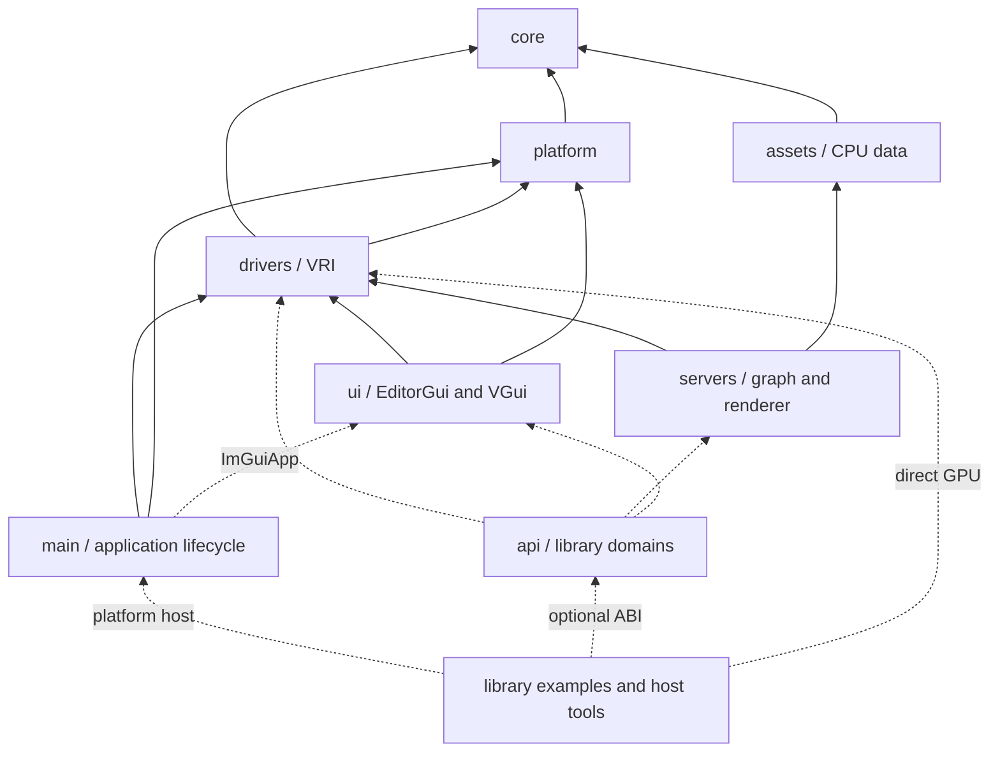
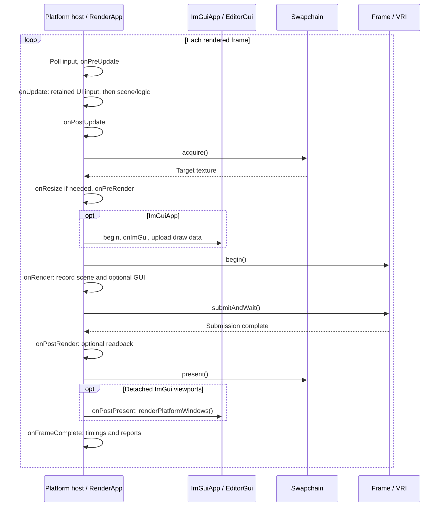
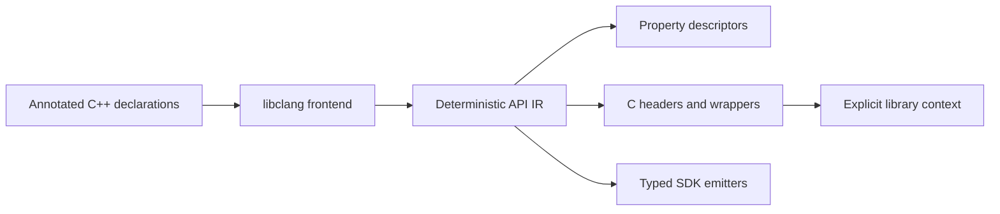

# Architecture

libvultra is a composable C++23 graphics library. Applications select capabilities around one public `vultra`
static library: values/logging, platform hosts, VRI resource ownership, RenderGraph, shaders, asset data, basic
rendering and optional UI. Direct GPU programs need no scene tree, ECS, scripting host or editor.

VRI is the rendering abstraction; RenderGraph is the only graph executor. Context-owned services and explicit
RAII ownership keep construction, GPU completion and destruction visible. Feature selection controls sources,
packages and targets together, following Bevy's additive approach.

VRI exposes an NRI-style C API with immutable device-owned conventions and explicit conversion helpers.
`Device(VriDeviceCreationDesc)` preserves caller configuration. Convenience constructors select the existing
Y-up shader/camera convention; a different convention also needs matching application matrices and shaders.
Submission and explicit waits check returned status; destructor cleanup reports errors without throwing.

The optional `compute` feature provides a synchronous buffer/kernel context and generated C table. It supports
float32/int32/uint32 buffers and owned transfers; bindings, group dimensions and scalar push-constant offsets come
from Slang target reflection. This feature includes host shader compilation. The separate cooked shader runtime
does not require that compiler. No Python runtime is required by either native path.

## Feature selection

`libvultra_features` is a comma-separated dependency union controlling sources, packages and targets.
Embedded projects default to `gpu`; the repository defaults to `all` for development.
Example requirements extend the union, and each example compiles only its selected modes.

| Capability | Selected features |
| --- | --- |
| Basic values/diagnostics | `foundation`, with optional `random`, `math`, `json`, `properties`, `image` and image I/O/metrics. |
| GPU and desktop | `gpu`; add `window`/`input`, `swapchain`/`desktop`, `capture` or `xr` as needed. |
| Graph and shaders | `graph`/`graph_json`, cooked `shader_runtime`/`game_shader_runtime`, GPU `shader_material`, host `shader`/`game_shader` and `blit`. |
| Compute interop | `compute` adds a synchronous buffer/kernel context and generated C ABI over `shader`/`gpu`; no Python or UI dependency. |
| Assets and rendering | Byte `asset_source`/`resource_pack`, CPU asset values/import, `rendering` and camera controls. |
| UI | Independent `editor_gui`/`vgui`, generic properties and generated UI ABI. |

`shader_runtime` reads compiled programs and their VRI-normalized bindings. `game_shader_runtime` adds cooked
material schemas, variants and typed instances; `shader_material` prepares their GPU parameters/pipelines without
Slang, ANTLR, file watching, importers, a scene or a window. Host `game_shader` adds `.vshader` parsing/cooking.
`rendering` consumes prepared geometry/textures and cooked shaders; it selects no compiler, importer or watcher.
Select `scene_prepare` for CPU texture/meshlet preparation, `asset_import` for model files and `shader` for source
compilation. `vgui` also uses the cooked shader runtime. Both remain part of the selected `vultra` static library.
`ImportedAsset` is an owned CPU data snapshot in `asset_values`; storing it requires no importer or GPU.
`render_values` exposes light value types independently of rendering resources.
Cooked layouts store VRI descriptor/view types, not Slang enum values.

`ShaderRuntime` belongs to `shader_material`: it owns one asset snapshot and independent instances, validates
replacement GPU candidates before publishing, and retains the previous snapshot after failure. It can load relative
VPK entries or explicitly reload cooked files without worker threads or host dependencies. Adding `game_shader`
enables source compilation/polling; private `ShaderSourceReload` owns and joins those watchers/jobs before runtime
GPU ownership ends. Source watching never retains a GPU preparation callback.

`interactive` groups desktop drawing requirements; `tools` selects host import/shader tools.

[scripts/build_features.lua](../scripts/build_features.lua) owns the dependency closure;
[examples/selection.lua](../examples/selection.lua) owns example requirements.
VGui compiles into the same selected `vultra` archive; RmlUi remains a private dependency.
No consumer builds another hidden core with different public layouts. Commands live in [BUILD.md](../BUILD.md).

## Source ownership

Each `source/<module>` owns `include/vultra/<module>` and `src`. Public includes remain `<vultra/...>`.
Directory ownership and build selection are separate.

Library dependencies are shown below; arrows point toward the dependency. Dashed edges are optional.
Application state and document policy remain outside these modules.



| Directory | Responsibility |
| --- | --- |
| `core` | Diagnostics, identifiers, math/images, typed properties and basic values. |
| `platform` | Desktop windows, GameActivity/Web input, files/processes and OS integration. |
| `drivers` | VRI Device/resources/Swapchain, GPU profiling and XR GPU integration. |
| `assets` | CPU model/material values, byte sources, import/cache and generic VPK reading/writing/embedding. |
| `servers` | RenderGraph, GPU scene ownership/RIDs, raster rendering and texture blits. |
| `ui` | EditorGui/ImGui and VGui/RmlUi integration; no editor application dependency. |
| `main` | BaseApp/RenderApp, DesktopApp/AndroidApp/WebApp, desktop ImGuiApp and package bootstrap. |
| `api` | Generated library ABI domains and their context/borrow checks. |
| `tools`, `examples` | Library cooking tools and direct C++ drawing/UI examples. Lower modules do not depend on them. |

## Ownership and frame lifecycle

DesktopApp owns RuntimeContext directly. RuntimeContext hides desktop construction behind `unique_ptr<Impl>` and owns
Window → Device → Swapchain → Frame → Profiler. Applications own optional renderers, servers and pass catalogs.
RenderApp keeps update, UI construction, command recording, submission, completed-frame callbacks and
presentation distinct. ImGui construction stays in pre-render; retained game UI processes input and hit-test
layout before scene logic. Offline programs own their GPU services directly.

PlatformApp is a compile-time alias for DesktopApp, AndroidApp or WebApp. Grouped examples share one platform entry
and build setup while keeping separate executables and mode dependencies. AppConfig describes rendering requirements;
AppLaunch supplies borrowed GameActivity entry state or a browser canvas selector. AndroidApp owns the Vulkan
surface/swapchain and processes the GameActivity native glue on its native thread. It waits for GPU completion
before acknowledging surface destruction, blocks while paused and resets the update clock on resume. WebApp yields
to requestAnimationFrame with ASYNCIFY; CSS size/DPR determine its drawing extent. AppConfig.size/title configure
desktop windows; Android's Activity and the Web page own their presentation size/title.
The Web shell's optional `Module.onGraphicsReady` callback runs after the first completed/presented frame.
Emscripten's `onRuntimeInitialized` only means WASM startup; the page keeps its startup status until GPU work succeeds.

The normal desktop/Android acquisition path is:



Minimized/unavailable main targets skip recording; detached ImGui windows can still update through
`onRenderSkipped()`. Offline paths record/submit/wait without a swapchain or native UI.

Browser WebGPU canvas images expire on an event-loop yield. WebApp renders/readbacks an owned image first, then
acquires the canvas and copies/submits before yielding for GPU completion. Canvas texture views are recreated per
acquisition. WebGL2's VRI backbuffers already own their storage and use the normal frame path. The pinned VRI patches
preserve sRGB presentation and implement browser queue-completion waits; animation-frame pacing is not a GPU fence.
WebGL context loss currently fails explicitly and requires restart. Android/Web input covers keys, pointer/scroll
and primary touch; IME, additional touch contacts and gamepads are not yet integrated. ImGuiApp remains desktop-only
until its platform input and GUI lifecycle are ported.

One frame is in flight. Graphs/scene handles expire before their pass/server owners, and those expire before Device.
CPU destruction is not GPU completion: release resources, views and cached UI textures only after their final use.
Module unload also stops callbacks and removes borrowed descriptors/passes before releasing code.

| Identity | Meaning |
| --- | --- |
| Graph resource | Local to one graph; never persisted or retained by scripts. |
| Server RID | Live GPU resource in one server/context; never persisted. |
| ObjectId | Live CPU object in one world; foreign/retired references are rejected. |
| Asset/node ID | Stable authored identity stored in project/scene/package documents. |

## GPU, graph and rendering

Use VRI descriptors/commands directly; do not reinterpret its handles as Vulkan objects or add another RHI.
CPU/shader layouts, resource states, color spaces, projection/depth and UV conventions follow verified VRI and
shader contracts. Native interop remains inside declared platform/XR/plugin boundaries.

`<vultra/core/math/projection.hpp>` provides explicit `flipProjectionY()` and depth conversions between
`[-1, 1]` and `[0, 1]`. Y conversion negates the full clip-Y row, including off-center and jitter terms;
it leaves Z/W unchanged. These value helpers do not change the current device/camera convention implicitly.

RenderGraph supports imports, transients, explicit history and exports. `addPass()` remains the direct C++ path.
PassDefinition adds stable type names, typed ports, numeric parameters, extent/format constraints and capability
requirements. PassCatalog starts empty; a caller explicitly installs builtin/project definitions.
Version-1 JSON `.vgraph` connections compile to that same executor and reject invalid graphs before GPU recording.
The definition validates schema, connections and cycles before constructing its reachable pass instances. Marked
outputs and `PassDefinition::sideEffect` determine reachability; unused branches create no GPU implementation.
Declare side effects in the definition, including for instances without outputs. The catalog retains the command
passes emitted by such an instance. Direct C++ `addPass(..., true)` remains available.

`Use::discardPrevious` explicitly declares a full-resource replacement and permits culling the previous producer.
It is legal only with write-only usages. The default preserves content dependencies, including for partial copies;
attachment LOAD and blending still require read/write usage to declare the GPU access correctly.
Compilation tracks execution hazards separately from content producers: overwritten writes and unused readers
do not stay live solely because another pass follows them. Snapshot `dependencies` reports ordering constraints;
`contentDependencies` reports producers needed for liveness. History roots retain their final writer.
Depth-test-only draws use `eDepthRead` to preserve read-only graph dataflow and pass culling. The pinned VRI
attachment API still stores depth, so execution barriers include that write even with pipeline depth writes disabled.

History is graph-owned and explicitly reset by its caller. Optional transient reuse shares whole VRI resources
only for identical descriptions and disjoint active lifetimes; imports/exports/history are excluded.
The reused plan is immutable. The current executor uses one graphics queue.
Texture resources remain single-mip, single-layer 2D; depth attachments use D32. Complete resource/port constraints,
subresource tracking, typed parameters and pass recompilation are open prerequisite gates in the roadmap.

SceneData → GpuScene → BuiltinRenderer works without SceneTree. RenderingServer offers the same upload/render
implementation through owned, move-only handles and checked RIDs, with GPU-complete retirement.
The raster paths are NaiveDeferred and NaiveForward, with the current opaque OpenPBR subset, IBL and shadows.
Task/mesh shaders, ray queries and ray pipelines require explicit device capabilities, without silent emulation.

## Shaders and assets

Native `.slang` exposes compilation/reflection/cooking without game metadata. Game `.vshader` adds typed material
properties, named variants, Surface templates and explicit passes; ANTLR belongs only to this selected path.
A scoped compiler reuses module IR/program caches; Device owns VRI pipeline caches.
Cooked `.vshaderc` programs support source-free delivery. Failed reload retains the last valid shader/pipeline.
`shader_runtime` loads checked artifacts from files or borrowed entry bytes into owned program data and builds
ordinary VRI pipelines. It has no Slang compiler or FileWatch dependency. `shader` adds source compilation, binding
reflection, cooking and file watching; `blit` requires only the cooked runtime. Source-based applications select
`shader` explicitly. A pipeline built from an in-memory program consumes it synchronously and has no file reload.
ShaderPipeline, Environment, BuiltinRenderer and VGui accept a borrowed shader AssetSource for filesystem or VPK
`.vshaderc` entries. This source outlives the consumer and its reload/rebuild operations. An explicit shader source
never compiles `.slang`; entry names select cooked siblings. A memory-backed VPK needs no extraction or source tree.

`ShaderCompileOptions.profile` selects a SPIR-V profile (default `spirv_1_5`) or `wgsl`. Slang emits code and
reflection for that target into the same version-1 archive; no SPIR-V-to-WGSL translator is involved. A program
owns one target, so its layout cannot accidentally come from a different target. WGSL entry strings remain owned
and NUL-terminated for VRI. Pipeline creation rejects target/backend mismatches before invoking its builder.
Pipeline/report identities use `bytecodeHash`, independent of shader format. The basic WebGPU paths use VRI's
existing push-constant integration; libvultra does not inject native backend bindings or shader coordinate fixes.

Material parameters are shader-defined; OpenPBR is one builtin material schema. MaterialInstance already stores
typed shader-property overrides, and ShaderMaterial owns their reflected GPU bindings. The planned MaterialBlock
contract separates immutable reflected layout, instance-owned CPU values/revisions and renderer-owned GPU storage
and descriptors within the optional material/shader features. Layout and allocation follow Slang reflection and VRI
requirements. An unlit or research material can define its own fields and textures; it need not carry unused PBR
parameters. Direct Slang callers must be able to use the block without `.vshader` metadata, a scene or a builtin
renderer. A block follows one reflected layout; parameter edits update its values/revision and reuse GPU storage
while that layout remains unchanged. Render passes validate the material inputs they consume.
For example, an unlit block may contain only `tint` and `colorTexture`, while an experiment block contains
`density`, `phase` and `volumeTexture`. Neither inherits an OpenPBR parameter superset. A MaterialBlock describes
data and bindings, not a shading algorithm: a custom block needs a compatible pass, rather than being implicitly
accepted by every builtin raster or reference path. CPU values do not own GPU allocations; their renderer prepares
and retires reflected storage at the existing GPU completion boundary.
Generalizing the remaining fixed OpenPBR scene/ABI interfaces is still roadmap work;
the generic block implementation is not complete.

CPU SceneData/material/texture values own no GPU resources. Import preserves source files and caches derived data
under `.vultra/assets/`, validating actual source/dependency hashes. Static glTF/GLB, OBJ and FBX geometry and
material textures are supported; skinning, morphs, animation and blended transparency remain outside this importer.
AssetSource supplies filesystem or checked VPK entry bytes. Persistent asset references never contain GPU RIDs or graph-local handles.

## Properties and C ABI

PropertyValue owns typed values; PropertySchema describes defaults, validation, visibility and optional reference
constraints. ObjectTypeInfo supplies typed accessors and inheritance; ObjectTypeCatalog holds explicit
registrations. Applications choose their object categories. These mechanisms require no scene tree, ECS, language
host or editor. Serialization, Inspector visibility, binding and reload flags are independent.
The generator honors each compilation command's working directory and discovers binding domains from attributes,
independently of manifest source labels. C, managed and Python declarations share argument transport rules for
values, UTF-8, spans and borrowed references. The IR records transport direction and borrow duration.
Persistent ID wrappers declare their category with `VULTRA_REFERENCE("category")` and one public `StableId value`;
the generator does not infer application identity semantics from names such as `NodeId` or `AssetId`.

Property access uses semantic getters/setters so validation and change notification remain intact. Descriptors
are not permission to overwrite arbitrary object bytes. Owned schemas can outlive an inspection operation;
accessor code and its owner must remain live while a registration is used.

The public C ABI exposes selected library services without exporting C++ classes. UI and a narrow synchronous
compute domain are implemented; graph, texture and broader function-call domains remain incomplete. Direct C++
programs can use the library without this boundary.

| Boundary | Contract |
| --- | --- |
| Layout | Fixed-width IDs/flags, documented byte counts, explicit POD layout/alignment, UTF-8/byte pointer-length pairs and opaque handles. No STL, C++ exceptions, ImGui or Slang compiler types cross the boundary. |
| Ownership | Each context, handle, span and callback declares its owner, borrow duration and release operation. Allocation and destruction stay in the same native module. Foreign, stale and wrong-kind handles fail at the owning boundary. |
| GPU lifetime | Submission completion and host visibility are explicit. Releasing a CPU wrapper does not prove GPU completion; resources and borrowed memory survive their final use. |
| Calls/errors | Declared calling convention, returned status and context-owned diagnostics. Generated wrappers translate exceptions; callbacks specify thread/phase/reentrancy and are revoked before owner teardown. |
| Evolution | File and ABI versions remain 1 before release. Generated service tables carry size and a domain signature/POD-layout fingerprint. Consumers reject stale tables even when their byte size matches; breaking changes update both ends together. |
| Verification | Independent C compilation/linking, layout assertions, ownership/bounds/error tests and Windows/Linux calling/export checks. Bindings additionally verify safe marshalling and completion/readback. |

### Generation

One tool parses annotated C++ through libclang into a deterministic IR and emits property descriptors, C
declarations/wrappers and language-facing layouts. Shader signatures, descriptor bindings and target memory
layouts come from Slang reflection, not C++ reflection. VRI's existing C-first declarations remain authoritative.
Checked-in generated output keeps ordinary native builds independent of Python/libclang.



Public declarations opt in with `VULTRA_REFLECT`, `VULTRA_PROPERTY(...)` and supported domain annotations such as
`VULTRA_BIND_UI`. Unmarked APIs remain ordinary C++. For example:

```cpp
namespace vultra
{
    struct VULTRA_REFLECT PreviewSettings
    {
        VULTRA_PROPERTY("label=Gain;min=0;max=4") float gain = 1;
    };
}
```

`source/api/codegen.json` declares compilation roots, public-header groups and outputs. New annotated types in a
selected group need no per-type output list. Discovery records actual headers/qualified names; unknown
annotations, ambiguous exports and unsupported signatures fail before publication. Outputs are formatted before
any destination is updated. `xmake codegen --check` checks consistency.

### Remaining generator work

Parsing and marshalling still contain domain-specific branches. Normalize the existing model and emitters before
adding more domains; a generated C table alone does not complete a typed SDK. The model must describe:

- Owner-qualified type/member keys, base type, field/property/method role, public names and source diagnostics.
- Scalar/enum/POD representation, array element/count relations, reference type/nullability and parameter direction.
- Owning context, allowed call phase/thread, borrow extent, result allocation/release and callback revocation.
- Property defaults/flags and semantic accessors, plus C table layout/calling convention and signature identity.

Domain policy defines lifetimes once; common conversion rules lower supported signatures. A normal supported
addition should require its declaration/annotation without another per-function wrapper or emitter branch.
Keep bootstrap/context ownership and genuinely custom conversions handwritten. Missing ownership information or
unsupported types must produce a source diagnostic rather than guessed marshalling.

Use explicit PODs for math values; never assume GLM and a language runtime share binary layout. Typed scalar/vector
calls use typed parameters rather than a JSON round trip. Dynamic property values remain useful for generic tools.
Registrations belong to explicit contexts; generated static initializers do not create a process-global service.
Verify one property/method addition across all applicable outputs, stale-table rejection and deterministic output.

## UI and applications

The selected tool/editor direction is an optional **retained native C++ GUI**, independently implemented from
Flax's responsibility split. It is not implemented yet. EditorGui/ImGui remains optional debug/direct-draw UI;
VGui/RmlUi remains document-based game UI. Neither becomes the implementation of the native control tree.

| Planned native GUI boundary | Contract |
| --- | --- |
| Context/root | Own theme, control tree, focus, pointer capture and extension registrations; accept a window or offscreen target without requiring an engine world. Two contexts share no mutable GUI registration state. |
| Controls/layout | Parent owns children through `unique_ptr`; measure/arrange and invalidation reuse stable controls. Owner-bound callbacks and deferred deletion make dispatch safe when a handler removes itself or a parent. |
| Drawing/text | Shapes, textures/nine-slice, clipping, transforms and FreeType text produce VRI draw batches. Text layout and cursor/selection mapping share UTF-8 boundaries; clipboard/IME use platform input. Complex text shaping remains a separately stated limitation. |
| PropertyPresenter | Bind common descriptors or explicit getter/setter functions to left-label/right-control rows. Report begin/change/commit/cancel; invoke semantic setters while dragging. Documents own transactions/history, not controls or drawers. |
| Tool components | Tree/list, split/tab/dock and graph controls own interaction/layout. Application documents own selection, data and commands. Introduce each composite only for an actual consumer. |

First verify buttons, checkbox, slider, dropdown, text/scroll/texture controls and an Inspector independently.
Then migrate a real tool slice with live values, output preview and one undo entry per gesture. Preserve existing
tool behavior until its replacement passes interaction and image tests. Persistent native-control handles must
be validated separately from existing callback-borrowed EditorGui frame handles; generate that ABI only after
the native ownership/input contract runs. Native GUI requires neither ImGui/RmlUi nor .NET.

EditorGui wraps upstream Dear ImGui with frame/window/layout and left-label/right-control Inspector rows.
The GUI context owns property drawers; callback data/code must survive registration and active frames.
Each EditorGui initializes and selects its own ImGui context. Frame borrows expire at upload or the next frame;
widget calls reject a different current context. Complete window/Inspector scopes before switching contexts.
Drawers may unregister themselves during a call; callback data remains the application's responsibility.
VGui wraps RmlUi for authored game documents and embedded PNG control skins.
Only one VGui may be live at a time because the current adapter owns RmlUi's process-wide interfaces.
Call `processInput(input, framebuffer, earlierCapture)` once after polling, before application logic consumes
that same event journal and earlier capture. It preserves event-time modifiers/positions and marks
individual consumed events. `update(framebuffer)` prepares retained drawing in pre-render without replaying input.
Its conservative `inputCapture()` hints include any UI-owned events in the frame, plus current focus/hover; these
are for raw-state polling such as cameras, not for filtering the whole journal. Earlier game events must survive
later UI focus in that batch. Higher-priority input, focus loss and an unrenderable extent cancel pointer activity
without control activation; clicking the scene releases control focus. Callback captures outlive registration;
replace documents after GPU completion. A callback may replace its document; its callable stays alive until return,
and listeners detach before their owner is destroyed. Destroy VGui outside its callbacks. RmlUi 6.2's
[input propagation and pointer state](https://github.com/mikke89/RmlUi/blob/6.2/Source/Core/Context.cpp) and
[parent-directed Blur](https://github.com/mikke89/RmlUi/blob/6.2/Source/Core/Element.cpp) determine the adapter's
cancellation/focus handling.
The current backend lacks advanced transforms, clip masks, layers and effects. Layouts are isolated by AppName.

## Resources and platform delivery

Embedded VPK bytes also have an explicit borrowed-memory constructor. Their owner must outlive every archive copy
and AssetSource; reads return owned bytes. The supplied path is a virtual asset namespace, not a required file.
AndroidAsset maps an uncompressed APK asset read-only, including a non-page-aligned asset offset; it owns the mapping,
not the Activity/asset manager. A Web pack can live in static WASM data. Both use the existing VPK parser, entry
checksums and AssetSource resolution without extracting the project. The desktop EXE trailer remains a distinct
delivery container, not an Android APK or WASM format.

Desktop/Web work has priority; Android/Meta Quest and iOS/iPadOS are lower-priority targets with early compile/link
gates. Their later runtime gates require explicit platform frame hosts around BaseApp's phases, host-side shader
cooking and target capability validation. WebGPU and WebGL2 have
different capabilities; unsupported passes fail instead of silently selecting another algorithm. Device can receive
a VRI graphics API explicitly; a backend without a pipeline-cache interface keeps its cache pointer null.
Each selected shader and application path still needs platform-specific acceptance.

Feature selection reads VRI directly: `GetDeviceDesc()` reports granted optional features and compute/queue/limit
capabilities; `GetFormatSupport()` checks actual attachment, sampled, storage and vertex formats. Device's `features`
mask is the granted set, not the requested set. Its final `bestEffort` constructor argument defaults to false. Apps
that opt in may request a subset and explicitly select a tested simpler implementation before recording commands.
The platform probe uses this for Compute versus fragment raster, and a texture/depth scene versus a simple triangle.
The chosen path and missing requirements are observable; driver/shader errors still fail. Reference experiments may
retain strict requirements rather than changing their algorithm. No second capability registry or RHI is introduced.
For graph-based renderers, this selection belongs before graph construction: the selected graph must still meet
its declared requirements. Fallback does not weaken RenderGraph validation or reinterpret a reference pass.

Remaining implementation and acceptance gates are in [roadmap.md](roadmap.md).

## Design references

- [Bevy](https://bevy.org/learn/quick-start/getting-started/): additive capabilities and explicit dependency selection.
- [Flax binding tools](https://github.com/FlaxEngine/FlaxEngine/tree/57fe03308a05868f07cda77bae8acf553dcb9bf8/Source/Tools/Flax.Build/Bindings): annotated declarations, a resolved API model and native/managed emitters. Keep libclang as the frontend and implement independently; [Flax source is EULA-governed](https://github.com/FlaxEngine/FlaxEngine/blob/57fe03308a05868f07cda77bae8acf553dcb9bf8/LICENSE.md).
- [Flax property presentation](https://github.com/FlaxEngine/FlaxEngine/blob/57fe03308a05868f07cda77bae8acf553dcb9bf8/Source/Editor/CustomEditors/SyncPointEditor.cs): separate controls/value editing and gesture tokens. Generic controls report interaction phases; application history owns undo.
- [OpenEngine API model](https://github.com/Game-Crafters-Guild/OpenEngine/blob/583571412ba1959a6d74369ad70e7cc2d242b8f5/Tools/ComponentScanner/ApiModel.h) and [native emitter](https://github.com/Game-Crafters-Guild/OpenEngine/blob/583571412ba1959a6d74369ad70e7cc2d242b8f5/Tools/ComponentScanner/NativeBindingEmitter.cpp): typed signatures, context/thread policy and source diagnostics; retain one generator and independently test the ABI handshake.
- [Godot C extension interface](https://github.com/godotengine/godot/blob/876b290332ec6f2e6d173d08162a02aa7e6ca46d/core/extension/gdextension_interface.h): explicit native boundaries. Do not introduce a global object registry or force generic Variant dispatch on direct C++ calls.

References guide individual mechanisms. Adapted implementations need pinned provenance, license notices and tests;
source inspection does not establish runtime parity with a reference project.
